# User Manual — GRBL Studio

> **Version:** 0.23.0  
> **Updated:** October 26, 2026  
> **Language:** English  
> **License:** MIT

This is the complete manual for **GRBL Studio**, the native Linux alternative to
LaserGRBL. It goes from the first contact to the advanced drawing, symbol and
series production features.

The images were generated with the real app connected to a **GRBL emulator** (over
TCP). So the port, position and some values are examples — your machine will show
the real values.

**Conventions used in this manual:**

| Symbol | Meaning |
| :--- | :--- |
| ⚠️ | Warning: risk of burns, fire or damage to the machine. |
| 💡 | Practical tip or shortcut to save time. |
| ✅ | Checklist/check before proceeding. |
| 🔧 | Advanced feature; requires a little more experience. |
| **Bold** | Name of a button, field or menu exactly as it appears on screen. |

---

## Contents

- [Before you start: safety](#before-you-start-safety)
- [Part I — Basics](#part-i--basics)
  - [1. What is GRBL Studio](#1-what-is-grbl-studio)
  - [2. Installing on Linux](#2-installing-on-linux)
  - [3. First run](#3-first-run)
  - [4. The main screen](#4-the-main-screen)
  - [5. Connecting the machine](#5-connecting-the-machine)
  - [6. Opening an existing G-code](#6-opening-an-existing-g-code)
  - [7. Importing an image](#7-importing-an-image)
  - [8. Previewing and positioning](#8-previewing-and-positioning)
  - [9. Engraving and controlling the job](#9-engraving-and-controlling-the-job)
  - [10. Real-time overrides](#10-real-time-overrides)
  - [11. Console, DRO and status](#11-console-dro-and-status)
  - [12. Macros](#12-macros)
- [Part II — Intermediate](#part-ii--intermediate)
  - [13. Machine profile and settings](#13-machine-profile-and-settings)
  - [14. G-code editor](#14-g-code-editor)
  - [15. Preflight](#15-preflight)
  - [16. Job queue](#16-job-queue)
  - [17. Job library](#17-job-library)
  - [18. Material presets](#18-material-presets)
  - [19. Material catalog](#19-material-catalog)
  - [20. Material test](#20-material-test)
  - [21. Focus test](#21-focus-test)
  - [22. Batch with variable data](#22-batch-with-variable-data)
  - [23. Production mode](#23-production-mode)
  - [24. Resume and recovery](#24-resume-and-recovery)
  - [25. Importing SVG, DXF and PDF](#25-importing-svg-dxf-and-pdf)
- [Part III — Advanced](#part-iii--advanced)
  - [26. Vector editor (Design)](#26-vector-editor-design)
  - [27. Layers and multi-operation](#27-layers-and-multi-operation)
  - [28. Shape library](#28-shape-library)
  - [29. Jig (mold)](#29-jig-mold)
  - [30. Parametric generators](#30-parametric-generators)
  - [31. Engrave both sides](#31-engrave-both-sides)
  - [32. Registration marks](#32-registration-marks)
  - [33. Split into tiles](#33-split-into-tiles)
  - [34. Array of copies](#34-array-of-copies)
  - [35. Nest on sheet](#35-nest-on-sheet)
  - [36. Offset contour](#36-offset-contour)
  - [37. Artwork size](#37-artwork-size)
  - [38. QR Code, Data Matrix, PDF417 and Aztec](#38-qr-code-data-matrix-pdf417-and-aztec)
  - [39. 1D barcode](#39-1d-barcode)
  - [40. Appearance and language](#40-appearance-and-language)
  - [41. About](#41-about)
- [Part IV — Reference](#part-iv--reference)
  - [42. Real-time commands](#42-real-time-commands)
  - [43. GRBL alarms](#43-grbl-alarms)
  - [44. Troubleshooting](#44-troubleshooting)
  - [45. Keyboard shortcuts](#45-keyboard-shortcuts)
  - [46. Files and folders](#46-files-and-folders)
  - [47. Checklist before engraving](#47-checklist-before-engraving)
  - [48. Glossary](#48-glossary)
  - [49. Links and license](#49-links-and-license)

---

## Before you start: safety

⚠️ **Engraving/cutting lasers are dangerous radiation.** Even 3 W to 10 W lasers
can burn the retina and the skin in fractions of a second. Read this section
before turning the machine on.

**Personal and environmental protection:**

- Wear **protective glasses specific to your laser's wavelength** (usually
  445–450 nm). Regular sunglasses do **not** protect you.
- Never look directly into the beam, or at its reflection on metal, glass or
  polished surfaces.
- Enclose the machine in a **box/enclosure** with a filtering window whenever
  possible. Mark off the work area and keep people and animals away.
- Keep a **fire extinguisher** (CO₂ or dry chemical) nearby. Lasers are a real
  ignition source: paper, MDF, acrylic and fabrics burn.
- **Never leave the machine engraving unattended.** Stay nearby, with the
  **machine's** emergency button within reach.
- Use **exhaust/ventilation** for smoke and particulates. MDF, leather and some
  plastics release toxic smoke.
- Secure the material and the USB cable. Vibration can shift the workpiece or
  loosen the connection mid-job.

**Forbidden materials (do not engrave/cut):**

| Material | Why |
| :--- | :--- |
| **PVC, vinyl, EVA with PVC** | Releases **chlorine and hydrochloric acid (HCl)** — corrodes the machine and harms the lungs. |
| **Polycarbonate (PC)** | Melts, releases irritant smoke and may catch fire. |
| **ABS** | Releases hydrogen cyanide (HCN) and other toxic gases. |
| **Any material with unknown adhesive** | May release gases or catch fire. |

**Before every engraving:**

1. Check the **focus** and the laser height (use the focus test if needed).
2. Confirm the **origin** and the **outline** of the area on the material.
3. Check that **preflight** did not report any blockers.
4. Keep the **fire extinguisher** and the **machine's emergency button**
   accessible.
5. Test on a **scrap** whenever you change material, power or speed.

> The software helps, but it **does not replace** common sense and supervision.
> The preview shows the planned path; it does not detect the wrong material, bad
> focus or fire.

---

# Part I — Basics

## 1. What is GRBL Studio

**GRBL Studio** is a **native Linux application** (Electron + TypeScript) for
controlling laser engravers and cutters with **GRBL 1.1** firmware. It is an
alternative to LaserGRBL, focused on:

- **Reliable communication**: send window with character counting, without
  overflowing GRBL's 128-byte buffer.
- **Safety**: preflight, emergency stop, alarms and machine limits.
- **Complete workflow**: connect, open G-code or an image, draw, preview,
  position, engrave and repeat.
- **Production features**: queue, job library, material presets, material/focus
  tests, batch with CSV and production mode.

**Requirements:**

- Linux (X11 or Wayland), 64-bit.
- USB serial port (CH340/CH341/CP2102, common) **or** WiFi/TCP (ESP8266/ESP32
  with serial-over-TCP firmware).
- Permission to access the serial port (see section 2.4).
- The app works **offline** after installation.

**What it does not do:**

- It does not replace the GRBL firmware; it sends commands to the controller.
- It is not a full CAD. The vector editor is focused on 2D artwork for laser.
- It does not guarantee that the material or the power are safe. That is up to
  you.

---

## 2. Installing on Linux

### 2.1 AppImage (recommended)

The AppImage needs no installation and runs on most distributions.

```bash
# 1. Download the latest release at:
#    https://github.com/viniciuswerneck/GRBL-Studio/releases
# 2. Make it executable
chmod +x GRBL-Studio-*.AppImage
# 3. Run it
./GRBL-Studio-*.AppImage
```

💡 If the AppImage does not open on some distros, install `libfuse2`
(Ubuntu/Debian: `sudo apt install libfuse2`).

### 2.2 `.deb` package

For Ubuntu, Debian, Mint, Pop!\_OS and derivatives:

```bash
sudo apt install ./grbl-studio_*_amd64.deb
```

The **GRBL Studio** shortcut appears in the applications menu.

### 2.3 Flatpak

When published on Flathub:

```bash
flatpak install flathub com.grblstudio.app
flatpak run com.grblstudio.app
```

### 2.4 Serial port permission (required on Linux)

Without permission, the port list is empty or the app shows “Permission denied”.

**Option A — `dialout` group (Ubuntu/Debian/Mint/Pop!\_OS):**

```bash
sudo usermod -aG dialout "$USER"
# Log out and log back in (or reboot) for it to take effect.
```

**Option B — Fedora/RHEL/CentOS/openSUSE:**

```bash
sudo usermod -aG dialout "$USER"   # or uucp, depending on the distro
# Logout/login.
```

**Option C — persistent udev rule (recommended for a specific machine):**

```bash
# Example for CH340/CH341 adapters (COMGO, Sculpfun, Ortur, AtomStack):
echo 'SUBSYSTEM=="tty", ATTRS{idVendor}=="1a86", ATTRS{idProduct}=="7523", MODE="0666", GROUP="dialout"' \
  | sudo tee /etc/udev/rules.d/99-grbl-studio.rules
sudo udevadm control --reload-rules
sudo udevadm trigger
# Reconnect the USB cable.
```

✅ Quick test: `ls -l /dev/ttyUSB0` must show the `dialout` group and read/write
permission for the group. If the port is `/dev/ttyACM0`, adjust the path.

---

## 3. First run

On first launch, the app shows a short **splash** (version and WerneckLab credit)
and then the main window. The **welcome tour** opens automatically in 5 steps:

1. **Connect** — choose port, baud and profile.
2. **Machine profile** — 30 profiles or “Generic (GRBL)”.
3. **Open file/image** — G-code, PNG, JPG, SVG, DXF, PDF…
4. **Preview and position** — zoom/pan, faint outline, mark center.
5. **Engrave** — Play, floating bar, real-time overrides.

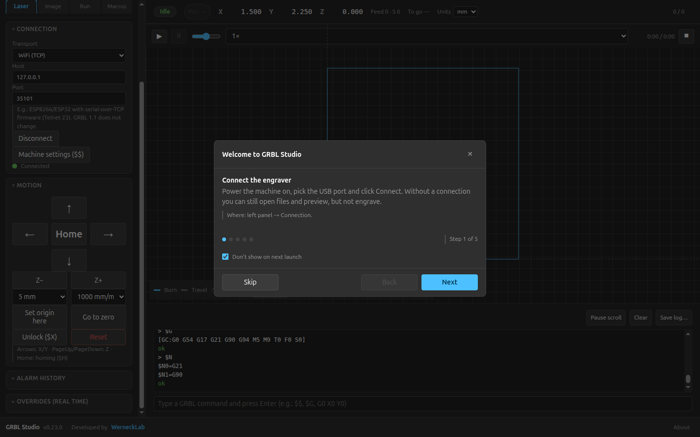

- Check **Don't show on next launch** to dismiss the tour.
- To see it again: menu **Help → Welcome tour**.
- The **Assistant** button at the top opens the quick guide (Basic mode). In
  Advanced mode, all panels are available.

**Language and theme** are detected from the system on first run. To change them:
menu **View → Appearance and language…**.

💡 The manual uses **Advanced mode**, which shows all tabs and cards. If you
prefer the guided mode, click **Assistant** and follow the steps.

---

## 4. The main screen

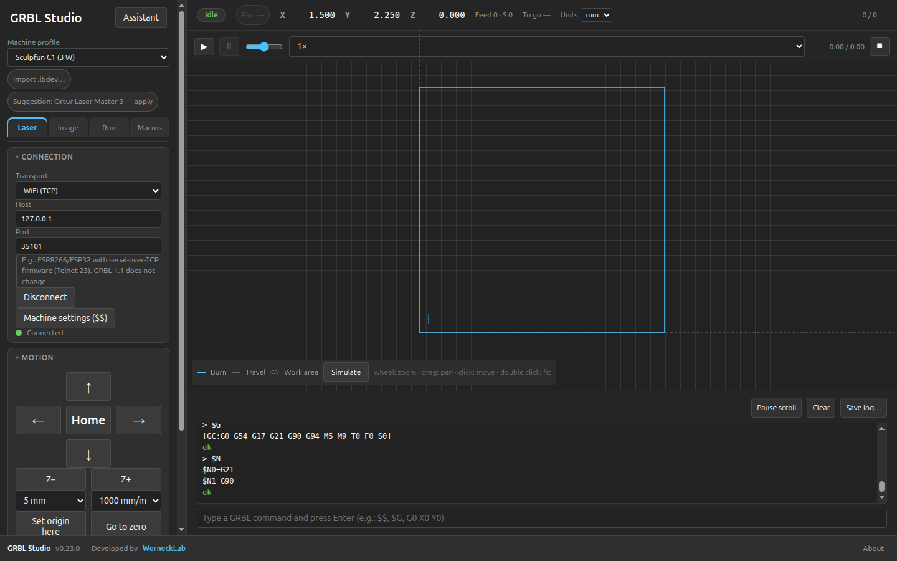

The window is divided into five areas:

| Area | What it contains |
| :--- | :--- |
| **Top bar** | Machine state (Idle/Run/Alarm), pins, X/Y/Z DRO, feed, S power, “To go” (DTG), unit (mm/in) and progress. |
| **Left sidebar** | Machine profile, **Laser / Image / Run / Macros** tabs and the connection, motion, overrides, etc. cards. |
| **Center** | 2D preview of the path, simulation controls and job status bar. |
| **Center footer** | GRBL console, with a field to type commands and scroll/clear/log buttons. |
| **Footer** | Version, WerneckLab credit and **About** link. |

### 4.1 Top bar (status)

- **State badge** — `Idle`, `Run`, `Paused`, `Alarm`, etc.
- **Pins** — shows the state of the limit switches/probe when the firmware
  reports it.
- **X / Y / Z** — work position (WPos) with 0.001 mm.
- **Feed** — actual feed rate; **S** — instantaneous laser power.
- **To go** — remaining distance to the end of the current segment (DTG).
- **Units** — toggles the display between **mm** and **in** (the G-code does not
  change).
- **Progress** — current line / total and ETA during the job.

### 4.2 Preview

The preview draws the G-code path:

- **Burn** (blue) — cutting/engraving moves (`G1`/`G2`/`G3`).
- **Travel** (dashed) — rapid moves (`G0`).
- **Work area** — machine travel box (`$130`/`$131`).
- **Simulate** — job playback with adjustable speed.

**Navigation:**

- **Mouse wheel** — zoom.
- **Drag** — pan (in the preview, left button; in the editor, middle button or
  `Space` + drag).
- **Click** — chooses a point to move the head to (asks for confirmation).
- **Double click** — returns to the default framing.
- **F** — fit to screen; **0** — 100% (in the design editor).

### 4.3 Sidebar

The top shows the **Machine profile** (with `.lbdev` import from LightBurn and a
profile suggestion) and the **Assistant** button. Below are the tabs:

- **Laser** — connection, motion (jog), overrides, alarm history.
- **Image** — image to G-code conversion.
- **Run** — open G-code, start, batch, production, resume, queue.
- **Macros** — ready-made command buttons and custom macros.

Each card is a `<details>`: click the title to open/close it.

### 4.4 Console

The console shows the commands sent (`>`) and the machine responses (`ok`,
`error:`, `ALARM:`, `[MSG:]`). Use the bottom field for manual commands:

```text
$$
$G
$#
G92 X0 Y0
```

> The status (`?`) is queried automatically by the app; do not type `?` in the
> console, because the field sends the line with `Enter` (the real-time `?` is a
> single byte, without `\n`).

- **Pause scroll** — freezes the console to read a message.
- **Clear** — clears the screen (does not delete the log on disk).
- **Save log…** — exports the session to a file.

---

## 5. Connecting the machine

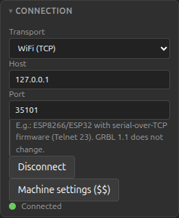

### 5.1 USB (serial) connection

1. Connect the USB cable and turn the machine on.
2. Open the **Laser** tab.
3. Under **Connection → Transport**, choose **Serial (USB)**.
4. Select the **Port**:
   - `/dev/ttyUSB0` — CH340/CH341/CP2102 adapters (most machines).
   - `/dev/ttyACM0` — boards with native USB (Arduino, some Ortur/xTool).
   - `/dev/ttyS0` — real serial ports (rare).
5. **Baud rate**: start with **115200** (GRBL 1.1 default). If it does not
   connect, try **250000**, **57600**, **38400** or **9600** (options in the
   list).
6. Choose the **Machine profile** (see 5.3).
7. Click **Connect**.

✅ **Connection OK** when:

- The dot next to **Connection** turns green and the text shows **Connected** (the
  machine badge shows **Idle**).
- The console shows the firmware banner (`Grbl 1.1…`).
- The **Machine** panel fills in firmware, travel, limits, laser and offsets.
- There is no `error:` in the console.

💡 The refresh ports button reloads the list without restarting the app. If the
port does not appear, check the cable and the `dialout` permission (section 2.4).

### 5.2 WiFi/TCP connection

For ESP8266/ESP32 with **serial-over-TCP** (Telnet) firmware:

1. Under **Transport**, choose **WiFi (TCP)**.
2. Fill in **Host** (e.g. `192.168.4.1`) and **Port** (default `23`; the emulator
   used in the images was on another port).
3. Click **Connect**.

> GRBL 1.1 itself **does not** speak TCP; the WiFi adapter bridges serial↔TCP.
> Network latency and stability affect streaming. Prefer a USB cable for long,
> critical jobs.

### 5.3 Machine profile

The profile is a set of machine data: travel (`$130`/`$131`), maximum speed
(`$110`/`$111`), power ceiling (`$30`), laser mode (`$32`), homing, limits and
pointer power. It is used by preflight and by the preview.

- Choose the model in the **Machine profile** selector.
- **Import .lbdev…** imports a LightBurn device profile.
- If the app recognizes the firmware, a **suggestion** appears (e.g. “Ortur Laser
  Master 3 — apply”). Apply it only if it is your machine.
- Without a specific profile, use **Generic (GRBL)** and adjust `$$` manually.

> ⚠️ Wrong profile = wrong limits. Preflight may block valid jobs or let through
> a job that hits the frame. Check your machine's actual travel.

### 5.4 If it does not connect

| Symptom | Probable cause | Solution |
| :--- | :--- | :--- |
| Empty port list | No serial permission | `dialout` group or udev rule (section 2.4). |
| “Access denied” / “Permission denied” | Permission | `sudo usermod -aG dialout "$USER"` + logout/login. |
| Connects, silent console | Wrong baud rate | Try 115200 → 9600 → 250000. |
| `ALARM:9` on connect | Homing not performed | Click **Home** (`$H`) or disable `$22` if there are no limit switches. |
| Firmware not identified | Older GRBL/fork | Use “Generic (GRBL)” and check `$I` in the console. |
| Connection drops mid-job | Cable/hub/noise | Short cable, ferrite, USB 2.0 directly on the motherboard. |

---

## 6. Opening an existing G-code

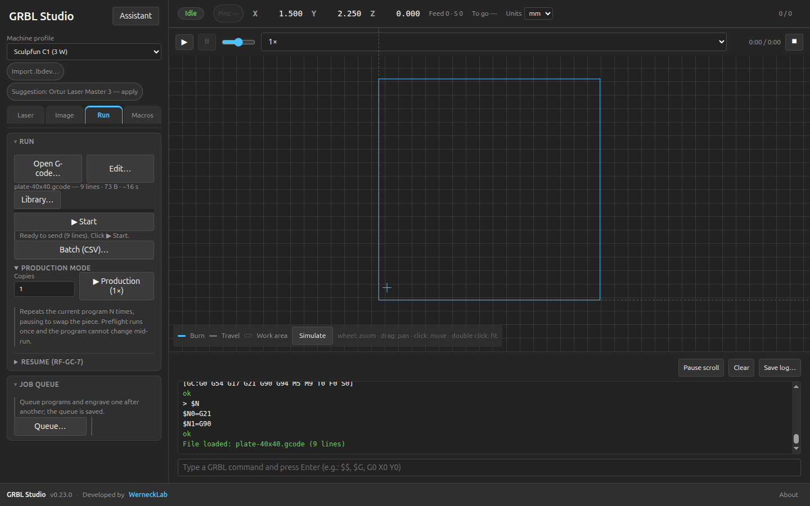

1. Open the **Run** tab.
2. Click **Open G-code…** (or use **File → Open G-code…** in the menu).
3. Select the file (`.gcode`, `.nc`, `.tap`, `.txt`).
4. The app shows **name, lines, size and estimated time**.
5. The preview draws the path; the **Start** bar becomes enabled.
6. Use **Edit…** to open the G-code editor (section 14) or **Library…** to reuse
   previous jobs (section 17).

**What the app checks before engraving (preflight):**

- Dangerous or malformed lines.
- `M3`/`M4` without `S` (laser with no power).
- Coordinates outside the machine travel.
- Speed limits.

> ⚠️ The G-code is sent **exactly as it is**, preserving the file's precision.
> The app does not round values.

💡 The estimated time adds up `distance / feed` and considers `G0` at
3000 mm/min. Use it as a reference, not as a stopwatch.

---

## 7. Importing an image

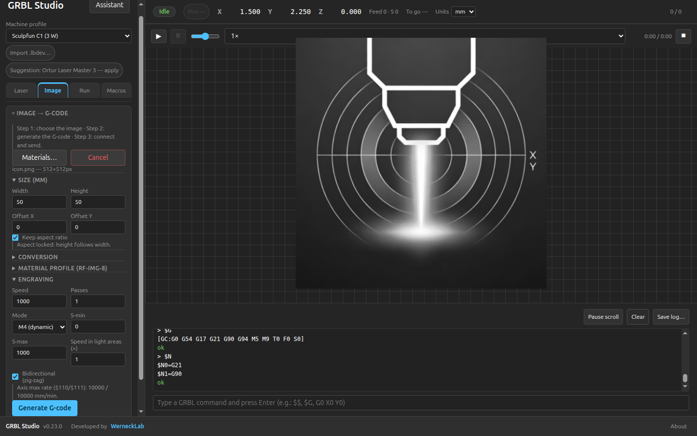

The **Image** tab converts PNG/JPG/BMP/GIF/WebP/AVIF into raster or vector
G-code.

### 7.1 Step by step

1. Open the **Image** tab.
2. Click **Choose image…**.
3. Adjust **Size (mm)**:
   - **Width** and **Height** — final size of the artwork.
   - **Offset X**/**Offset Y** — displacement relative to the origin.
   - **Keep aspect ratio** — locks the width/height ratio.
4. Open **Conversion** and choose the **Algorithm**:
   - **Line-to-line** — grayscale with PWM/M4; ideal for photos.
   - **Dithering** (Floyd–Steinberg) — 1 bit; ideal for logos and text.
   - **Centerline (single line)** — skeleton/single line; ideal for bold letters
     and logos.
   - **Vectorize (outline / cut)** — threshold outline; ideal for
     cutting/line-art.
5. Adjust **Brightness**, **Contrast**, **B&W Threshold** and **Invert
   black/white** according to the material (on dark material, inverting helps).
6. Under **Material profile**, choose a material and an action
   (engraving/cutting). The **Materials…** button opens the catalog (section 19).
7. Under **Engraving**, check:
   - **Speed** (mm/min) and **Passes**.
   - **Mode** `M3` (constant power) or `M4` (dynamic by speed).
   - **S-max** (maximum power) and **Speed in light areas (×)**.
   - **Bidirectional (zig-zag)**.
8. Click **Generate G-code**.
9. Check the preview and click **Start** (or **Save .gcode**).

💡 **Golden tip:** run the **material test** (section 20) on your actual material.
Every batch of MDF/acrylic responds differently.

⚠️ Images with a white background generate many travel moves. Use the **B&W
Threshold** or **Vectorize (outline / cut)** to reduce time and mess.

---

## 8. Previewing and positioning

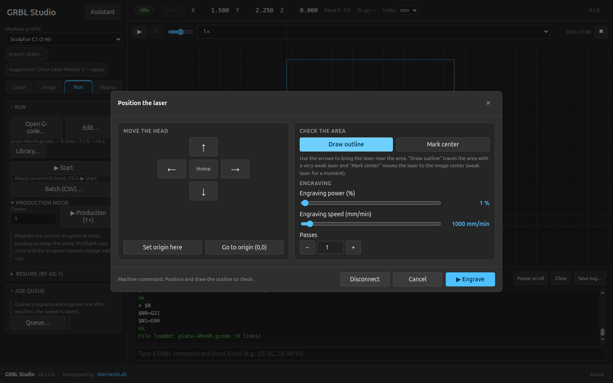

### 8.1 Preview

- **Zoom** with the wheel; **drag** to pan; **double click** to fit.
- The legend shows **Burn**, **Travel**, **Work area** and **Simulate**.
- During the job, a crosshair follows the real position (WPos).

### 8.2 Positioning the laser

The **Position the laser** dialog opens after generating an image/drawing or
through the **Position** button in the assistant. It has two columns:

**Move the head**

- **X−/X+/Y−/Y+** arrows — incremental jog.
- **Home** — homing (`$H`), if the machine has limit switches.
- **Set origin here** — sends `G92 X0 Y0 Z0` at the current position.
- **Go to origin (0,0)** — `G90 G0 X0 Y0`.

**Check the area**

- **Draw outline** — traces the artwork's bounding box with a **very weak**
  laser (minimum power). ⚠️ The laser **is on**; wear glasses.
- **Mark center** — moves the head to the artwork's geometric center and fires a
  **very weak** laser pulse to mark the point (`M3`/`M5`).
- **Engraving power (%)**, **Engraving speed (mm/min)** and **Passes** — adjust
  the job that will be sent.
- **Engrave** — closes the dialog and starts the job.
- **Cancel** — closes the dialog without engraving.

⚠️ **Always** draw the outline before engraving on a new material. It is the
cheapest way to find out that the artwork is outside the workpiece.

💡 For small pieces, set the origin at the bottom-left corner of the artwork and
position the laser at that corner. The editor's G-code already comes out anchored
at `X0 Y0`.

---

## 9. Engraving and controlling the job

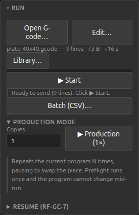

### 9.1 Starting

1. Load the G-code (**Run** tab) or generate it from an image/drawing.
2. Check the preview and the origin.
3. Click **▶ Start**.
4. **Preflight** runs automatically (section 15). If there is a blocker, it
   explains why and prevents the start.
5. If it passes, the job starts; the badge changes to **Run**.

### 9.2 Floating bar (always visible)

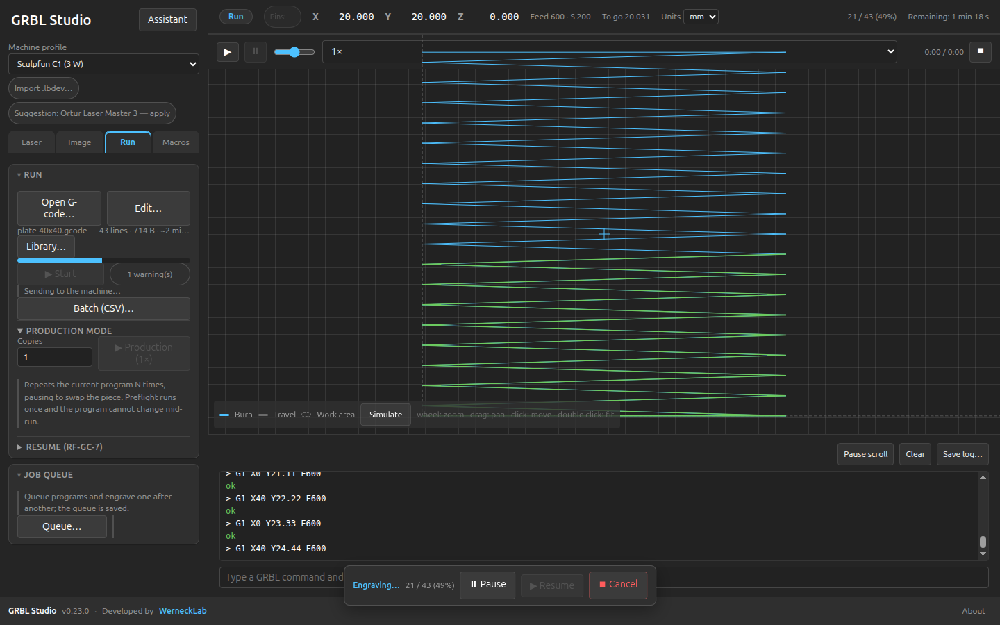

During the job, a floating bar is overlaid on everything:

| Button | Command | Function |
| :--- | :--- | :--- |
| **⏸ Pause** | `!` (Feed Hold) | Stops the motion and holds the position. |
| **▶ Resume** | `~` (Cycle Start) | Continues from where it stopped. |
| **⏹ Cancel** | `Ctrl-X` (0x18) | Aborts the job and resets GRBL; laser turns off. |

⚠️ **`Ctrl+X` is the guaranteed emergency stop**: it works even with focus in the
console or in a field. There is no separate “Emergency” button — **Cancel** on
the bar and the `Ctrl+X` shortcut perform the abort. `Esc` also stops the job
when no dialog is open.

### 9.3 Progress

- **Current line / total** (e.g. `1,247 / 15,832`).
- **ETA** — estimated completion time.
- **DTG** — remaining distance in the plane.
- **DRO** — X/Y/Z position in 0.001 mm.
- **Feed / S** — actual values read from the `?` status.
- **Active overrides** — feed and power in %.

### 9.4 When it finishes

- The console shows **Job finished.** and the badge returns to **Idle**.
- The laser turns off (`M5`).
- The job enters the **Job library** (section 17).
- The head stays where it ended; use **Go to zero** to return to the origin. In
  the queue, the app returns to zero between items.

💡 If something goes wrong, **stop first** and only then investigate. Do not try
to “save” the job by poking at the console with the laser on.

---

## 10. Real-time overrides

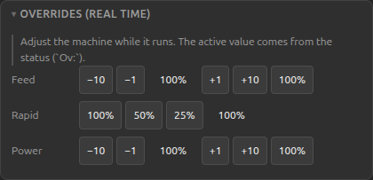

Overrides adjust the machine **while it moves**, without stopping the job. The
active value comes from the status (`Ov:`).

| Control | Effect | Step |
| :--- | :--- | :--- |
| **Feed −10 / −1 / +1 / +10** | Feed rate | Coarse/fine |
| **Feed 100%** | Returns to the programmed feed | Reset |
| **Rapid 100% / 50% / 25%** | `G0` speed | 3 levels |
| **Power −10 / −1 / +1 / +10** | Laser power (spindle) | Coarse/fine |
| **Power 100%** | Returns to the programmed power | Reset |

**When to use them:**

- Sensitive wood starting to scorch → reduce **Feed** by 10–20%.
- Cut did not go through → reduce **Feed** and/or increase **Power** gradually.
- Thin material → reduce **Power** and keep the feed.
- Scary rapid moves → **Rapid 50%**.

💡 The **dose** (J/mm) is `W × power(%) / 100 × 60 / feed`. If you halve the feed,
the dose doubles. Adjust both together to keep the result.

⚠️ Overrides **do not** change the G-code on disk. The next job goes back to the
programmed values.

---

## 11. Console, DRO and status

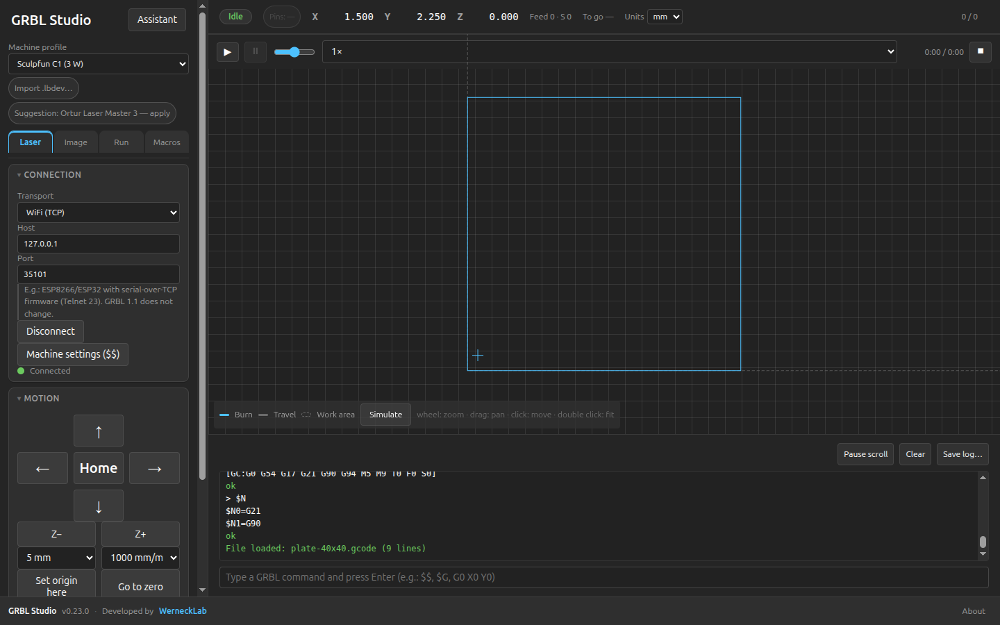

### 11.1 DRO and status

- **X/Y/Z** — work position, 0.001 mm, with `tabular-nums` (it does not “jump”).
- **Feed** and **S** — actual values from the status.
- **To go** — distance to the end of the segment.
- **Units** — mm/in; affects the display only.

### 11.2 Manual motion (jog)

In the **Motion** card:

- **X/Y** and **Z−/Z+** arrows — jog.
- **Step** — 5 mm (or another value in the selector).
- **Feed** — 1000 mm/min (adjust according to the material).
- **Home** — `$H`.
- **Set origin here** — `G92 X0 Y0 Z0`.
- **Go to zero** — `G90 G0 X0 Y0`.
- **Unlock ($X)** — clears the alarm.
- **Reset** — soft reset (0x18).

💡 With the machine connected and no dialog open, the **keyboard arrows** jog X/Y
and **PageUp/PageDown** jog Z. The **Home** key triggers homing (if `$22=1`).

⚠️ Jogging with the laser on is dangerous. The app does **not** turn the laser on
during a jog, but it may have been left on by a previous command/macro; check the
badge and the console and send `M5` if needed.

### 11.3 Console

Useful commands:

| Command | What it does |
| :--- | :--- |
| `$G` | Shows the modal state (units, distance, plane, feed, S). |
| `$$` | Lists all settings. |
| `$#` | Shows offsets (G54…G59, G28/G30, G92, TLO, PRB). |
| `$I` | Firmware version/build/options. |
| `$N` | Startup blocks. |
| `$X` | Unlocks the alarm (use with care). |
| `$H` | Homing. |
| `G92 X0 Y0` | Sets the work origin here. |
| `G90 G0 X0 Y0` | Goes to the work origin. |
| `M5` | Turns the laser off. |

⚠️ Do not send real-time commands (`!`, `~`, `?`) through the text field with
`Enter`: they are a **single byte** and do not carry `\n`. The app queries the
status automatically and the buttons send the correct bytes. The console is for
line commands (`$G`, `$$`, `$#`, `$I`, `G92 …`).

---

## 12. Macros

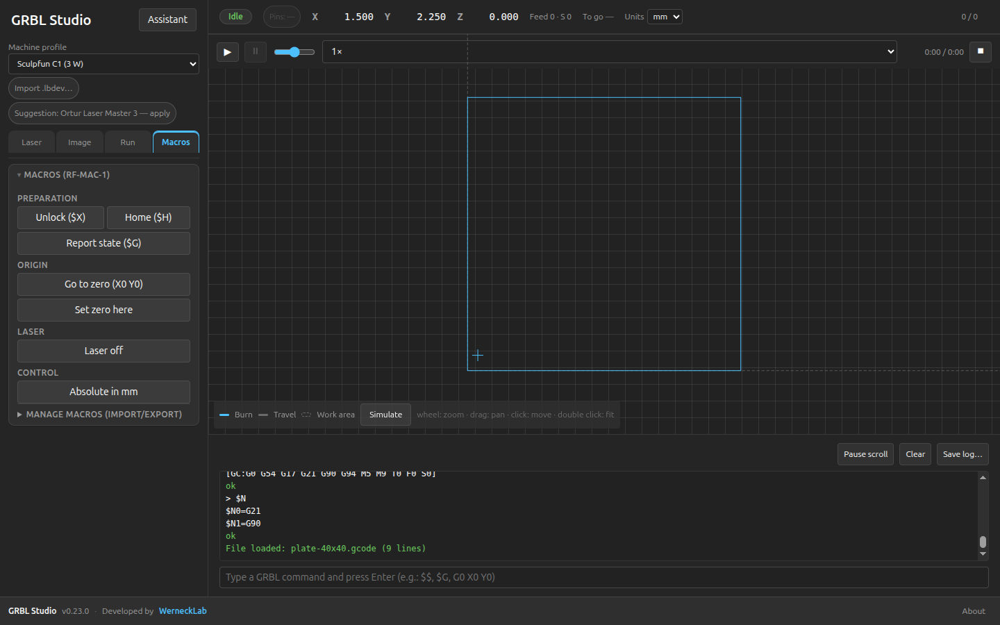

Macros are buttons that send one or more G-code commands. The app ships a safe set
by default:

| Group | Macro | Command |
| :--- | :--- | :--- |
| Preparation | Unlock ($X) | `$X` |
| Preparation | Home ($H) | `$H` |
| Preparation | Report state ($G) | `$G` |
| Origin | Go to zero (X0 Y0) | `G90 G0 X0 Y0` |
| Origin | Set zero here | `G92 X0 Y0 Z0` |
| Laser | Laser off | `M5` |
| Control | Absolute in mm | `G21 G90` |

**Using them:** open the **Macros** tab and click the button. The commands are
queued one by one, respecting the send window.

**Managing them:** open **Manage macros (import/export)** to:

- **Add** a macro (name, G-code, group).
- **Restore defaults**.
- **Import…** / **Export…** a JSON file.

💡 Create macros for repetitive tasks: positioning at a corner, turning air-assist
on/off (if the firmware controls it), going to a workpiece swap point.

⚠️ Macros do not go through preflight. Avoid commands that move outside the
limits or turn the laser on without a defined `S`.

---

# Part II — Intermediate

## 13. Machine profile and settings

### 13.1 Machine panel

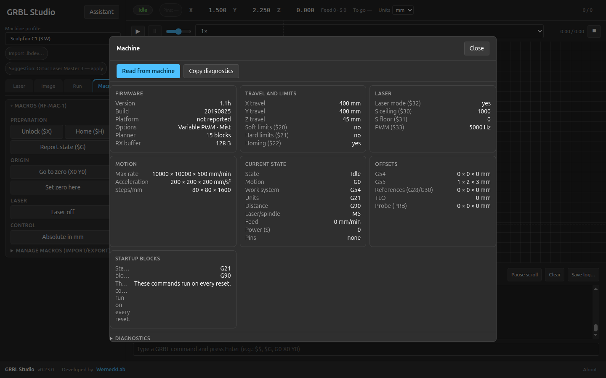

Open it from the **Tools → Machine and diagnostics** menu or the **Machine
settings ($$)** button. The panel shows:

- **Firmware** — version, build, platform, options, planner, RX buffer.
- **Travel and limits** — X/Y/Z travel, soft/hard limits, homing.
- **Laser** — mode (`$32`), S ceiling (`$30`), floor (`$31`), PWM (`$33`).
- **Motion** — max rate, acceleration, steps/mm.
- **Current state** — state, motion, system, units, distance, laser, feed, power,
  pins.
- **Offsets** — G54, G55, references, TLO, probe.
- **Startup blocks** — commands that run on every reset.
- **Diagnostics** — raw/exportable reading.

**Read from machine** refreshes the data; **Copy diagnostics** copies a report to
the clipboard (useful for support).

### 13.2 `$$` settings

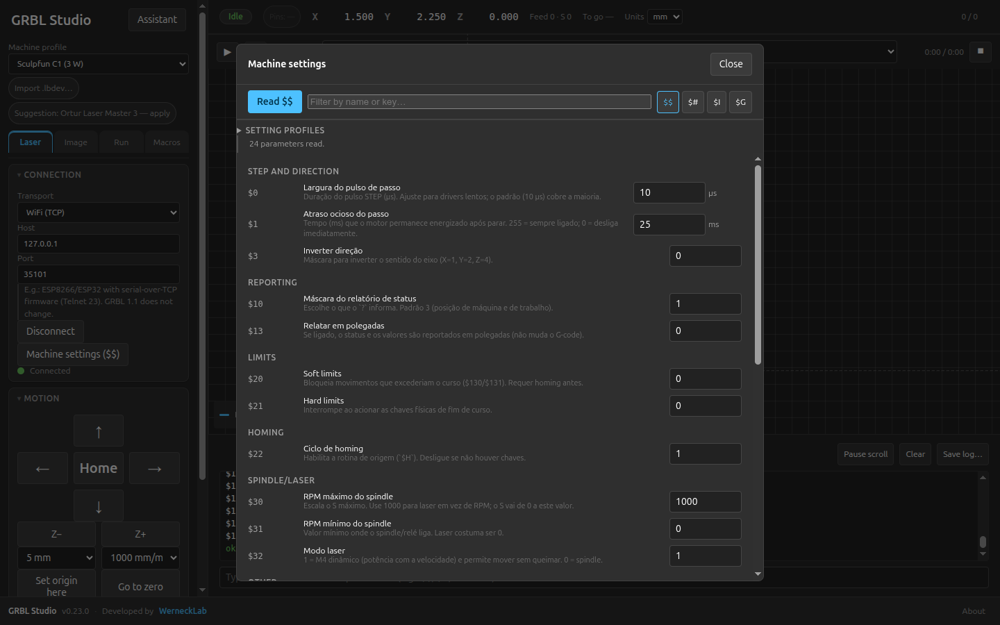

The editor lists the parameters with **name, description and unit**. You can:

- **Read $$** — reloads from the machine.
- **Filter** by name/key.
- Switch between **$$**, **$#**, **$I** and **$G**.
- Edit a value and apply it (the app sends `$n=value`).
- Save/load **setting profiles** (to return to a known state).

**Parameters you will find:**

| Key | Meaning | Typical default |
| :--- | :--- | :--- |
| `$0` | Step pulse width (µs) | 10 |
| `$1` | Step idle delay (ms) | 25 |
| `$3` | Invert direction (mask) | 0 |
| `$10` | Status report mask | 1 |
| `$13` | Report in inches | 0 |
| `$20` | Soft limits | 0 |
| `$21` | Hard limits | 0 |
| `$22` | Homing | 1 |
| `$30` | Maximum RPM/power (S-max) | 1000 |
| `$31` | Minimum RPM/power | 0 |
| `$32` | Laser mode (1 = dynamic M4) | 1 |
| `$100`/`$101`/`$102` | Steps/mm X/Y/Z | 80/80/1600 |
| `$110`/`$111`/`$112` | Max rate X/Y/Z | 10000/10000/500 |
| `$120`/`$121`/`$122` | Acceleration X/Y/Z | 200/200/200 |
| `$130`/`$131`/`$132` | Travel X/Y/Z (mm) | 400/400/45 |

⚠️ **Do not change `$100`–`$102` without knowing what you are doing**: it changes
the motion scale and can make the machine hit the frame. Write down the original
values before any change.

💡 Use **setting profiles** to save the “good” state before testing.

---

## 14. G-code editor

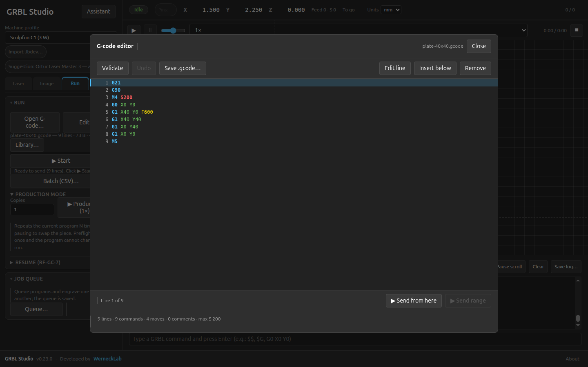

Open it through the **Edit…** button on the Run tab or the **File → Edit
G-code…** menu.

**Features:**

- **Validate** — checks dangerous lines, `M3`/`M4` without `S`, limits and syntax.
- **Undo** — undoes the last edit.
- **Save .gcode…** — saves the edited file.
- **Edit line** — edits the selected line.
- **Insert below** / **Remove** — manipulate lines.
- **Send from here** — starts sending from the current line.
- **Send range** — sends only the selected range.
- Footer: lines, commands, moves, comments and max S.

**When to use it:**

- Fix a missing `F` or a wrong `S`.
- Remove a line that preflight blocked.
- Test a specific range without running the whole file.

⚠️ The editor is for **small adjustments**. For large changes, edit in your CAD
and reimport. The app preserves the precision of the values; do not round
coordinates.

---

## 15. Preflight

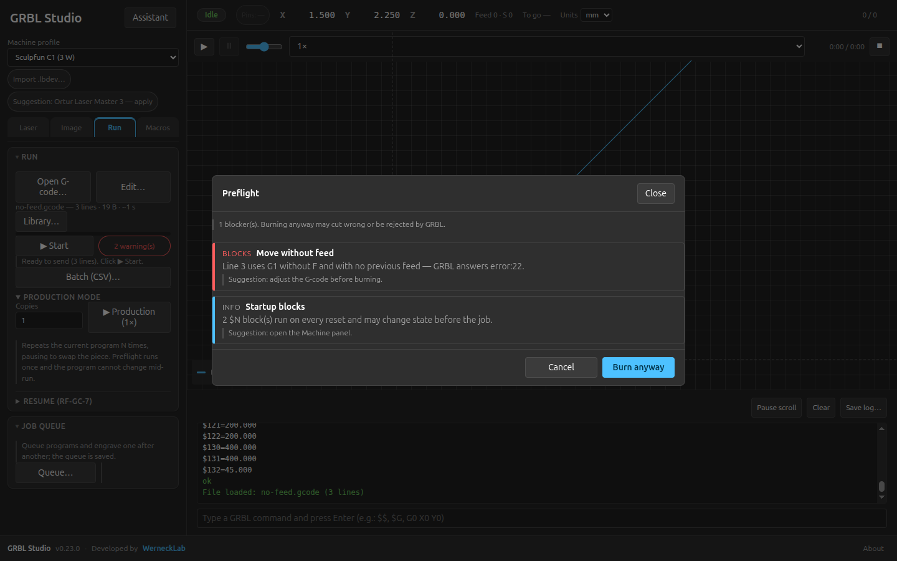

Preflight runs automatically when you click **Start**. It classifies the findings:

| Level | Effect | Real examples |
| :--- | :--- | :--- |
| **BLOCKS** (block) | Does not start | `G1` without `F`; job larger than the travel; laser on with `$32=0`; safety pin active. |
| **WARNING** (warn) | Allows with confirmation | `S` above `$30`; `M3`/`M4` without `S`; soft limits without homing; `$30` different from the profile; `G28`/`G30` without home. |
| **INFO** (info) | Only informs | `$N` startup blocks; `G20` with the report in mm; firmware without a buffer `OPT`. |

**How to act:**

- Read the reason and the suggestion.
- Fix the G-code (editor) or the parameters.
- If it is only a warning you are aware of, use **Burn anyway**.
- If it is a blocker, **Cancel** and fix it.

💡 Preflight is your first line of defense against burning material and
`error:22` (missing feed). Do not ignore it.

---

## 16. Job queue

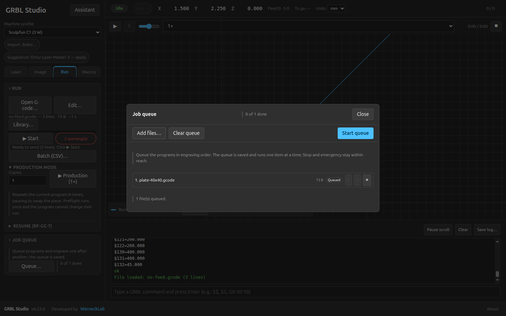

The queue runs several files in sequence, without you having to open them one by
one.

1. Open **Run → Queue…** (or the **Queue** button on the card).
2. **Add files…** — choose one or more G-code files.
3. **Reorder** — use each item's **↑/↓** arrows (they are disabled during
   execution).
4. **Remove** — the item's “×”.
5. **Start queue** — starts with the first one.

**Behavior:**

- The queue is saved in `queue.json` and survives restarts.
- Preflight runs on the first item.
- On an error/alarm/“Stop queue”, the schedule pauses and returns the current item
  to the queue.
- **Pause** and **Cancel** remain on the floating bar.

💡 Use the queue for a sequence of **different** pieces. To repeat the **same**
program, use **Production mode** (section 23).

---

## 17. Job library

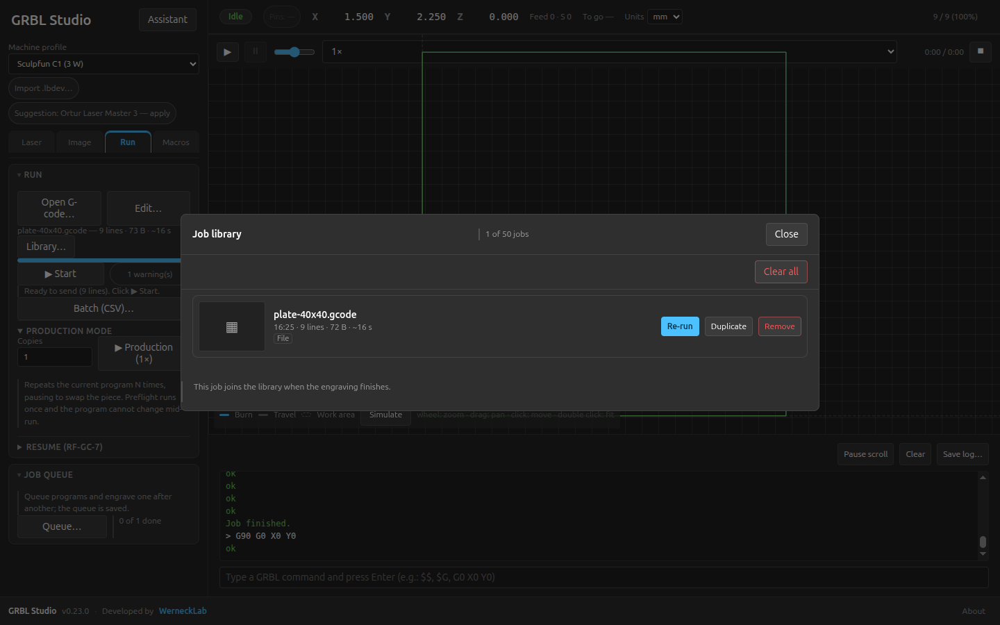

The last **50 programs executed** stay in the library, with a thumbnail.

**Open:** **Run → Library…** or the **File → Job library…** menu.

Each item shows:

- File name, date/time, time, size and number of lines.
- Thumbnail of the path.
- Source: file, image, design or library.

**Actions:**

- **Re-run** — loads the saved G-code and starts it again.
- **Duplicate** — loads a copy to edit/adjust.
- **Remove** — deletes the item.
- **Clear all** — deletes the library (asks for confirmation).

💡 The library stores the **executed G-code**, not the original file. If you
changed the image/drawing afterwards, the old job keeps the G-code from that time.

---

## 18. Material presets

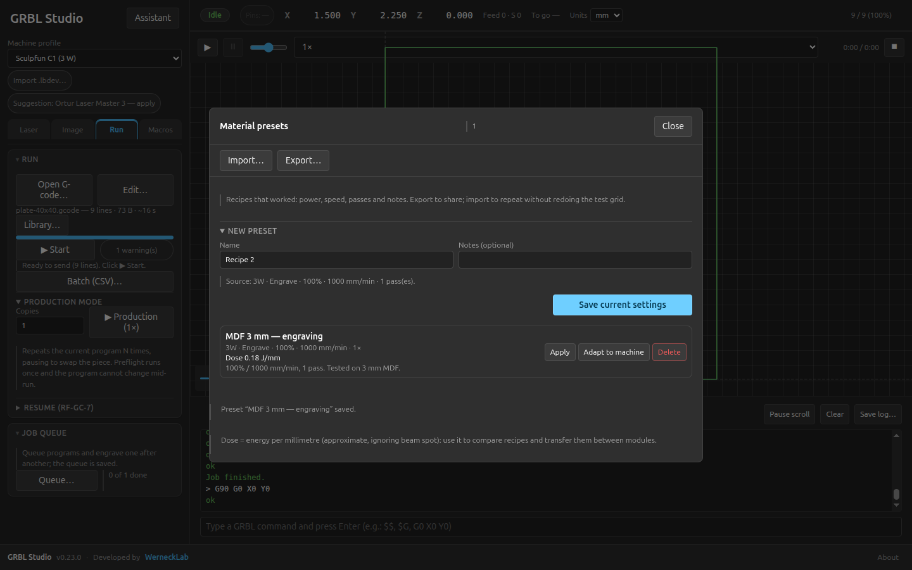

A preset is a **recipe** that worked: power, speed, passes, mode and notes. It
saves you from redoing tests every time.

**Creating:**

1. Adjust power/speed/passes in the module (image, design, etc.).
2. Open **Presets** (**Tools → Material presets…** menu or **Save as preset…**).
3. Give it a **Name** and **Notes** (optional).
4. Click **Save current settings**.

**Using:**

- **Apply** — takes the values to the current module.
- **Adapt to machine** — converts the recipe to the current machine's module
  (3 W/5 W/10 W…), preserving the **dose** (J/mm).
- **Delete** — removes the preset.
- **Import… / Export…** — JSON for sharing.

**Dose:** `watts × power(%) / 100 × 60 / speed(mm/min)`. It is used to compare
recipes and transfer them between lasers of different powers. If the destination
module cannot reach the dose even at 100%, the app warns you and you must reduce
the speed.

💡 Presets are per **module** and **action** (engraving/cutting). An “MDF 3 mm —
engraving” preset should not be applied to “cutting”.

---

## 19. Material catalog

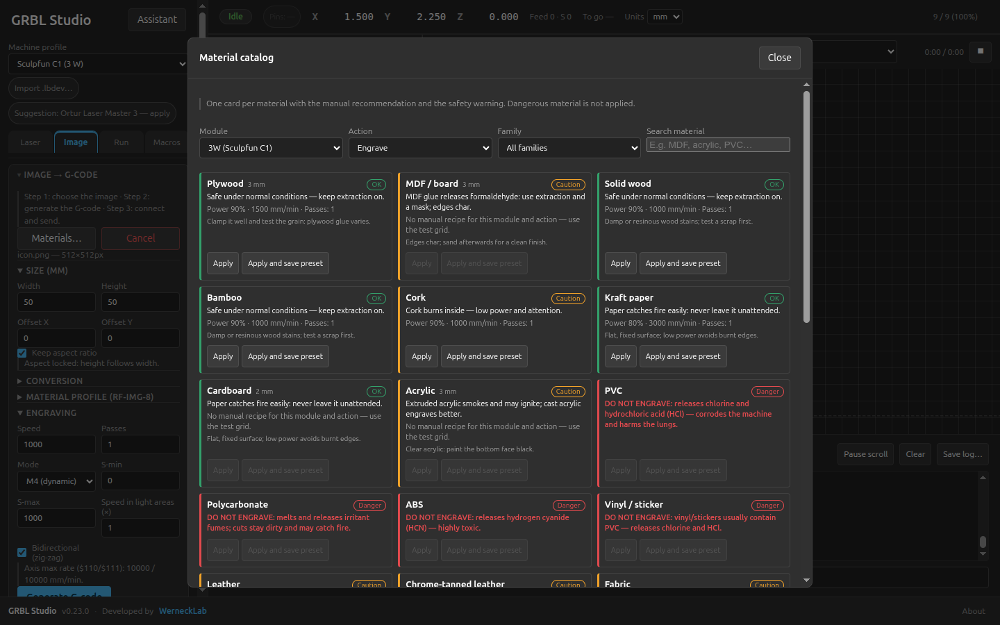

The catalog brings material cards with recommended power/speed, passes, notes and
a **safety warning**.

**Filters:** module (3 W/5 W/10 W…), action (engraving/cutting), family (wood,
plastic, paper, etc.) and search by name.

**Each card shows:**

- **Badge** `OK`, `Caution` or `Danger`.
- Power (%), speed (mm/min), passes.
- Safety and finishing notes.
- **Apply** / **Apply and save preset**.

**Dangerous materials** (PVC, polycarbonate, ABS, vinyl) appear in red and **are
not applied** — the app blocks the recipe.

⚠️ The recommendations are a **starting point**. Test on your material, with your
machine and your module. The catalog does not replace the material test.

---

## 20. Material test

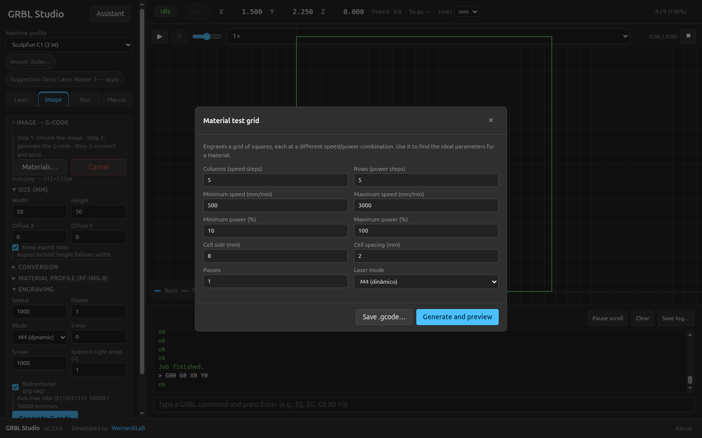

It engraves a grid of squares, each with a combination of **speed × power**, so
you can find the ideal parameters.

**Fields:**

- **Columns (speed steps)** and **Rows (power steps)**.
- **Minimum/maximum speed** and **minimum/maximum power**.
- **Cell side** and **Cell spacing** (mm).
- **Passes** and **Laser mode** (`M3`/`M4`).

**Flow:**

1. Fill in the values (start with a wide range).
2. **Generate and preview** — the app creates the grid and opens positioning.
3. Check the preview and engrave on a scrap.
4. Mark which cell gave the best result.
5. Save the recipe as a **preset** (section 18).

💡 Do one grid per material and per thickness. Write the date in the preset name.

---

## 21. Focus test

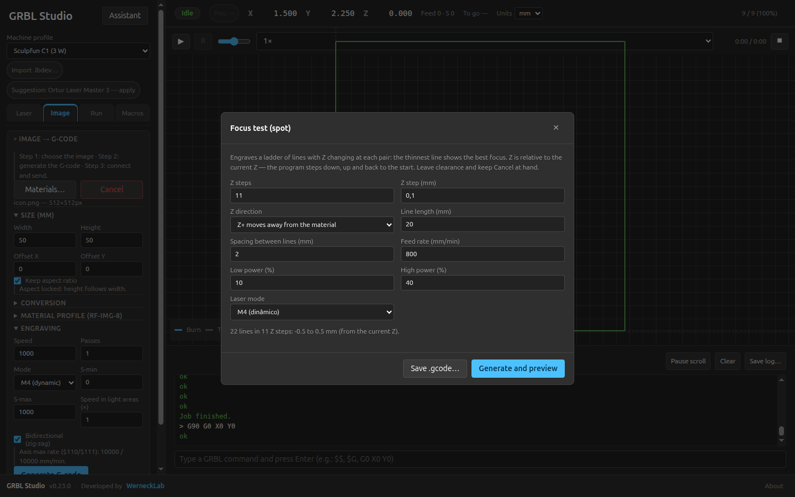

It engraves a ladder of lines with **Z changing every pair**. The thinnest line
indicates the best focus height.

**Fields:**

- **Z steps** and **Z step (mm)**.
- **Z direction** (`Z+` moves away or closer, depending on the machine).
- **Line length** and **Spacing between lines**.
- **Feed rate**, **Low power (%)** and **High power (%)**.
- **Laser mode**.

**Flow:**

1. Position the laser over a scrap, with clearance to go down/up.
2. Generate and preview.
3. Engrave; the thinnest/most marked line is the best focus.
4. Adjust Z and repeat if necessary.

⚠️ The program **goes down, up and back** to the initial Z. Leave clearance and
keep **Cancel** at hand. Use different powers to compare marking and cutting.

---

## 22. Batch with variable data

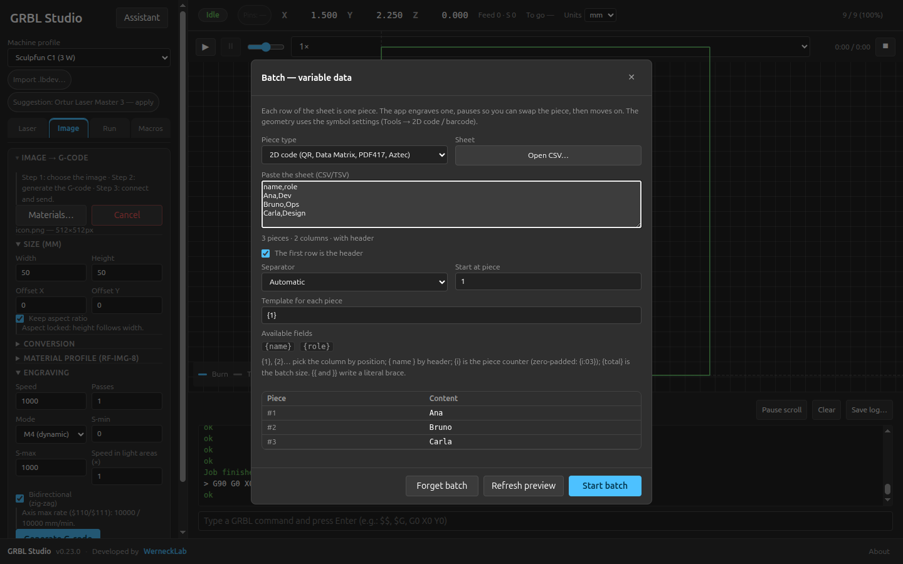

The batch turns a sheet into a **queue of pieces**, one per row. It is ideal for
QR codes/barcodes with variable data (names, URLs, serial numbers).

### 22.1 Preparing the sheet

CSV or TSV, with or without a header:

```csv
name,role
Ana,Dev
Bruno,Ops
Carla,Design
```

- **Separator**: automatic, comma, semicolon, tab or `|`.
- **The first row is the header** — check it if that is the case.
- **Start at piece** — useful to resume an interrupted batch.

### 22.2 Template for each piece

Use tokens in the **Template for each piece** field:

| Token | Meaning |
| :--- | :--- |
| `{1}`, `{2}`… | Column by position. |
| `{name}` | Column by header. |
| `{i}` | Piece counter. |
| `{i:03}` | Counter with leading zeros (`001`, `002`…). |
| `{total}` | Total number of pieces. |
| `{{` / `}}` | Literal brace. |

Example: `https://example.com/{1}` or `Piece {i:03} — {name}`.

### 22.3 Engraving the batch

1. Choose the **Piece type** (2D or 1D). The geometry uses the symbol settings
   (Tools → 2D code / Barcode).
2. Paste or open the sheet.
3. Check the **preview** (piece + content).
4. Click **Start batch**.
5. The app engraves one piece, **pauses so you can swap the piece** and shows
   **▶ Next piece**. Use **End batch** to stop.

⚠️ The batch **does not** move the origin by itself. Each piece must be in the
same position (use a jig, section 29). Check the first one before releasing the
series.

💡 For the **same** program repeated N times, use **Production mode** (section
23), which is simpler.

---

## 23. Production mode

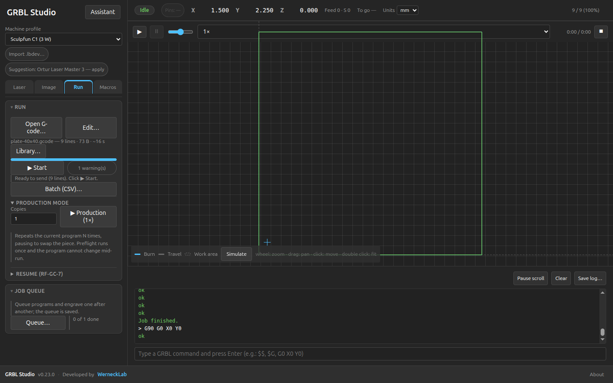

Production mode repeats the **current program** N times, pausing between pieces.

1. Load the G-code.
2. Under **Production mode**, set **Copies** (1–999).
3. Click **▶ Production**.
4. Preflight runs **once**; the program does not change mid-series.
5. At the end of each piece, the app pauses for the swap; use **▶ Next piece**.
6. **End** interrupts the series.

**UI lock:** during production, changing the program is blocked to avoid repeating
the wrong file.

💡 Use it together with a **jig** to place each piece in the same spot. The
precision of the series depends on the setup, not on the software.

---

## 24. Resume and recovery

If a job is interrupted (pause, alarm, connection loss), the app can resume from
the point where it stopped.

1. Open **Run → Resume (RF-GC-7)**.
2. The app shows the resume line and the state.
3. Click **Resume from here**.
4. Before continuing, the app re-asserts **plane, units, distance, offsets and
   laser** (e.g. `G21 G90`, `G54`, `M4`) so GRBL does not inherit a wrong state.

**When to resume:**

- Pause (`!`) or connection loss without the workpiece moving.
- An alarm that did not move the head.

**When NOT to resume:**

- The workpiece moved, the head crashed or the material burned.
- You are not sure of the position. In that case, **start over** from scratch
  after repositioning.

⚠️ Resuming in the middle of a cut can overlap the line and burn. When in doubt,
redo the piece.

---

## 25. Importing SVG, DXF and PDF

The **File** menu imports vectors into the editor:

- **Import SVG…** — vector paths.
- **Import DXF…** — ASCII DXF (LINE, LWPOLYLINE, CIRCLE, ARC, SPLINE, blocks).
- **Import PDF…** — first page, vector paths.

The app converts them into G-code/contours in the editor, where you can scale,
move, combine and assign layers. Scanned (image) PDFs **are not** vectorized by
this import; use the Image tab.

💡 SVG is the best option for vector artwork: keep the original file and import it
at a known scale.

---

# Part III — Advanced

## 26. Vector editor (Design)

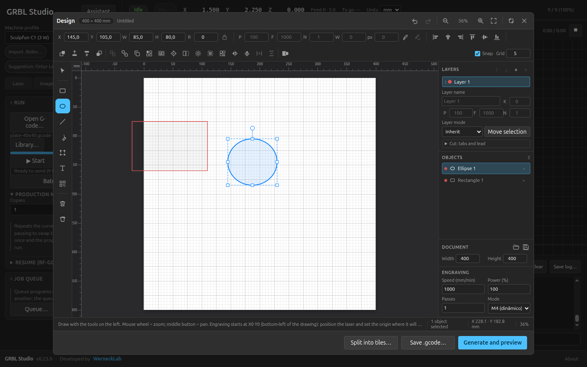

The **Design** editor is a drawing board in **mm**, with rulers, a grid and the
machine area. The G-code comes out **anchored at the origin (X0 Y0)**, in the
bottom-left corner.

### 26.1 Toolbar

| Tool | Shortcut | Use |
| :--- | :--- | :--- |
| Select | `V` | Select, move, resize. |
| Rectangle | `R` | Drag to create. |
| Ellipse | `E` | Drag to create. |
| Line | `L` | Drag. |
| Pen | `P` | Freehand drawing with simplification. |
| Nodes | `N` | Edit the nodes of a path. |
| Text | `T` | Vector text. |
| Symbol | `Q` | Symbol library. |

### 26.2 Properties

For the selected object: **X**, **Y**, **W** (width), **H** (height), **R**
(rotation), **P** (power), **F** (speed), **N** (passes), **W** (stroke width),
plus **Padlock** (aspect ratio) and **px** (unit).

### 26.3 Actions

- **Undo/Redo** (`Ctrl+Z` / `Ctrl+Y`).
- **Zoom** (`+`/`-`, `F` fit, `0` 100%).
- **Mirror horizontally/vertically**, **distribute horizontally/vertically**.
- **Group/ungroup** (`Ctrl+G`).
- **Align** (left, center, right, top, middle, bottom).
- **Z order** (bring to front/send to back).
- **Booleans** (intersection menu): weld, subtract, intersect, exclusion.
- **Snap** and **Grid** (mm).

### 26.4 Document and engraving

- **Document** — page width/height (mm), import/export.
- **Engraving** — speed, power, passes and mode (`M4`/`M3`).
- **Save .gcode…** — saves the generated G-code.
- **Generate and preview** — opens **Artwork size** (section 37), then the
  positioning and the preview.

💡 The editor is not a parametric CAD. For precision parts, import DXF/SVG and
adjust the scale.

---

## 27. Layers and multi-operation

Each **layer** has its own power, speed, passes, mode and **kerf**. That allows
**engraving and cutting in the same run**.

- **New layer** / **Delete layer**.
- **Layer name**, **P/F/N**, **Layer mode** (inherit or its own).
- **Cut: tabs and lead** — tabs hold the part; overcut (lead-in/out) improves
  the entry/exit.
- **Move selection** — assigns the selected objects to the layer.
- **Order** — the layer order defines the engraving sequence.

**Typical workflow:**

1. Layer 1 — **engraving** (low power, high speed).
2. Layer 2 — **cut** (high power, low speed, passes).
3. Select the objects and move them to the correct layer.
4. Generate and check the colors/order in the preview.

⚠️ Order matters: cutting before engraving can shift the part. Engrave first,
cut last.

---

## 28. Shape library

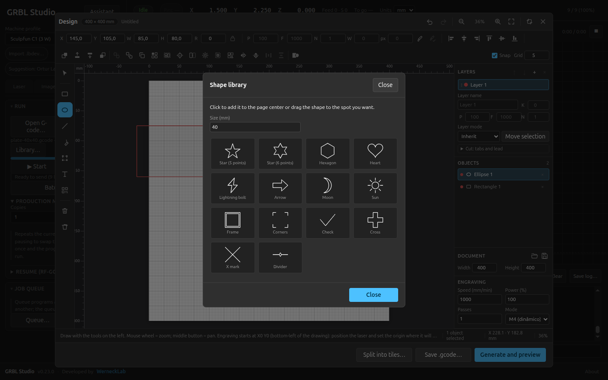

The library brings ready-made shapes: stars (5/6 points), hexagon, heart,
lightning bolt, arrow, moon, sun, frame, corners, check, cross, X mark and
divider.

- **Size (mm)** — sets the shape size.
- **Click** — inserts it at the page center.
- **Drag** — inserts it at the desired spot.

💡 Use it as a base for jigs, markers and icons. Then edit nodes/booleans.

---

## 29. Jig (mold)

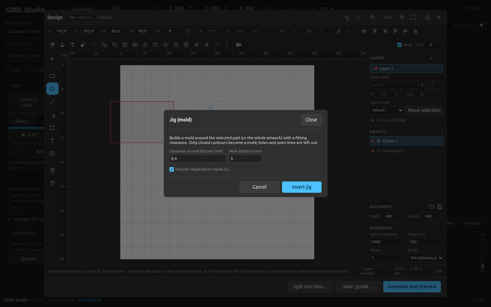

The jig creates a **mold** around the part, with clearance and registration
marks, to position repeated parts.

**Fields:**

- **Clearance around the part (mm)** — space between the part and the mold.
- **Mark distance (mm)** — offset of the registration marks.
- **Include registration marks (L)** — L-shaped marks for alignment.
- **Insert jig** — adds it to the drawing.

**Use:**

1. Draw/import the part.
2. Generate the jig with enough clearance to fit the part.
3. Cut the jig in MDF/board.
4. Place the part in the mold and engrave each unit.

💡 The jig is the most reliable way to repeat parts without repositioning the
origin for each one.

---

## 30. Parametric generators

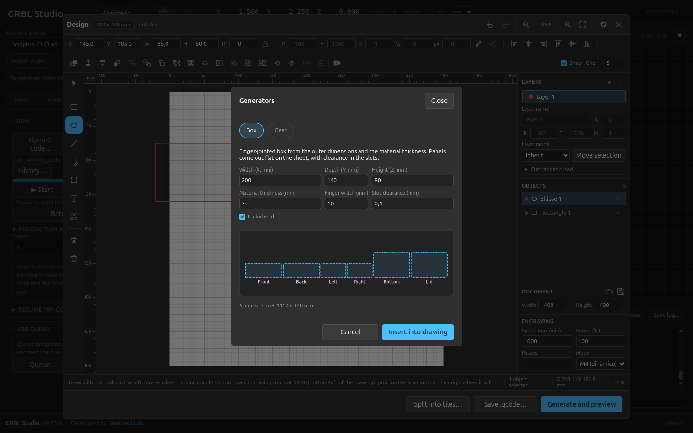

The generator creates parametric shapes:

### 30.1 Finger-jointed box

- **Width (X, mm)**, **Depth (Y, mm)**, **Height (Z, mm)**.
- **Material thickness (mm)**.
- **Finger width (mm)** and **Slot clearance (mm)**.
- **Include lid**.
- Preview with the 6 panels and the sheet size.

### 30.2 Gear

- Module/teeth/thickness parameters (as shown in the interface).
- Preview and insertion into the drawing.

**Use:** adjust the dimensions, check the preview and click
**Insert into drawing**. Then set the layers (engraving/cut) and generate.

⚠️ Check the **actual thickness** of the material with a caliper. The slot
clearance must compensate for your laser's kerf.

---

## 31. Engrave both sides

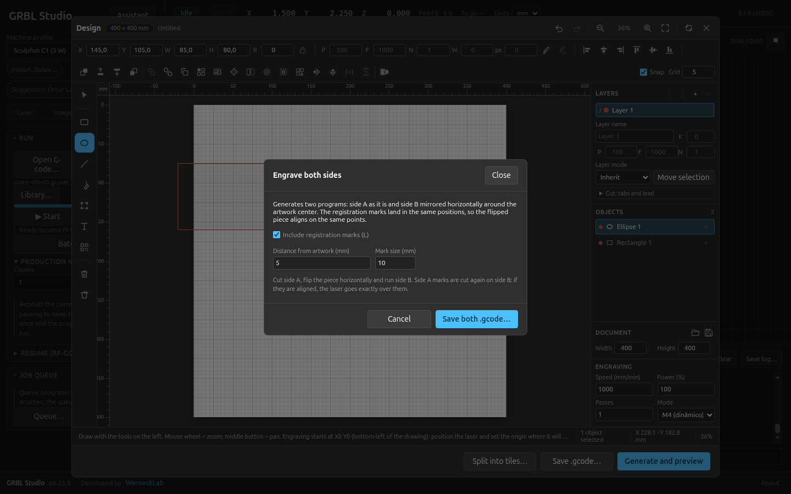

The wizard generates **two G-code files**: side A and side B **mirrored**, with
the same origin and registration marks to align.

**Fields:**

- **Include registration marks (L)**.
- **Distance from artwork (mm)** — offset of the marks.
- **Mark size (mm)**.
- **Save both .gcode…** — writes both files.

**Workflow:**

1. Draw the artwork.
2. Generate both sides with marks.
3. Engrave side A.
4. Flip the part using the marks to align.
5. Engrave side B (mirrored).

⚠️ Alignment depends on the marks and the jig. Test on a scrap before flipping
the final part.

---

## 32. Registration marks

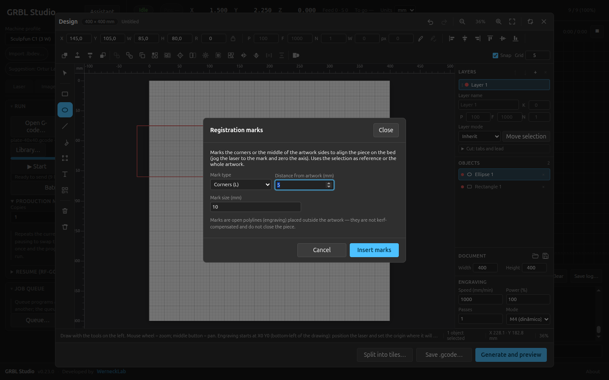

Inserts alignment marks around the artwork:

- **Mark type** — **Corners (L)** or **Crosses**.
- **Distance from artwork (mm)**.
- **Mark size (mm)**.
- **Insert marks**.

**Uses:** align the back side, position in a jig, check the origin and recover
the position after an interruption.

💡 Use **crosses** for camera/pointer reading and **L corners** for physical
fitting.

---

## 33. Split into tiles

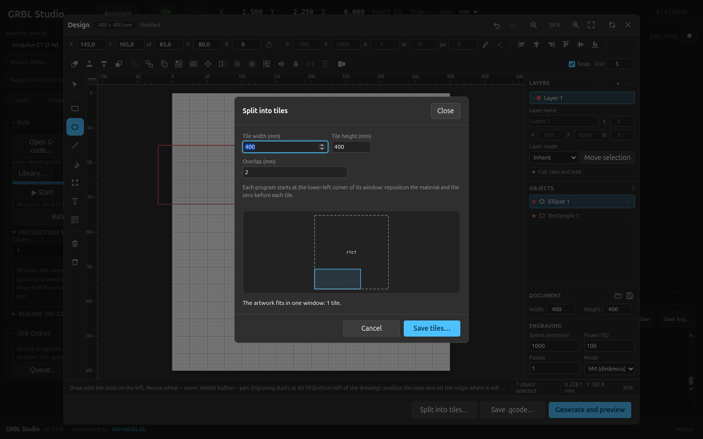

For artwork larger than the machine area, the app splits it into **tiles** with
overlap.

**Fields:**

- **Tile width (mm)** and **Tile height (mm)**.
- **Overlap (mm)** — avoids a visible seam.
- Preview with the artwork and the windows.
- **Save tiles…** — generates one file per tile.

**Workflow:**

1. Set the tile size (a little smaller than the useful travel).
2. Use 2–5 mm overlap.
3. Save the tiles.
4. Engrave them one by one, repositioning the origin/marks.
5. Use the registration marks to align each window.

⚠️ The seam depends on the repositioning accuracy. Do a small test before the
large artwork.

---

## 34. Array of copies

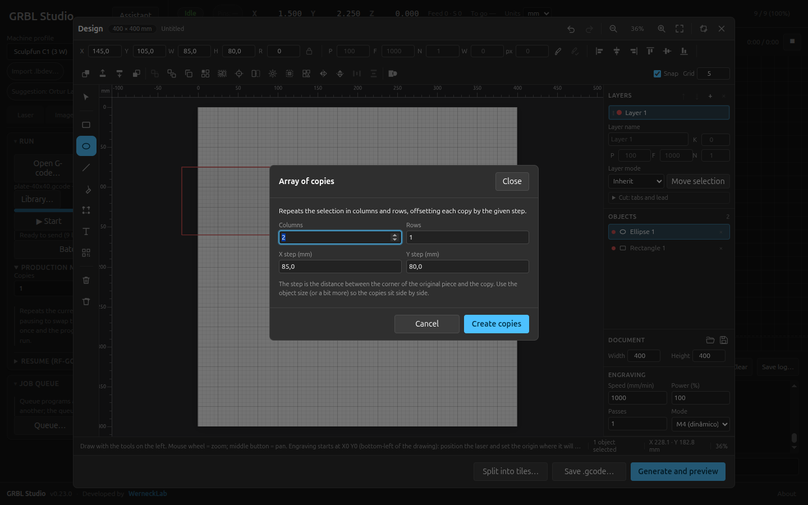

Creates several copies of the selected object in a grid.

**Fields:**

- **Columns** and **Rows**.
- **X step (mm)** and **Y step (mm)**.
- **Create copies** (max. 1000).

**Use:** series production on the same sheet. Combine it with **nesting**
(section 35) to make better use of the material.

💡 Leave a gap between the parts for the kerf and to avoid overheating the
material.

---

## 35. Nest on sheet

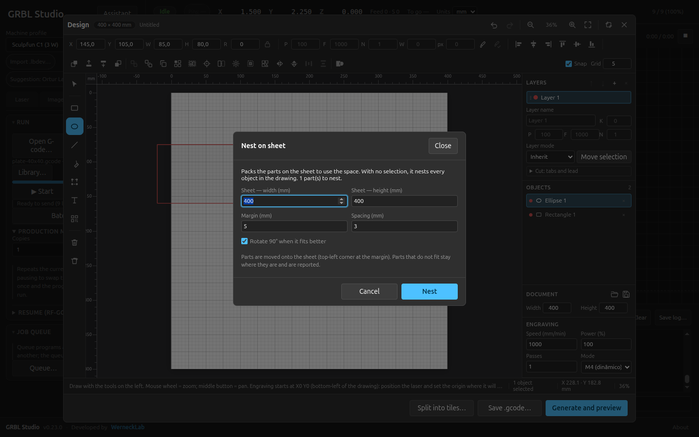

Nesting arranges the parts on the sheet to make use of the material.

**Fields:**

- **Sheet — width (mm)** and **Sheet — height (mm)**.
- **Margin (mm)** and **Spacing (mm)**.
- **Rotate 90° when it fits better**.
- **Nest** — distributes the parts.
- Result: nested parts, usage (%) and parts that did not fit.

**Use:** select the parts, set the sheet and nest. Check the preview before
generating.

⚠️ Nesting considers the contour, not the kerf. Leave enough spacing.

---

## 36. Offset contour

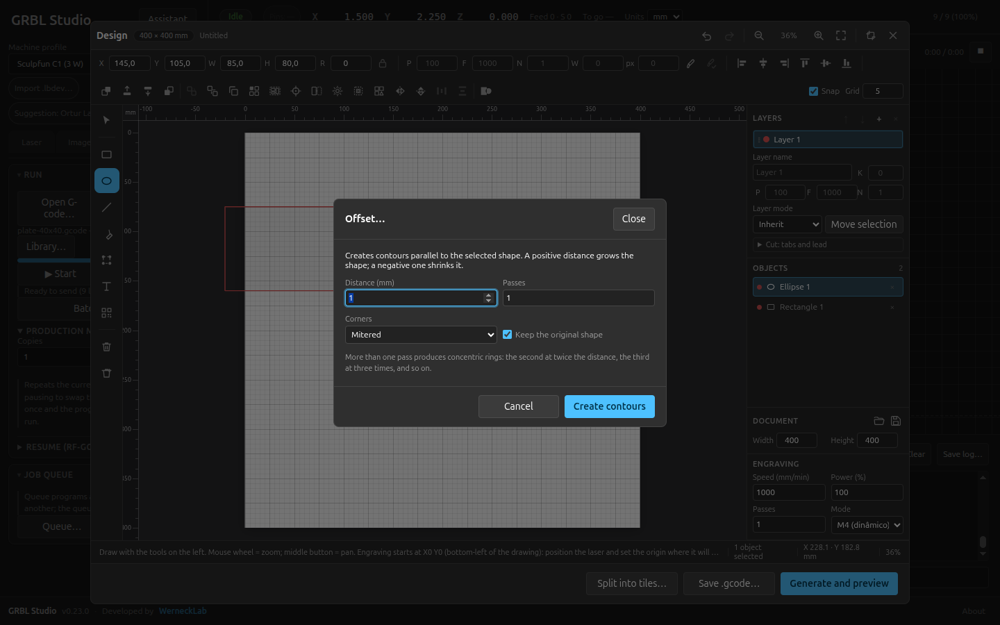

Creates contours parallel to a shape, for cutting, reinforcement or kerf.

**Fields:**

- **Distance (mm)** — positive outward, negative inward.
- **Passes** — concentric contours.
- **Corners** — mitered, rounded or beveled.
- **Keep the original shape**.
- **Create contours**.

**Uses:**

- Compensate for the **kerf** (cut width) with a negative offset.
- Create a decorative border.
- Make a loose fit.

💡 For a tight cut, measure the kerf (e.g. 0.15 mm) and use an offset of
`-kerf/2` on the cut layer.

---

## 37. Artwork size

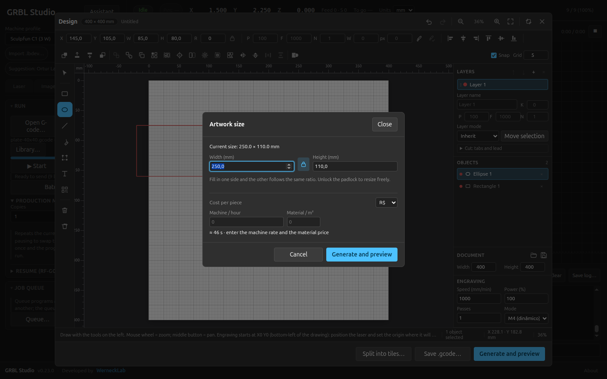

Before generating, the app asks for the final artwork size:

- **Width (mm)** and **Height (mm)**.
- **Padlock** — keeps the aspect ratio.
- Shows the **current size** and the estimated cost/time.
- **Generate** — applies it and opens the positioning.

**Use:** set the actual size you want on the material. The editor works in mm;
the artwork size is the final scale.

💡 If the artwork is in inches, convert it to mm first (1 in = 25.4 mm).

---

## 38. QR Code, Data Matrix, PDF417 and Aztec

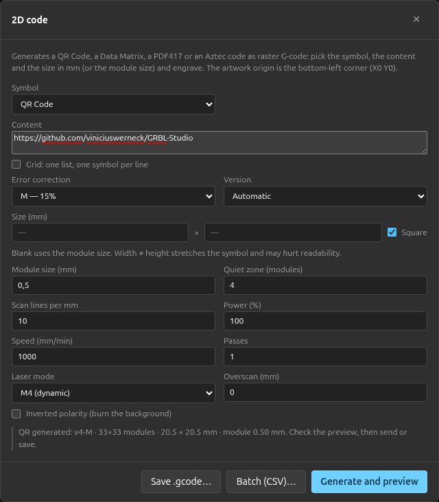

The app generates 2D symbols as raster G-code.

### 38.1 Symbologies

- **QR Code** — L/M/Q/H error correction, automatic or fixed version.
- **Data Matrix ECC200** — ECC 0–8.
- **PDF417** — correction levels.
- **Aztec** — correction levels.

### 38.2 Fields

- **Content** — text/URL.
- **Grid** — one list, one symbol per line (generates a grid).
- **Error correction** and **Version**.
- **Size (mm)** — width × height; **Square** locks the aspect ratio.
- **Module size (mm)** and **Quiet zone (modules)**.
- **Scan lines per mm**.
- **Power (%)**, **Speed (mm/min)**, **Passes**.
- **Laser mode** (`M4`/`M3`), **Overscan (mm)**.
- **Inverted polarity** (burn the background).

### 38.3 Generate

1. Fill in the content.
2. Adjust the size/module (a module that is too small = unreadable).
3. **Generate and preview** — the app loads the G-code and opens the
   positioning.
4. Check that it scans with your phone **before** engraving.
5. Engrave or **Save .gcode…**.

⚠️ A small module, high power or dark material can destroy the contrast. Test
and validate the scan.

💡 For variable data, use the **Batch** (section 22) with the sheet.

---

## 39. 1D barcode

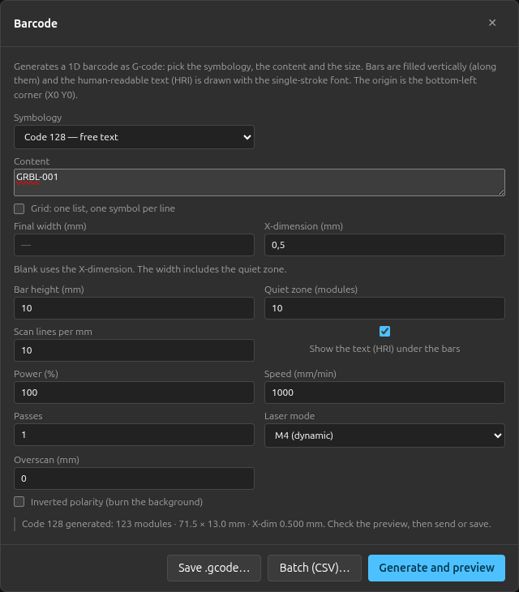

Supported symbologies: **Code 128/GS1-128, EAN-13, EAN-8, UPC-A, Code 39,
ITF-14, Codabar and Code 93**.

**Fields:**

- **Symbology** and **Content**.
- **Grid** — list, one code per line.
- **Final width (mm)** or **X-dimension (mm)**.
- **Bar height (mm)**, **Quiet zone (modules)**.
- **Scan lines per mm**, **Show the text (HRI)**.
- **Power**, **Speed**, **Passes**, **Mode**, **Overscan**.
- **Inverted polarity**.

**Generate:** fill it in, adjust the X-dimension (readable minimum),
**Generate and preview**, validate with a scanner and engrave.

⚠️ EAN/UPC have check-digit and size rules. Use the correct content; the app
validates and shows an error if the code is invalid.

💡 For label runs, use the **Batch** with `{1}`/`{name}`.

---

## 40. Appearance and language

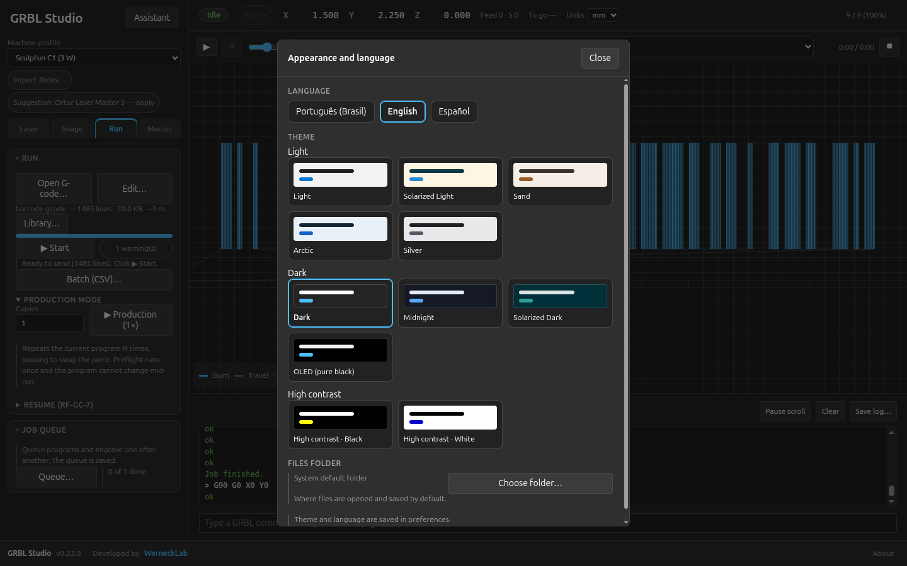

Open it in **View → Appearance and language…**.

- **Language** — Português (Brasil), English, Español. The change is immediate.
- **Theme** — 5 light, 4 dark and 2 high-contrast:
  - Light: Light, Solarized Light, Sand, Arctic, Silver.
  - Dark: Dark, Midnight, Solarized Dark, OLED (pure black).
  - High contrast: Black, White.
- **Files folder** — default folder for the open/save dialogs.

💡 In bright environments, use a light theme; in dark environments, OLED saves
battery and reduces eye strain.

---

## 41. About

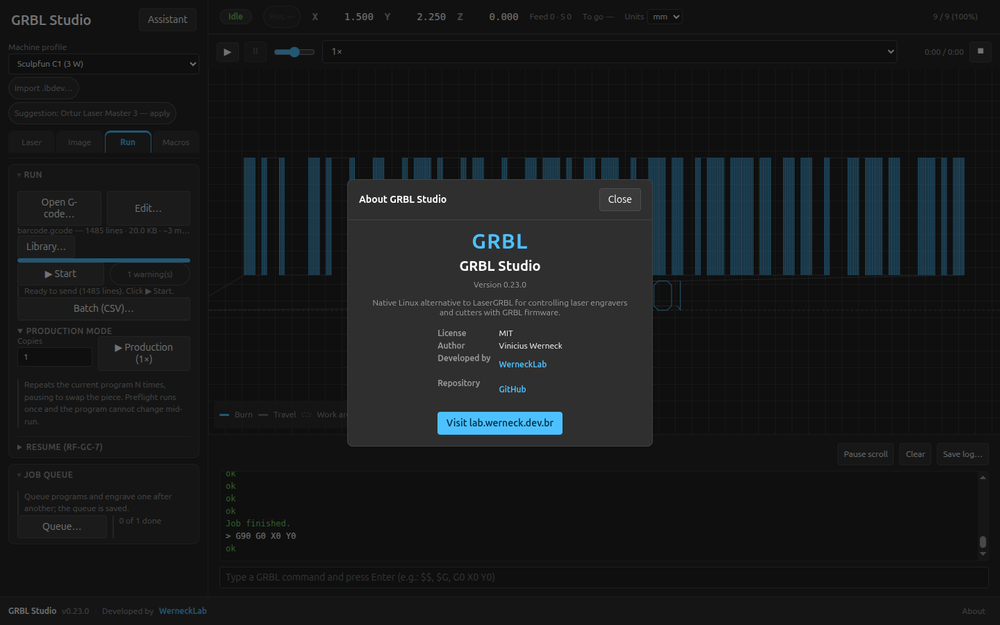

Shows the version, license (MIT), author (Vinicius Werneck), developer
(WerneckLab), GitHub repository and the website. Use
**Visit lab.werneck.dev.br** for news.

---

# Part IV — Reference

## 42. Real-time commands

**Single-byte** commands — they do not take `\n`. Use the app buttons; the
console is not the place to type them with Enter.

| Command | Byte | Function |
| :--- | :--- | :--- |
| Status | `?` | State/position report. |
| Feed Hold | `!` | Pauses the motion. |
| Cycle Start | `~` | Resumes. |
| Soft Reset | `0x18` (Ctrl-X) | Aborts and resets. |
| Jog Cancel | `0x85` | Cancels the jog. |
| Feed 100% | `0x90` | Feed reset. |
| Feed +10% / −10% | `0x91` / `0x92` | Coarse override. |
| Feed +1% / −1% | `0x93` / `0x94` | Fine override. |
| Rapid 100/50/25% | `0x95` / `0x96` / `0x97` | Rapid traverse. |
| Spindle 100% | `0x99` | Power reset. |
| Spindle +10% / −10% | `0x9A` / `0x9B` | Power. |
| Spindle +1% / −1% | `0x9C` / `0x9D` | Fine power. |

## 43. GRBL alarms

| Alarm | Meaning | Recommended action |
| :--- | :--- | :--- |
| **1** | Hard limit triggered | **Unlock ($X)** → jog away → **Home ($H)**. |
| **2** | Soft limit exceeded | Check the preview/travel; adjust the origin or reduce the artwork. |
| **3** | Reset during execution | EMI noise/cable/power supply; use a shielded cable/ferrite, disable USB suspend. |
| **4** | Probe failure: unexpected initial state | Check the probe/wiring; `$X` to unlock. |
| **5** | Probe failure: did not touch the workpiece within the travel | Check the contact/programmed travel; `$X`. |
| **6** | Homing: reset during the cycle | Repeat `$H`; avoid resetting in the middle of homing. |
| **7** | Homing: safety door open | Close the door/lid and repeat `$H`. |
| **8** | Homing: limit switch did not clear on pull-off | Increase `$27` (pull-off) and check the wiring. |
| **9** | Homing: limit switch not found | Check the switch/wiring, `$24`/`$25` and the seek distance. |

## 44. Troubleshooting

### 44.1 Connection

| Symptom | Solution |
| :--- | :--- |
| No ports listed | `dialout`/udev permission; cable; refresh ports. |
| “Permission denied” | `sudo usermod -aG dialout "$USER"` + logout. |
| Silent console | Wrong baud (115200 → 9600 → 250000). |
| Drops mid-job | Short cable/ferrite/USB 2.0; avoid an unpowered hub. |

### 44.2 Job

| Symptom | Solution |
| :--- | :--- |
| Stops at a random line | Buffer/noise; use the app (byte window), a good cable. |
| `error:20` | Unsupported/invalid G-code command — check the line in the editor. |
| `error:22` | Feed not defined — add `F` to the first `G1`. |
| `ALARM:3` | EMI/power supply; shielded cable, ferrite, grounding. |
| Job outside the area | Preflight blocks it; adjust the origin/travel. |
| Material burned | Reduce power/increase feed; material test. |

### 44.3 Image/drawing

| Symptom | Solution |
| :--- | :--- |
| Image inverted | Use **Invert black/white** or mirror it in the editor. |
| Too much time on white areas | Use **B&W Threshold**/**Vectorize (outline / cut)**; reduce the white area. |
| Mirrored text | Use **Mirror horizontally/vertically** only on the intended object; for readable text, avoid mirroring. |
| Contour does not close | Check the nodes/booleans; use **Validate**. |

### 44.4 Symbols

| Symptom | Solution |
| :--- | :--- |
| Unreadable QR | Increase the module, reduce power, improve the contrast. |
| Invalid barcode | Check the check digit/format; use the correct content. |
| Clipped symbol | Increase the quiet zone/size; check the preview. |

## 45. Keyboard shortcuts

**Global (verified):**

| Action | Shortcut |
| :--- | :--- |
| Emergency stop | `Ctrl+X` (always) |
| Stop the job (no dialog) | `Esc` |
| Close dialog | `Esc` |
| Jog X/Y | Arrow keys |
| Jog Z | `PageUp` / `PageDown` |
| Homing | `Home` (if `$22=1`) |

**Design editor:**

| Action | Shortcut |
| :--- | :--- |
| Select / Rectangle / Ellipse / Line / Pen / Nodes / Text / Symbol | `V` / `R` / `E` / `L` / `P` / `N` / `T` / `Q` |
| Undo / Redo | `Ctrl+Z` / `Ctrl+Y` |
| Group | `Ctrl+G` |
| Fit to page | `F` |
| Zoom 100% | `0` |
| Zoom + / − | `+` / `-` |
| Snap | `J` |
| Move selection (arrows) | Arrow keys (with step) |
| Delete | `Delete` |

> Menu shortcuts (such as `Ctrl+O`) depend on the environment/desktop. Use the
> native menu as the guaranteed path.

## 46. Files and folders

```text
~/.config/grbl-studio/        # Electron userData (name per package)
├── prefs.json                # preferences, macros, presets and $$ profiles
├── queue.json                # job queue
├── joblib/
│   ├── index.json            # metadata + thumbnails of the last 50 jobs
│   └── <id>.gz               # compressed G-code for each job
└── logs/
    └── session-<date>.log    # session log (console/events)
```

**Backup:** copy the whole folder. To restore, close the app and replace it.

**Logs:** menu **Help → Open logs folder** (or **Save log…** in the console).

## 47. Checklist before engraving

- [ ] Safety glasses and a fire extinguisher nearby.
- [ ] Approved material (no PVC/PC/ABS) and well secured.
- [ ] Laser focus and height checked.
- [ ] Correct machine profile (travel/limits).
- [ ] Origin set at the desired corner/center.
- [ ] Outline drawn (weak laser) inside the part.
- [ ] Preview matches the artwork.
- [ ] Preflight with no blockers.
- [ ] Power/speed/passes tested on the material.
- [ ] Extraction on.
- [ ] You will stay nearby until the end.

## 48. Glossary

| Term | Meaning |
| :--- | :--- |
| **GRBL** | Open-source firmware for CNC/laser controllers. |
| **G-code** | Motion command language. |
| **WPos** | Work position (after offsets/origin). |
| **MPos** | Machine position (absolute coordinates). |
| **DRO** | Digital readout of position (X/Y/Z). |
| **DTG** | Distance to go to the end of the segment. |
| **Feed** | Feed rate (mm/min). |
| **S** | Laser power (0–S-max). |
| **M3/M4** | Constant/dynamic laser mode. |
| **Override** | Real-time adjustment of feed/power/rapid. |
| **Homing** | Reference routine on the limit switches (`$H`). |
| **Soft/hard limits** | Software limits/physical limit switches. |
| **Kerf** | Cut width (material removed). |
| **Offset** | Parallel contour; also an origin shift. |
| **Tabs** | Bridges that hold the part during the cut. |
| **Lead-in/out** | Cut entry/exit. |
| **Dose (J/mm)** | Energy per millimeter; compares recipes. |
| **HRI** | Human-readable text under the barcode. |
| **Quiet zone** | White margin around the symbol. |
| **X-dimension** | Width of the barcode module. |

## 49. Links and license

- **Repository:** https://github.com/viniciuswerneck/GRBL-Studio
- **Releases:** https://github.com/viniciuswerneck/GRBL-Studio/releases
- **Author's website:** https://lab.werneck.dev.br
- **GRBL Wiki:** https://github.com/gnea/grbl/wiki
- **LaserGRBL (reference):** https://lasergrbl.com/usage/
- **License:** MIT — free software, no warranty.

> **Final warning:** a laser is dangerous. GRBL Studio is a tool; the
> responsibility for safe operation lies with whoever operates the machine.
> Test, supervise and never leave the laser alone.
