# Manual del usuario — GRBL Studio

> **Versión de la app:** 0.24.0  
> **Actualizado:** 26 de octubre de 2026  
> **Idioma:** Español  
> **Licencia:** MIT

Este es el manual completo de **GRBL Studio**, la alternativa nativa para Linux a
LaserGRBL. Abarca desde el primer contacto hasta las funciones avanzadas de
dibujo, símbolos y producción en serie.

Las imágenes se generaron con la app real conectada a un **emulador GRBL** (vía
TCP). Por eso, el puerto, la posición y algunos valores son de ejemplo — su
máquina mostrará los valores reales.

**Convenciones usadas en este manual:**

| Símbolo | Significado |
| :--- | :--- |
| ⚠️ | Atención: riesgo de quemadura, incendio o daño a la máquina. |
| 💡 | Consejo práctico o atajo para ahorrar tiempo. |
| ✅ | Lista de verificación/comprobación antes de continuar. |
| 🔧 | Función avanzada; exige un poco más de experiencia. |
| **Negrita** | Nombre de botón, campo o menú exactamente como aparece en pantalla. |

---

## Índice

- [Antes de comenzar: seguridad](#antes-de-comenzar-seguridad)
- [Parte I — Básico](#parte-i--básico)
  - [1. Qué es GRBL Studio](#1-qué-es-grbl-studio)
  - [2. Instalación en Linux](#2-instalación-en-linux)
  - [3. Primera ejecución](#3-primera-ejecución)
  - [4. La pantalla principal](#4-la-pantalla-principal)
  - [5. Conectar la máquina](#5-conectar-la-máquina)
  - [6. Abrir un G-code listo](#6-abrir-un-g-code-listo)
  - [7. Importar una imagen](#7-importar-una-imagen)
  - [8. Previsualizar y posicionar](#8-previsualizar-y-posicionar)
  - [9. Grabar y controlar el trabajo](#9-grabar-y-controlar-el-trabajo)
  - [10. Overrides en tiempo real](#10-overrides-en-tiempo-real)
  - [11. Consola, DRO y estado](#11-consola-dro-y-estado)
  - [12. Macros](#12-macros)
- [Parte II — Intermedio](#parte-ii--intermedio)
  - [13. Perfil y ajustes de la máquina](#13-perfil-y-ajustes-de-la-máquina)
  - [14. Editor de G-code](#14-editor-de-g-code)
  - [15. Pre-vuelo](#15-pre-vuelo)
  - [16. Cola de trabajos](#16-cola-de-trabajos)
  - [17. Biblioteca de jobs](#17-biblioteca-de-jobs)
  - [18. Presets de material](#18-presets-de-material)
  - [19. Catálogo de materiales](#19-catálogo-de-materiales)
  - [20. Prueba de material](#20-prueba-de-material)
  - [21. Prueba de foco](#21-prueba-de-foco)
  - [22. Lote con datos variables](#22-lote-con-datos-variables)
  - [23. Modo producción](#23-modo-producción)
  - [24. Reanudación y recuperación](#24-reanudación-y-recuperación)
  - [25. Importar SVG, DXF y PDF](#25-importar-svg-dxf-y-pdf)
- [Parte III — Avanzado](#parte-iii--avanzado)
  - [26. Editor vectorial (Dibujar)](#26-editor-vectorial-dibujar)
  - [27. Capas y multioperación](#27-capas-y-multioperación)
  - [28. Biblioteca de formas](#28-biblioteca-de-formas)
  - [29. Plantilla (molde)](#29-plantilla-molde)
  - [30. Generadores paramétricos](#30-generadores-paramétricos)
  - [31. Grabar por los dos lados](#31-grabar-por-los-dos-lados)
  - [32. Marcas de registro](#32-marcas-de-registro)
  - [33. Dividir en tiles](#33-dividir-en-tiles)
  - [34. Matriz de copias](#34-matriz-de-copias)
  - [35. Encaje en la chapa](#35-encaje-en-la-chapa)
  - [36. Contorno paralelo](#36-contorno-paralelo)
  - [37. Tamaño de la obra](#37-tamaño-de-la-obra)
  - [38. QR Code, Data Matrix, PDF417 y Aztec](#38-qr-code-data-matrix-pdf417-y-aztec)
  - [39. Código de barras 1D](#39-código-de-barras-1d)
  - [40. Apariencia e idioma](#40-apariencia-e-idioma)
  - [41. Acerca de](#41-acerca-de)
- [Parte IV — Referencia](#parte-iv--referencia)
  - [42. Comandos en tiempo real](#42-comandos-en-tiempo-real)
  - [43. Alarmas del GRBL](#43-alarmas-del-grbl)
  - [44. Solución de problemas](#44-solución-de-problemas)
  - [45. Atajos de teclado](#45-atajos-de-teclado)
  - [46. Archivos y carpetas](#46-archivos-y-carpetas)
  - [47. Lista de comprobación antes de grabar](#47-lista-de-comprobación-antes-de-grabar)
  - [48. Glosario](#48-glosario)
  - [49. Enlaces y licencia](#49-enlaces-y-licencia)

---

## Antes de comenzar: seguridad

⚠️ **El láser de grabado/corte es radiación peligrosa.** Incluso los láseres de
3 W a 10 W pueden causar quemaduras en la retina y en la piel en fracciones de
segundo. Lea esta sección antes de encender la máquina.

**Protección personal y del entorno:**

- Use **gafas de protección específicas para la longitud de onda de su láser**
  (normalmente 445–450 nm). Las gafas de sol comunes **no** protegen.
- Nunca mire directamente al haz, ni al reflejo en metales, vidrio o
  superficies pulidas.
- Encierre la máquina en una **caja/enclosure** con ventana filtrante siempre que
  sea posible. Delimite el área de trabajo y mantenga alejadas a las personas y a
  los animales.
- Tenga un **extintor de incendios** (CO₂ o polvo químico) cerca. Los láseres son
  una fuente de ignición real: el papel, el MDF, el acrílico y los tejidos se
  queman.
- **Nunca deje la máquina grabando sola.** Permanezca cerca, con el botón de
  emergencia **de la máquina** a su alcance.
- Use **extracción/ventilación** para el humo y las partículas. El MDF, el cuero y
  algunos plásticos liberan humo tóxico.
- Sujete el material y el cable USB. La vibración puede desplazar la pieza o
  soltar la conexión en medio del trabajo.

**Materiales prohibidos (no grabe/corte):**

| Material | Por qué |
| :--- | :--- |
| **PVC, vinilo, EVA con PVC** | Libera **cloro y ácido clorhídrico (HCl)** — corroe la máquina y agrede los pulmones. |
| **Policarbonato (PC)** | Se derrite, libera humo irritante y puede incendiarse. |
| **ABS** | Libera cianuro de hidrógeno (HCN) y otros gases tóxicos. |
| **Cualquier material con adhesivo desconocido** | Puede liberar gases o incendiarse. |

**Antes de cada grabado:**

1. Compruebe el **enfoque** y la altura del láser (use la prueba de foco si es necesario).
2. Confirme el **origen** y el **contorno** del área sobre el material.
3. Verifique que el **pre-vuelo** no haya señalado bloqueos.
4. Deje el **extintor** y el **botón de emergencia de la máquina** accesibles.
5. Haga una prueba en un **retal** cuando cambie de material, potencia o velocidad.

> El software ayuda, pero **no sustituye** el sentido común y la supervisión. La
> vista previa muestra el recorrido planificado; no detecta material equivocado,
> mal enfoque ni incendio.

---

# Parte I — Básico

## 1. Qué es GRBL Studio

**GRBL Studio** es una aplicación **nativa para Linux** (Electron + TypeScript)
para controlar grabadoras y cortadoras láser con firmware **GRBL 1.1**. Es una
alternativa a LaserGRBL, centrada en:

- **Comunicación confiable**: ventana de envío con conteo de caracteres, sin
  desbordar el búfer de 128 bytes del GRBL.
- **Seguridad**: pre-vuelo, parada de emergencia, alarmas y límites de la máquina.
- **Flujo completo**: conectar, abrir G-code o imagen, dibujar, previsualizar,
  posicionar, grabar y repetir.
- **Funciones de producción**: cola, biblioteca de jobs, presets de material,
  pruebas de material/foco, lote con CSV y modo producción.

**Requisitos:**

- Linux (X11 o Wayland), 64 bits.
- Puerto USB serie (CH340/CH341/CP2102, habituales) **o** WiFi/TCP (ESP8266/ESP32
  con firmware serial-over-TCP).
- Permiso de acceso al puerto serie (vea la sección 2.4).
- La app funciona **sin conexión** una vez instalada.

**Lo que no hace:**

- No sustituye al firmware GRBL; envía comandos a la controladora.
- No es un CAD completo. El editor vectorial está centrado en arte 2D para láser.
- No garantiza que el material o la potencia sean seguros. Eso depende de usted.

---

## 2. Instalación en Linux

### 2.1 AppImage (recomendado)

El AppImage no necesita instalación y funciona en la mayoría de las
distribuciones.

```bash
# 1. Descargue la última versión desde:
#    https://github.com/viniciuswerneck/GRBL-Studio/releases
# 2. Hágalo ejecutable
chmod +x GRBL-Studio-*.AppImage
# 3. Ejecute
./GRBL-Studio-*.AppImage
```

💡 Si el AppImage no se abre en algunas distribuciones, instale `libfuse2`
(Ubuntu/Debian: `sudo apt install libfuse2`).

### 2.2 Paquete `.deb`

Para Ubuntu, Debian, Mint, Pop!\_OS y derivados:

```bash
sudo apt install ./grbl-studio_*_amd64.deb
```

El acceso directo **GRBL Studio** aparece en el menú de aplicaciones.

### 2.3 Flatpak

Cuando se publique en Flathub:

```bash
flatpak install flathub com.grblstudio.app
flatpak run com.grblstudio.app
```

### 2.4 Permiso del puerto serie (obligatorio en Linux)

Sin permiso, la lista de puertos queda vacía o la app muestra “Permission denied”.

**Opción A — grupo `dialout` (Ubuntu/Debian/Mint/Pop!\_OS):**

```bash
sudo usermod -aG dialout "$USER"
# Cierre la sesión y vuelva a entrar (o reinicie) para que surta efecto.
```

**Opción B — Fedora/RHEL/CentOS/openSUSE:**

```bash
sudo usermod -aG dialout "$USER"   # o uucp, según la distribución
# Cierre y abra la sesión.
```

**Opción C — regla udev persistente (recomendada para una máquina concreta):**

```bash
# Ejemplo para adaptadores CH340/CH341 (COMGO, Sculpfun, Ortur, AtomStack):
echo 'SUBSYSTEM=="tty", ATTRS{idVendor}=="1a86", ATTRS{idProduct}=="7523", MODE="0666", GROUP="dialout"' \
  | sudo tee /etc/udev/rules.d/99-grbl-studio.rules
sudo udevadm control --reload-rules
sudo udevadm trigger
# Vuelva a conectar el cable USB.
```

✅ Prueba rápida: `ls -l /dev/ttyUSB0` debe mostrar el grupo `dialout` y permiso
de lectura/escritura para el grupo. Si el puerto es `/dev/ttyACM0`, ajuste la
ruta.

---

## 3. Primera ejecución

Al abrirla por primera vez, la app muestra una **splash** breve (versión y
crédito WerneckLab) y después la ventana principal. El **tour de bienvenida** se
abre automáticamente en 5 pasos:

1. **Conectar** — elegir puerto, baudios y perfil.
2. **Perfil de la máquina** — 30 perfiles o “Genérica (GRBL)”.
3. **Abrir archivo/imagen** — G-code, PNG, JPG, SVG, DXF, PDF…
4. **Vista previa y posicionar** — zoom/pan, contorno tenue, marcar centro.
5. **Grabar** — Play, barra flotante, overrides en tiempo real.

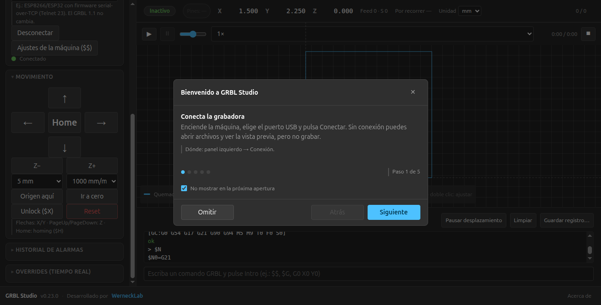

- Marque **No mostrar en la próxima apertura** para omitir el tour.
- Para volver a verlo: menú **Ayuda → Tour de bienvenida**.
- El botón **Asistente** de la parte superior abre la guía rápida (modo Básico).
  En el modo Avanzado, todos los paneles están disponibles.

**Idioma y tema** se detectan del sistema en la primera ejecución. Para
cambiarlos: menú **Ver → Apariencia e idioma…**.

💡 El manual usa el **modo Avanzado**, que muestra todas las pestañas y tarjetas.
Si prefiere el modo guiado, haga clic en **Asistente** y siga los pasos.

---

## 4. La pantalla principal

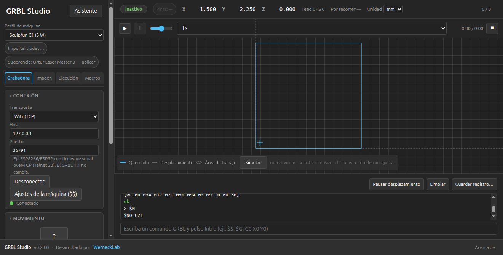

La ventana se divide en cinco áreas:

| Área | Qué contiene |
| :--- | :--- |
| **Barra superior** | Estado de la máquina (Inactivo/Ejecutando/Alarma), pines, DRO X/Y/Z, feed, potencia S, “Por recorrer” (DTG), unidad (mm/in) y progreso. |
| **Barra lateral izquierda** | Perfil de máquina, pestañas **Grabadora / Imagen / Ejecución / Macros** y las tarjetas de conexión, movimiento, overrides, etc. |
| **Centro** | Vista previa 2D del recorrido, controles de simulación y barra de estado del trabajo. |
| **Pie del centro** | Consola del GRBL, con campo para escribir comandos y botones de desplazamiento/limpieza/registro. |
| **Pie** | Versión, crédito WerneckLab y enlace **Acerca de**. |

### 4.1 Barra superior (estado)

- **Indicador de estado** — `Inactivo`, `Ejecutando`, `Pausado`, `Alarma`, etc.
- **Pines** — muestra el estado de los finales de carrera/sonda cuando el firmware lo informa.
- **X / Y / Z** — posición de trabajo (WPos) con 0,001 mm.
- **Feed** — avance real; **S** — potencia instantánea del láser.
- **Por recorrer** — distancia restante hasta el final del segmento actual (DTG).
- **Unidad** — alterna la visualización entre **mm** e **in** (el G-code no cambia).
- **Progreso** — línea actual / total y ETA durante el trabajo.

### 4.2 Vista previa

La vista previa dibuja el recorrido del G-code:

- **Quemado** (azul) — movimientos de corte/grabado (`G1`/`G2`/`G3`).
- **Desplazamiento** (discontinuo) — movimientos rápidos (`G0`).
- **Área de trabajo** — caja del recorrido de la máquina (`$130`/`$131`).
- **Simular** — reproducción del trabajo con velocidad ajustable.

**Navegación:**

- **Rueda del ratón** — zoom.
- **Arrastrar** — mover (en la vista previa, botón izquierdo; en el editor, botón
  central o `Espacio` + arrastrar).
- **Clic** — elige un punto para mover el cabezal (pide confirmación).
- **Doble clic** — vuelve al encuadre predeterminado.
- **F** — ajustar a la pantalla; **0** — 100% (en el editor de dibujo).

### 4.3 Barra lateral

En la parte superior está el **Perfil de máquina** (con importación de `.lbdev` de
LightBurn y sugerencia de perfil) y el botón **Asistente**. Debajo están las
pestañas:

- **Grabadora** — conexión, movimiento (jog), overrides, historial de alarmas.
- **Imagen** — conversión de imagen a G-code.
- **Ejecución** — abrir G-code, iniciar, lote, producción, reanudación, cola.
- **Macros** — botones de comandos preparados y macros personalizadas.

Cada tarjeta es un `<details>`: haga clic en el título para abrirla/cerrarla.

### 4.4 Consola

La consola muestra los comandos enviados (`>`) y las respuestas de la máquina
(`ok`, `error:`, `ALARM:`, `[MSG:]`). Use el campo inferior para comandos
manuales:

```text
$$
$G
$#
G92 X0 Y0
```

> El estado (`?`) lo consulta la app automáticamente; no escriba `?` en la
> consola, porque el campo envía la línea con `Enter` (el `?` de tiempo real es un
> byte único, sin `\n`).

- **Pausar desplazamiento** — congela la consola para leer un mensaje.
- **Limpiar** — limpia la pantalla (no borra el registro en disco).
- **Guardar registro…** — exporta la sesión a un archivo.

---

## 5. Conectar la máquina

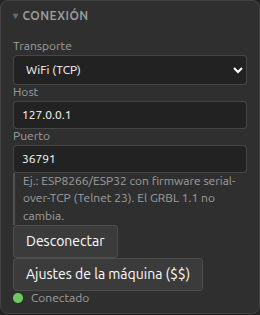

### 5.1 Conexión USB (serie)

1. Conecte el cable USB y encienda la máquina.
2. Abra la pestaña **Grabadora**.
3. En **Conexión → Transporte**, elija **Serial (USB)**.
4. Seleccione el **Puerto**:
   - `/dev/ttyUSB0` — adaptadores CH340/CH341/CP2102 (la mayoría de las máquinas).
   - `/dev/ttyACM0` — placas con USB nativo (Arduino, algunas Ortur/xTool).
   - `/dev/ttyS0` — puertos serie reales (poco común).
5. **Baud rate**: empiece con **115200** (predeterminado en GRBL 1.1). Si no
   conecta, pruebe **250000**, **57600**, **38400** o **9600** (opciones de la
   lista).
6. Elija el **Perfil de máquina** (vea 5.3).
7. Haga clic en **Conectar**.

✅ **Conexión correcta** cuando:

- El punto junto a **Conexión** se pone verde y el texto muestra **Conectado** (el
  indicador de la máquina muestra **Inactivo**).
- La consola muestra el banner del firmware (`Grbl 1.1…`).
- El panel **Máquina** rellena firmware, recorrido, límites, láser y offsets.
- No hay `error:` en la consola.

💡 El botón de actualizar puertos recarga la lista sin reiniciar la app. Si el
puerto no aparece, compruebe el cable y el permiso `dialout` (sección 2.4).

### 5.2 Conexión WiFi/TCP

Para ESP8266/ESP32 con firmware **serial-over-TCP** (Telnet):

1. En **Transporte**, elija **WiFi (TCP)**.
2. Rellene **Host** (ej.: `192.168.4.1`) y **Puerto** (predeterminado `23`; el
   emulador usado en las imágenes estaba en otro puerto).
3. Haga clic en **Conectar**.

> El GRBL 1.1 en sí **no** habla TCP; el adaptador WiFi hace de puente
> serie↔TCP. La latencia y la estabilidad de la red afectan al streaming.
> Prefiera el cable USB para trabajos largos y críticos.

### 5.3 Perfil de máquina

El perfil es un conjunto de datos de la máquina: recorrido (`$130`/`$131`),
velocidad máxima (`$110`/`$111`), tope de potencia (`$30`), modo láser (`$32`),
homing, límites y potencia de apuntado. Lo usan el pre-vuelo y la vista previa.

- Elija el modelo en el selector **Perfil de máquina**.
- **Importar .lbdev…** importa un perfil de dispositivo de LightBurn.
- Si la app reconoce el firmware, aparece una **sugerencia** (ej.: “Ortur Laser
  Master 3 — aplicar”). Aplíquela solo si es su máquina.
- Sin perfil específico, use **Genérica (GRBL)** y ajuste `$$` manualmente.

> ⚠️ Perfil equivocado = límites equivocados. El pre-vuelo puede bloquear
> trabajos válidos o dejar pasar un trabajo que choque contra el marco. Compruebe
> el recorrido real de su máquina.

### 5.4 Si no conecta

| Síntoma | Causa probable | Solución |
| :--- | :--- | :--- |
| Lista de puertos vacía | Sin permiso serie | Grupo `dialout` o regla udev (sección 2.4). |
| “Access denied” / “Permission denied” | Permiso | `sudo usermod -aG dialout "$USER"` + cerrar/abrir sesión. |
| Conecta, consola muda | Baudios incorrectos | Pruebe 115200 → 9600 → 250000. |
| `ALARM:9` al conectar | Homing no realizado | Haga clic en **Home** (`$H`) o desactive `$22` si no hay finales de carrera. |
| Firmware no identificado | GRBL antiguo/fork | Use “Genérica (GRBL)” y compruebe `$I` en la consola. |
| La conexión cae en medio del trabajo | Cable/hub/ruido | Cable corto, ferrita, USB 2.0 directo a la placa base. |

---

## 6. Abrir un G-code listo

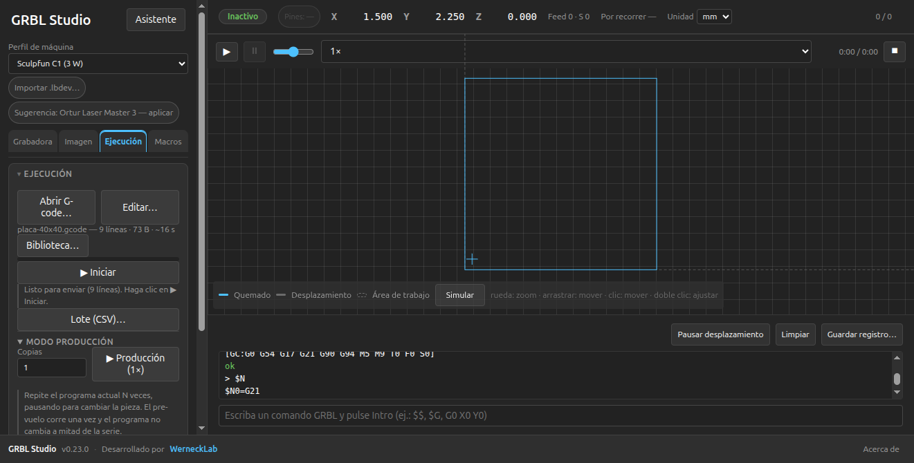

1. Abra la pestaña **Ejecución**.
2. Haga clic en **Abrir G-code…** (o use **Archivo → Abrir G-code…** en el menú).
3. Seleccione el archivo (`.gcode`, `.nc`, `.tap`, `.txt`).
4. La app muestra **nombre, líneas, tamaño y tiempo estimado**.
5. La vista previa dibuja el recorrido; el botón **Iniciar** queda habilitado.
6. Use **Editar…** para abrir el editor de G-code (sección 14) o **Biblioteca…**
   para reutilizar trabajos anteriores (sección 17).

**Lo que la app comprueba antes de grabar (pre-vuelo):**

- Líneas peligrosas o mal formadas.
- `M3`/`M4` sin `S` (láser sin potencia).
- Coordenadas fuera del recorrido de la máquina.
- Límites de velocidad.

> ⚠️ El G-code se envía **exactamente como está**, preservando la precisión del
> archivo. La app no redondea valores.

💡 El tiempo estimado suma `distancia / feed` y considera `G0` a 3000 mm/min.
Úselo como referencia, no como cronómetro.

---

## 7. Importar una imagen

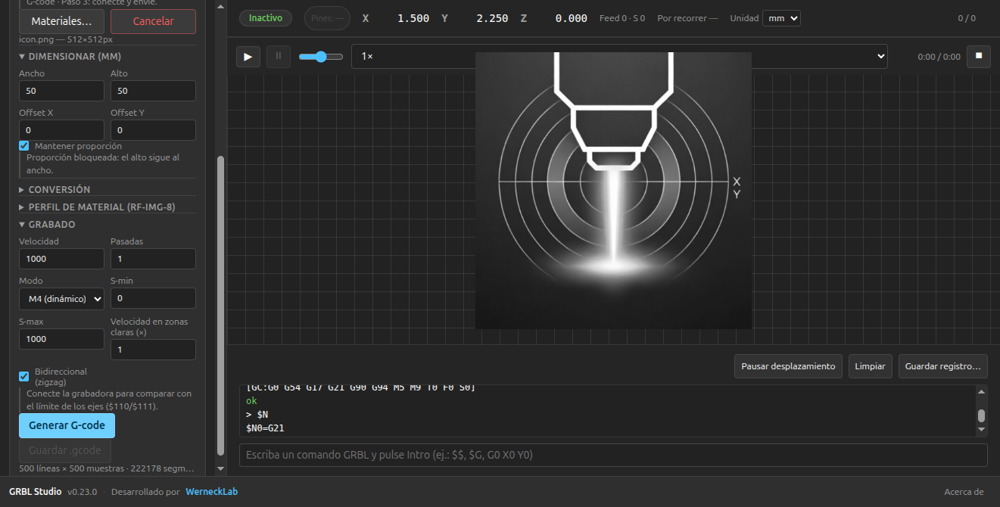

La pestaña **Imagen** convierte PNG/JPG/BMP/GIF/WebP/AVIF en G-code ráster o
vectorial.

### 7.1 Paso a paso

1. Abra la pestaña **Imagen**.
2. Haga clic en **Elegir imagen…**.
3. Ajuste **Dimensionar (mm)**:
   - **Ancho** y **Alto** — tamaño final del arte.
   - **Offset X/Y** — desplazamiento respecto al origen.
   - **Mantener proporción** — bloquea la relación ancho/alto.
4. Abra **Conversión** y elija el **Algoritmo**:
   - **Line-to-line** — tonos de gris con PWM/M4; ideal para fotos.
   - **Dithering** (Floyd–Steinberg) — 1 bit; ideal para logos y texto.
   - **Línea única (centerline)** — esqueleto/línea única; ideal para letras y logos gruesos.
   - **Vectorizar (contorno / recorte)** — contorno por umbral; ideal para corte/line-art.
5. Ajuste **Brillo**, **Contraste**, **Umbral B/N** e **Invertir blanco y negro**
   según el material (en material oscuro, la inversión ayuda).
6. En **Perfil de material**, elija un material y una acción (grabado/corte).
   El botón **Materiales…** abre el catálogo (sección 19).
7. En **Grabado**, compruebe:
   - **Velocidad** (mm/min) y **Pasadas**.
   - **Modo** `M3` (potencia constante) o `M4` (dinámico por velocidad).
   - **S-max** (potencia máxima) y **Velocidad en zonas claras (×)**.
   - **Bidireccional** (zigzag).
8. Haga clic en **Generar G-code**.
9. Compruebe la vista previa y haga clic en **Iniciar** (o **Guardar .gcode**).

💡 **Consejo de oro:** haga la **prueba de material** (sección 20) en su material
real. Cada lote de MDF/acrílico responde de forma distinta.

⚠️ Las imágenes con fondo blanco generan muchos movimientos en las zonas claras.
Use el **Umbral B/N** o **Vectorizar (contorno / recorte)** para reducir el tiempo
y la suciedad.

---

## 8. Previsualizar y posicionar

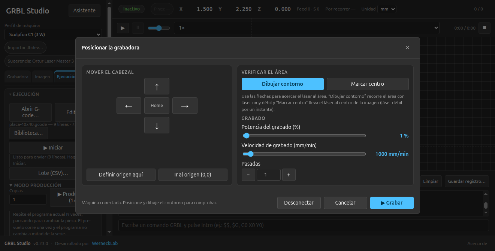

### 8.1 Vista previa

- **Zoom** con la rueda; **arrastrar** para mover; **doble clic** para encuadrar.
- La leyenda muestra **Quemado**, **Desplazamiento**, **Área de trabajo** y
  **Simular**.
- Durante el trabajo, una cruz sigue la posición real (WPos).

### 8.2 Posicionar la grabadora

El diálogo **Posicionar la grabadora** se abre después de generar una
imagen/dibujo o desde el botón **Posicionar** del asistente. Tiene dos columnas:

**Mover el cabezal**

- Flechas **X−/X+/Y−/Y+** — jog incremental.
- **Home** — homing (`$H`), si la máquina tiene finales de carrera.
- **Definir origen aquí** — envía `G92 X0 Y0 Z0` en la posición actual.
- **Ir al origen (0,0)** — `G90 G0 X0 Y0`.

**Verificar el área**

- **Dibujar contorno** — recorre el bounding box del arte con láser **muy
  débil** (potencia mínima). ⚠️ El láser **está encendido**; use gafas.
- **Marcar centro** — mueve el cabezal al centro geométrico del arte y da un pulso
  de láser **muy débil** para marcar el punto (`M3`/`M5`).
- **Potencia del grabado (%)**, **Velocidad (mm/min)** y **Pasadas** — ajustan el
  trabajo que se enviará.
- **Grabar** — cierra el diálogo e inicia el trabajo.
- **Cancelar** — cierra el diálogo sin grabar.

⚠️ **Siempre** dibuje el contorno antes de grabar en un material nuevo. Es la
forma más barata de descubrir que el arte está fuera de la pieza.

💡 Para piezas pequeñas, defina el origen en la esquina inferior izquierda del
arte y posicione el láser en esa esquina. El G-code del editor ya sale anclado en
`X0 Y0`.

---

## 9. Grabar y controlar el trabajo

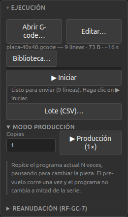

### 9.1 Iniciar

1. Cargue el G-code (pestaña **Ejecución**) o genérelo a partir de una
   imagen/dibujo.
2. Compruebe la vista previa y el origen.
3. Haga clic en **▶ Iniciar**.
4. El **pre-vuelo** se ejecuta automáticamente (sección 15). Si hay un bloqueo,
   explica el motivo e impide el inicio.
5. Si pasa, el trabajo comienza; el indicador cambia a **Ejecutando**.

### 9.2 Barra flotante (siempre visible)

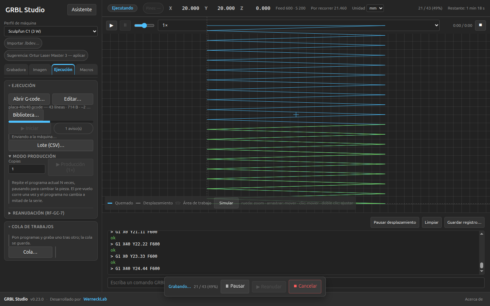

Durante el trabajo, una barra flotante queda superpuesta a todo:

| Botón | Comando | Función |
| :--- | :--- | :--- |
| **⏸ Pausar** | `!` (Feed Hold) | Detiene el movimiento y mantiene la posición. |
| **▶ Reanudar** | `~` (Cycle Start) | Continúa desde donde se detuvo. |
| **⏹ Cancelar** | `Ctrl-X` (0x18) | Aborta el trabajo y reinicia el GRBL; el láser se apaga. |

⚠️ **`Ctrl+X` es la parada de emergencia garantizada**: funciona incluso con el
foco en la consola o en un campo. No existe un botón separado de “Emergencia” — el
**Cancelar** de la barra y el atajo `Ctrl+X` realizan el aborto. `Esc` también
detiene el trabajo cuando no hay ningún diálogo abierto.

### 9.3 Progreso

- **Línea actual / total** (ej.: `1.247 / 15.832`).
- **ETA** — estimación de finalización.
- **DTG** — distancia restante en el plano.
- **DRO** — posición X/Y/Z con 0,001 mm.
- **Feed / S** — valores reales leídos del estado `?`.
- **Overrides activos** — feed y potencia en %.

### 9.4 Al terminar

- La consola muestra **Trabajo terminado** y el indicador vuelve a **Inactivo**.
- El láser se apaga (`M5`).
- El trabajo entra en la **Biblioteca de jobs** (sección 17).
- El cabezal permanece donde terminó; use **Ir a cero** para volver al origen.
  En la cola, la app vuelve al cero entre los elementos.

💡 Si algo va mal, **pare primero** y solo después investigue. No intente
“salvar” el trabajo tocando la consola con el láser encendido.

---

## 10. Overrides en tiempo real

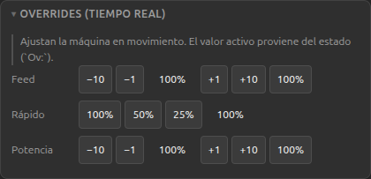

Los overrides ajustan la máquina **en movimiento**, sin detener el trabajo. El
valor activo proviene del estado (`Ov:`).

| Control | Efecto | Paso |
| :--- | :--- | :--- |
| **Feed −10 / −1 / +1 / +10** | Avance | Grueso/fino |
| **Feed 100%** | Vuelve al feed programado | Reset |
| **Rápido 100% / 50% / 25%** | Velocidad de los `G0` | 3 niveles |
| **Potencia −10 / −1 / +1 / +10** | Potencia del láser (spindle) | Grueso/fino |
| **Potencia 100%** | Vuelve a la potencia programada | Reset |

**Cuándo usarlos:**

- Madera sensible que empieza a chamuscarse → reduzca **Feed** un 10–20%.
- El corte no atravesó → reduzca **Feed** y/o aumente **Potencia** poco a poco.
- Material fino → reduzca **Potencia** y mantenga el feed.
- Movimientos rápidos que asustan → **Rápido 50%**.

💡 La **dosis** (J/mm) es `W × potencia(%) / 100 × 60 / feed`. Si reduce el feed
a la mitad, la dosis se duplica. Ajuste ambos a la vez para mantener el resultado.

⚠️ Los overrides **no** cambian el G-code en disco. El siguiente trabajo vuelve a
los valores programados.

---

## 11. Consola, DRO y estado

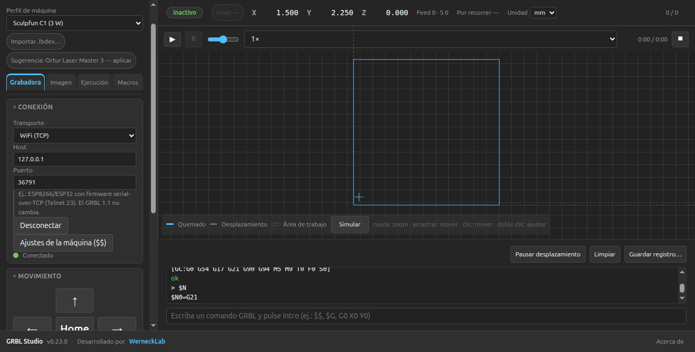

### 11.1 DRO y estado

- **X/Y/Z** — posición de trabajo, 0,001 mm, con `tabular-nums` (no “salta”).
- **Feed** y **S** — valores reales del estado.
- **Por recorrer** — distancia hasta el final del segmento.
- **Unidad** — mm/in; afecta solo a la visualización.

### 11.2 Movimiento manual (jog)

En la tarjeta **Movimiento**:

- Flechas **X/Y** y **Z−/Z+** — jog.
- **Paso** — 5 mm (u otro valor en el selector).
- **Feed** — 1000 mm/min (ajuste según el material).
- **Home** — `$H`.
- **Origen aquí** — `G92 X0 Y0 Z0`.
- **Ir a cero** — `G90 G0 X0 Y0`.
- **Unlock ($X)** — limpia la alarma.
- **Reset** — reinicio suave (0x18).

💡 Con la máquina conectada y sin diálogo abierto, las **flechas del teclado**
hacen jog X/Y y **PageUp/PageDown** hacen jog Z. La tecla **Home** lanza el homing
(si `$22=1`).

⚠️ Hacer jog con el láser encendido es peligroso. La app **no** enciende el láser
en el jog, pero este puede haber quedado encendido por un comando/macro anterior;
compruebe el indicador y la consola y envíe `M5` si es necesario.

### 11.3 Consola

Comandos útiles:

| Comando | Qué hace |
| :--- | :--- |
| `$G` | Muestra el estado modal (unidades, distancia, plano, feed, S). |
| `$$` | Lista todos los ajustes. |
| `$#` | Muestra offsets (G54…G59, G28/G30, G92, TLO, PRB). |
| `$I` | Versión/build/opciones del firmware. |
| `$N` | Bloques de inicio. |
| `$X` | Desbloquea la alarma (use con cuidado). |
| `$H` | Homing. |
| `G92 X0 Y0` | Define el origen de trabajo aquí. |
| `G90 G0 X0 Y0` | Va al origen de trabajo. |
| `M5` | Apaga el láser. |

⚠️ No envíe comandos en tiempo real (`!`, `~`, `?`) por el campo de texto con
`Enter`: son de **byte único** y no llevan `\n`. La app consulta el estado
automáticamente y los botones envían los bytes correctos. La consola sirve para
comandos de línea (`$G`, `$$`, `$#`, `$I`, `G92 …`).

---

## 12. Macros

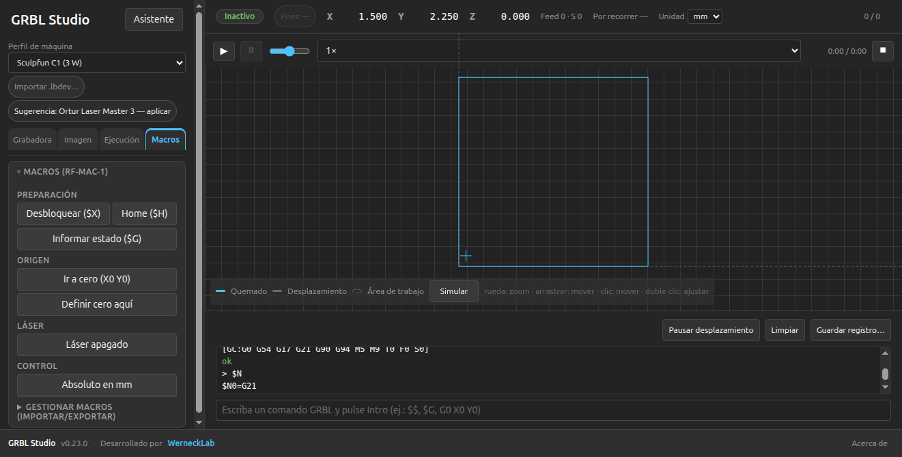

Las macros son botones que envían uno o más comandos G-code. La app incluye un
conjunto seguro de forma predeterminada:

| Grupo | Macro | Comando |
| :--- | :--- | :--- |
| Preparación | Desbloquear ($X) | `$X` |
| Preparación | Home ($H) | `$H` |
| Preparación | Informar estado ($G) | `$G` |
| Origen | Ir a cero (X0 Y0) | `G90 G0 X0 Y0` |
| Origen | Definir cero aquí | `G92 X0 Y0 Z0` |
| Láser | Láser apagado | `M5` |
| Control | Absoluto en mm | `G21 G90` |

**Usar:** abra la pestaña **Macros** y haga clic en el botón. Los comandos se
encolan uno a uno, respetando la ventana de envío.

**Gestionar:** abra **Gestionar macros (importar/exportar)** para:

- **Añadir** una macro (nombre, G-code, grupo).
- **Restaurar predeterminados**.
- **Importar…** / **Exportar…** un archivo JSON.

💡 Cree macros para tareas repetitivas: posicionar en una esquina, encender/apagar
el aire de asistencia (si el firmware lo controla), ir a un punto de cambio de
pieza.

⚠️ Las macros no pasan por el pre-vuelo. Evite comandos que muevan fuera de los
límites o enciendan el láser sin `S` definido.

---

# Parte II — Intermedio

## 13. Perfil y ajustes de la máquina

### 13.1 Panel Máquina

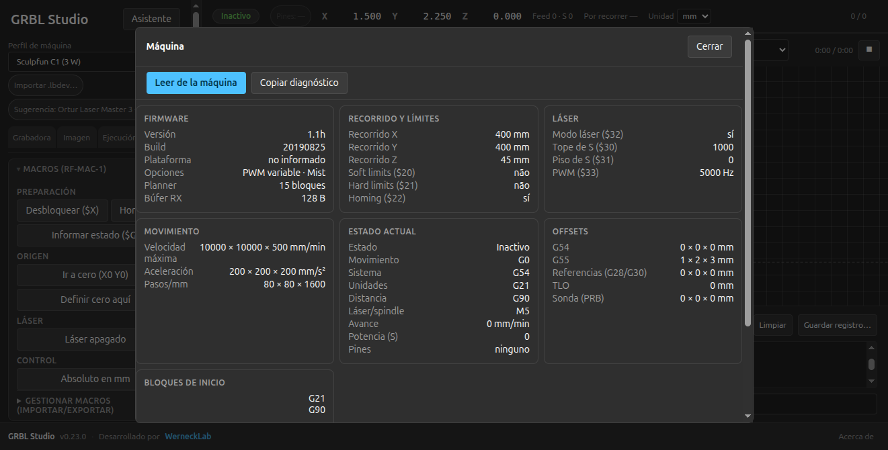

Ábralo desde el menú **Herramientas → Máquina y diagnóstico** o con el botón
**Ajustes de la máquina ($$)**. El panel muestra:

- **Firmware** — versión, build, plataforma, opciones, planner, búfer RX.
- **Recorrido y límites** — recorrido X/Y/Z, soft/hard limits, homing.
- **Láser** — modo (`$32`), tope de S (`$30`), piso (`$31`), PWM (`$33`).
- **Movimiento** — velocidad máxima, aceleración, pasos/mm.
- **Estado actual** — estado, movimiento, sistema, unidades, distancia, láser,
  feed, potencia, pines.
- **Offsets** — G54, G55, referencias, TLO, sonda.
- **Bloques de inicio** — comandos que se ejecutan en cada reinicio.
- **Diagnóstico** — lectura en bruto/exportable.

**Leer de la máquina** actualiza los datos; **Copiar diagnóstico** copia un
informe al portapapeles (útil para soporte).

### 13.2 Ajustes `$$`

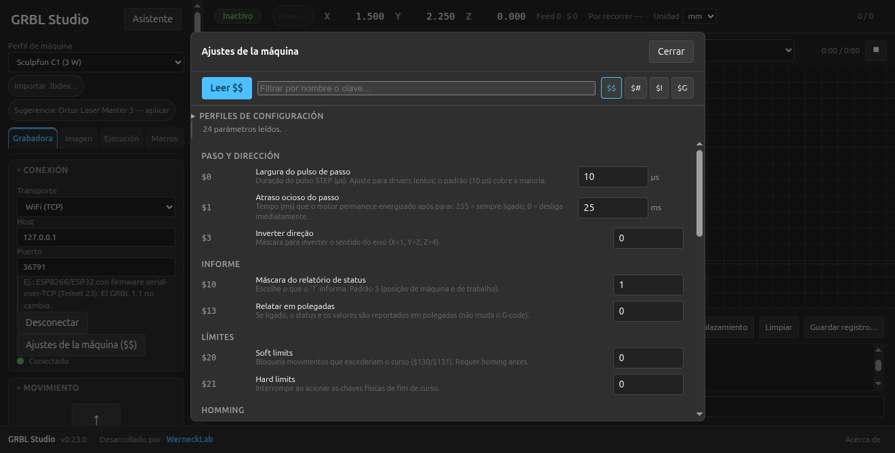

El editor lista los parámetros con **nombre, descripción y unidad**. Puede:

- **Leer $$** — recarga desde la máquina.
- **Filtrar** por nombre/clave.
- Alternar entre **$$**, **$#**, **$I** y **$G**.
- Editar un valor y aplicarlo (la app envía `$n=valor`).
- Guardar/cargar **perfiles de configuración** (para volver a un estado conocido).

**Parámetros que encontrará:**

| Clave | Significado | Valor típico |
| :--- | :--- | :--- |
| `$0` | Ancho del pulso de paso (µs) | 10 |
| `$1` | Retardo ocioso del paso (ms) | 25 |
| `$3` | Inversión de dirección (máscara) | 0 |
| `$10` | Máscara del informe de estado | 1 |
| `$13` | Informar en pulgadas | 0 |
| `$20` | Soft limits | 0 |
| `$21` | Hard limits | 0 |
| `$22` | Homing | 1 |
| `$30` | RPM/potencia máxima (S-max) | 1000 |
| `$31` | RPM/potencia mínima | 0 |
| `$32` | Modo láser (1 = M4 dinámico) | 1 |
| `$100`/`$101`/`$102` | Pasos/mm X/Y/Z | 80/80/1600 |
| `$110`/`$111`/`$112` | Velocidad máxima X/Y/Z | 10000/10000/500 |
| `$120`/`$121`/`$122` | Aceleración X/Y/Z | 200/200/200 |
| `$130`/`$131`/`$132` | Recorrido X/Y/Z (mm) | 400/400/45 |

⚠️ **No cambie `$100`–`$102` sin saber lo que hace**: eso altera la escala de
movimiento y puede hacer que la máquina choque contra el marco. Anote los valores
originales antes de cualquier cambio.

💡 Use **perfiles de configuración** para guardar el estado “bueno” antes de
probar.

---

## 14. Editor de G-code

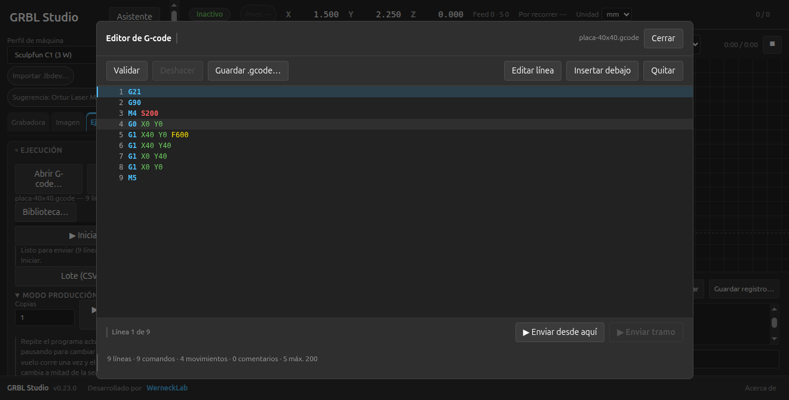

Ábralo con el botón **Editar…** de la pestaña Ejecución o con el menú **Archivo →
Editar G-code…**.

**Funciones:**

- **Validar** — comprueba líneas peligrosas, `M3`/`M4` sin `S`, límites y sintaxis.
- **Deshacer** — deshace la última edición.
- **Guardar .gcode…** — guarda el archivo editado.
- **Editar línea** — edita la línea seleccionada.
- **Insertar debajo** / **Quitar** — manipula líneas.
- **Enviar desde aquí** — empieza el envío desde la línea actual.
- **Enviar tramo** — envía solo el tramo seleccionado.
- Pie: líneas, comandos, movimientos, comentarios y S máx.

**Cuándo usarlo:**

- Corregir una `F` que falta o una `S` incorrecta.
- Eliminar una línea que el pre-vuelo bloqueó.
- Probar un tramo concreto sin ejecutar el archivo completo.

⚠️ El editor es para **ajustes pequeños**. Para cambios grandes, edite en su CAD
y vuelva a importar. La app preserva la precisión de los valores; no redondee
coordenadas.

---

## 15. Pre-vuelo

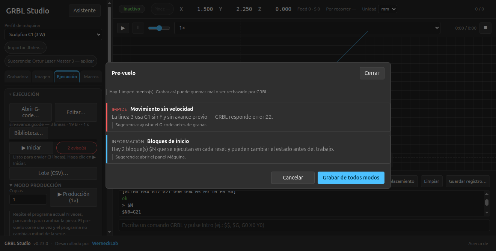

El pre-vuelo se ejecuta automáticamente al hacer clic en **Iniciar**. Clasifica
los hallazgos:

| Nivel | Efecto | Ejemplos reales |
| :--- | :--- | :--- |
| **IMPIDE** (block) | No inicia | `G1` sin `F`; trabajo mayor que el recorrido; láser encendido con `$32=0`; pin de seguridad activo. |
| **AVISO** (warn) | Permite con confirmación | `S` por encima de `$30`; `M3`/`M4` sin `S`; soft limits sin homing; `$30` distinto del perfil; `G28`/`G30` sin home. |
| **INFORMACIÓN** (info) | Solo avisa | Bloques de inicio `$N`; `G20` con informe en mm; firmware sin `OPT` de búfer. |

**Cómo actuar:**

- Lea el motivo y la sugerencia.
- Corrija el G-code (editor) o los parámetros.
- Si es solo un aviso consciente, use **Grabar de todos modos**.
- Si es un bloqueo, **Cancelar** y corrija.

💡 El pre-vuelo es su primera línea de defensa contra la quema de material y los
errores `error:22` (feed ausente). No lo ignore.

---

## 16. Cola de trabajos

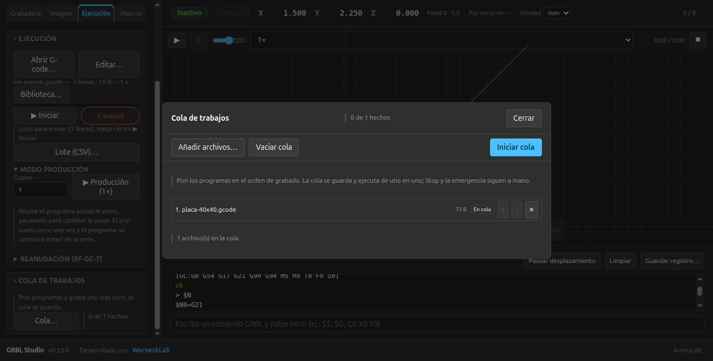

La cola ejecuta varios archivos en secuencia, sin que usted tenga que abrir uno
por uno.

1. Abra **Ejecución → Cola…** (o el botón **Cola** de la tarjeta).
2. **Añadir archivos…** — elija uno o más G-code.
3. **Reordenar** — use las flechas **↑/↓** de cada elemento (se deshabilitan
   durante la ejecución).
4. **Quitar** — la “×” del elemento.
5. **Iniciar cola** — empieza por el primero.

**Comportamiento:**

- La cola se guarda en `queue.json` y sobrevive a los reinicios.
- El pre-vuelo se ejecuta en el primer elemento.
- En caso de error/alarma/“Parar cola”, la agenda se pausa y devuelve el elemento
  actual a la cola.
- **Pausar** y **Cancelar** siguen en la barra flotante.

💡 Use la cola para una secuencia de piezas **diferentes**. Para repetir el
**mismo** programa, use el **Modo producción** (sección 23).

---

## 17. Biblioteca de jobs

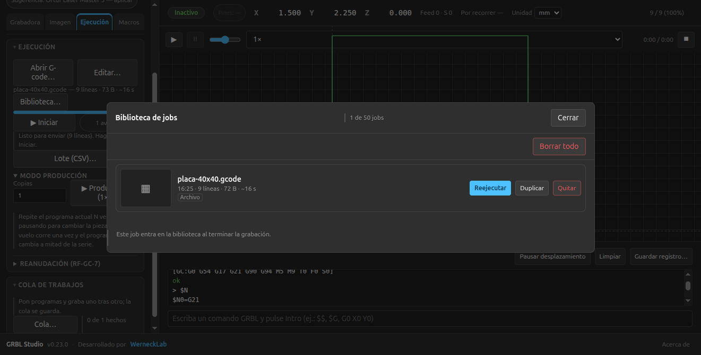

Los últimos **50 programas ejecutados** quedan en la biblioteca, con miniatura.

**Abrir:** **Ejecución → Biblioteca…** o menú **Archivo → Biblioteca de jobs…**.

Cada elemento muestra:

- Nombre del archivo, fecha/hora, tiempo, tamaño y número de líneas.
- Miniatura del recorrido.
- Origen: archivo, imagen, dibujo o biblioteca.

**Acciones:**

- **Reejecutar** — carga el G-code guardado y lo inicia de nuevo.
- **Duplicar** — carga una copia para editar/ajustar.
- **Quitar** — elimina el elemento.
- **Borrar todo** — borra la biblioteca (pide confirmación).

💡 La biblioteca guarda el **G-code ejecutado**, no el archivo original. Si usted
cambió la imagen/dibujo después, el job antiguo sigue con el G-code de aquel
momento.

---

## 18. Presets de material

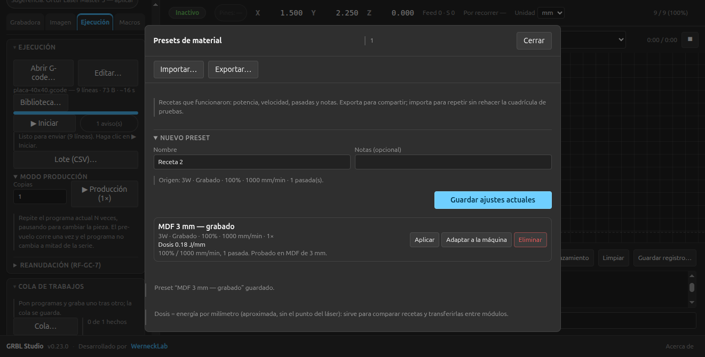

Un preset es una **receta** que funcionó: potencia, velocidad, pasadas, modo y
notas. Evita repetir pruebas cada vez.

**Crear:**

1. Ajuste potencia/velocidad/pasadas en el módulo (imagen, dibujo, etc.).
2. Abra **Presets** (menú **Herramientas → Presets de material…** o **Guardar
   como preset…**).
3. Indique un **Nombre** y **Notas** (opcional).
4. Haga clic en **Guardar ajustes actuales**.

**Usar:**

- **Aplicar** — lleva los valores al módulo actual.
- **Adaptar a la máquina** — convierte la receta al módulo de la máquina actual
  (3 W/5 W/10 W…), preservando la **dosis** (J/mm).
- **Eliminar** — quita el preset.
- **Importar… / Exportar…** — JSON para compartir.

**Dosis:** `watts × potencia(%) / 100 × 60 / velocidad(mm/min)`. Sirve para
comparar recetas y transferirlas entre láseres de potencias diferentes. Si el
módulo de destino no alcanza la dosis ni al 100%, la app avisa y usted debe
reducir la velocidad.

💡 Los presets son por **módulo** y **acción** (grabado/corte). Un preset de “MDF
3 mm — grabado” no debe aplicarse en “corte”.

---

## 19. Catálogo de materiales

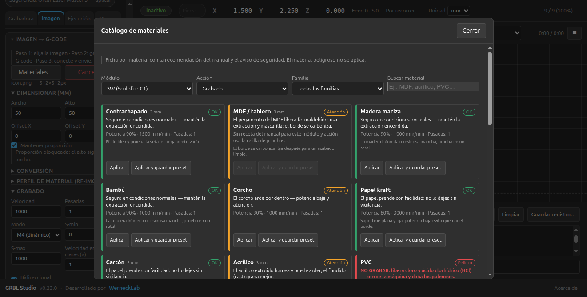

El catálogo incluye fichas de material con recomendación de potencia/velocidad,
pasadas, notas y **aviso de seguridad**.

**Filtros:** módulo (3 W/5 W/10 W…), acción (grabado/corte), familia (madera,
plástico, papel, etc.) y búsqueda por nombre.

**Cada ficha muestra:**

- **Indicador** `OK`, `Atención` o `Peligro`.
- Potencia (%), velocidad (mm/min), pasadas.
- Notas de seguridad y acabado.
- **Aplicar** / **Aplicar y guardar preset**.

**Materiales peligrosos** (PVC, policarbonato, ABS, vinilo) aparecen en rojo y
**no se aplican** — la app bloquea la receta.

⚠️ Las recomendaciones son un **punto de partida**. Pruebe con su material, su
máquina y su módulo. El catálogo no sustituye a la prueba de material.

---

## 20. Prueba de material

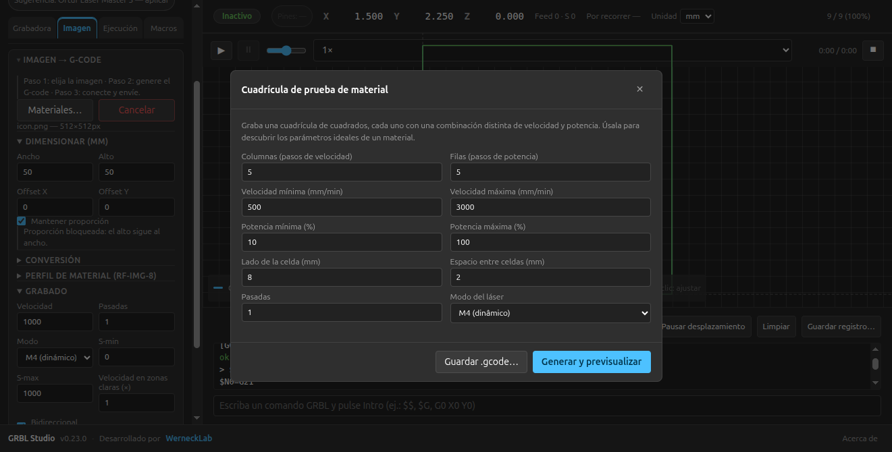

Graba una cuadrícula de cuadrados, cada uno con una combinación de **velocidad ×
potencia**, para que usted descubra los parámetros ideales.

**Campos:**

- **Columnas (pasos de velocidad)** y **Filas (pasos de potencia)**.
- **Velocidad mínima/máxima** y **Potencia mínima/máxima**.
- **Lado de la celda** y **Espacio entre celdas** (mm).
- **Pasadas** y **Modo del láser** (`M3`/`M4`).

**Flujo:**

1. Rellene los valores (empiece con un rango amplio).
2. **Generar y visualizar** — la app crea la cuadrícula y abre el posicionamiento.
3. Compruebe la vista previa y grabe en un retal.
4. Anote qué celda dio el mejor resultado.
5. Guarde la receta como **preset** (sección 18).

💡 Haga una cuadrícula por material y por espesor. Anote la fecha en el nombre del
preset.

---

## 21. Prueba de foco

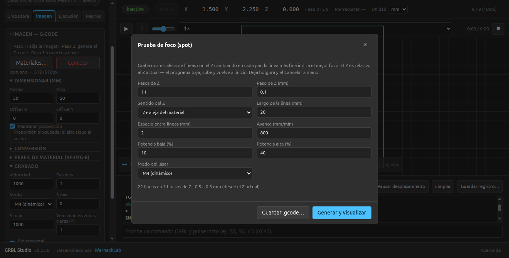

Graba una escalera de líneas con el **Z variando en cada par**. La línea más fina
indica la mejor altura de foco.

**Campos:**

- **Pasos de Z** y **Paso de Z (mm)**.
- **Sentido del Z** (`Z+` aleja o acerca, según la máquina).
- **Largo de la línea** y **Espacio entre líneas**.
- **Avance**, **Potencia baja (%)** y **Potencia alta (%)**.
- **Modo del láser**.

**Flujo:**

1. Posicione el láser sobre un retal, con margen para bajar/subir.
2. Genere y visualice.
3. Grabe; la línea más fina/marcada es el mejor foco.
4. Ajuste el Z y repita si es necesario.

⚠️ El programa **baja, sube y vuelve** al Z inicial. Deje margen y mantenga el
**Cancelar** a mano. Use potencias diferentes para comparar marcado y corte.

---

## 22. Lote con datos variables

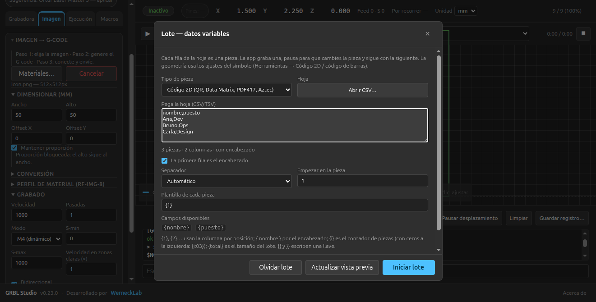

El lote convierte una hoja de cálculo en una **cola de piezas**, una por fila. Es
ideal para códigos QR/códigos de barras con datos variables (nombres, URLs,
números de serie).

### 22.1 Preparar la hoja

CSV o TSV, con o sin encabezado:

```csv
nombre,cargo
Ana,Dev
Bruno,Ops
Carla,Design
```

- **Separador**: automático, coma, punto y coma, tabulación o `|`.
- **La primera fila es el encabezado** — márquelo si es el caso.
- **Empezar en la pieza** — útil para retomar un lote interrumpido.

### 22.2 Plantilla de cada pieza

Use tokens en el campo **Plantilla de cada pieza**:

| Token | Significado |
| :--- | :--- |
| `{1}`, `{2}`… | Columna por posición. |
| `{nombre}` | Columna por el encabezado. |
| `{i}` | Contador de piezas. |
| `{i:03}` | Contador con ceros a la izquierda (`001`, `002`…). |
| `{total}` | Total de piezas. |
| `{{` / `}}` | Llave literal. |

Ejemplo: `https://ejemplo.com/{1}` o `Pieza {i:03} — {nombre}`.

### 22.3 Grabar el lote

1. Elija el **Tipo de pieza** (2D o 1D). La geometría usa los ajustes del símbolo
   (Herramientas → Código 2D / Código de barras).
2. Pegue o abra la hoja.
3. Compruebe la **vista previa** (pieza + contenido).
4. Haga clic en **Iniciar lote**.
5. La app graba una pieza, **pausa para que usted cambie la pieza** y luego
   muestra **▶ Siguiente pieza**. Use **Terminar lote** para parar.

⚠️ El lote **no** mueve el origen por sí solo. Cada pieza debe estar en la misma
posición (use una plantilla, sección 29). Compruebe la primera antes de lanzar la
serie.

💡 Para el **mismo** programa repetido N veces, use el **Modo producción** (sección
23), que es más sencillo.

---

## 23. Modo producción

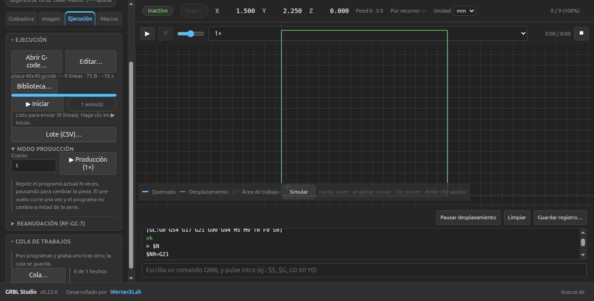

El modo producción repite el **programa actual** N veces, pausando entre las
piezas.

1. Cargue el G-code.
2. En **Modo producción**, defina **Copias** (1–999).
3. Haga clic en **▶ Producción**.
4. El pre-vuelo se ejecuta **una vez**; el programa no cambia en medio de la serie.
5. Al final de cada pieza, la app pausa para el cambio; use **▶ Pieza siguiente**.
6. **Terminar** interrumpe la serie.

**Bloqueo de la UI:** durante la producción, cambiar el programa está bloqueado
para evitar repetir el archivo equivocado.

💡 Úselo junto con una **plantilla** para colocar cada pieza en el mismo lugar. La
precisión de la serie depende del montaje, no del software.

---

## 24. Reanudación y recuperación

Si un trabajo se interrumpe (pausa, alarma, caída de conexión), la app puede
reanudar desde el punto donde se detuvo.

1. Abra **Ejecución → Reanudación (RF-GC-7)**.
2. La app muestra la línea de reanudación y el estado.
3. Haga clic en **Reanudar**.
4. Antes de continuar, la app reafirma **plano, unidades, distancia, offsets y
   láser** (ej.: `G21 G90`, `G54`, `M4`) para que el GRBL no herede un estado
   erróneo.

**Cuándo reanudar:**

- Pausa (`!`) o caída de conexión sin desplazamiento de la pieza.
- Alarma que no movió el cabezal.

**Cuándo NO reanudar:**

- La pieza se movió, el cabezal chocó o el material se quemó.
- Usted no está seguro de la posición. En ese caso, **empiece de nuevo** desde
  cero tras reposicionar.

⚠️ Reanudar en medio de un corte puede superponer la línea y quemar. En caso de
duda, rehaga la pieza.

---

## 25. Importar SVG, DXF y PDF

El menú **Archivo** importa vectores al editor:

- **Importar SVG…** — trazados vectoriales.
- **Importar DXF…** — DXF ASCII (LINE, LWPOLYLINE, CIRCLE, ARC, SPLINE, bloques).
- **Importar PDF…** — primera página, trazados vectoriales.

La app convierte a G-code/contornos en el editor, donde usted puede escalar,
mover, combinar y definir capas. Los PDF digitalizados (imagen) **no** se
vectorizan con esta importación; use la pestaña Imagen.

💡 El SVG es la mejor opción para arte vectorial: conserve el archivo original e
impórtelo con una escala conocida.

---

# Parte III — Avanzado

## 26. Editor vectorial (Dibujar)

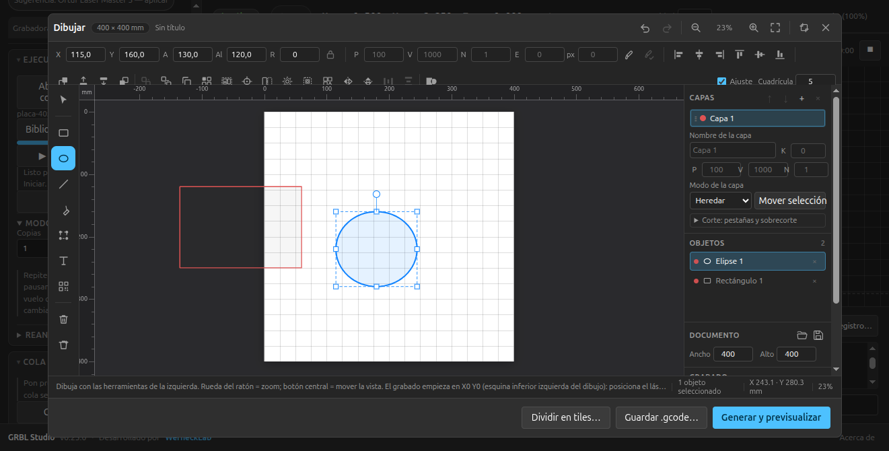

El editor **Dibujar** es una mesa de dibujo en **mm**, con reglas, cuadrícula y el
área de la máquina. El G-code sale **anclado al origen (X0 Y0)**, en la esquina
inferior izquierda.

### 26.1 Barra de herramientas

| Herramienta | Atajo | Uso |
| :--- | :--- | :--- |
| Seleccionar | `V` | Seleccionar, mover, redimensionar. |
| Rectángulo | `R` | Arrastrar para crear. |
| Elipse | `E` | Arrastrar para crear. |
| Línea | `L` | Arrastrar. |
| Pluma | `P` | Dibujo libre con simplificación. |
| Nodos | `N` | Editar los nodos de un trazado. |
| Texto | `T` | Texto vectorial. |
| Símbolo | `Q` | Biblioteca de formas. |

### 26.2 Propiedades

Para el objeto seleccionado: **X**, **Y**, **A** (ancho), **Al** (alto), **R**
(rotación), **P** (potencia), **V** (velocidad), **N** (pasadas), **E**
(grosor), además de **candado** (proporción) y **px** (unidad).

### 26.3 Acciones

- **Deshacer/Rehacer** (`Ctrl+Z` / `Ctrl+Y`).
- **Zoom** (`+`/`-`, `F` ajustar a la página, `0` 100%).
- **Espejar H/V**, **distribuir H/V**.
- **Agrupar/desagrupar** (`Ctrl+G`).
- **Alinear** (izquierda, centro, derecha, arriba, medio, abajo).
- **Orden Z** (traer al frente/enviar atrás).
- **Booleanas** (menú de intersección): unir, restar, intersección, exclusión.
- **Ajuste** y **Cuadrícula** (mm).

### 26.4 Documento y grabado

- **Documento** — ancho/alto de la página (mm), importar/exportar.
- **Grabado** — velocidad, potencia, pasadas y modo (`M4`/`M3`).
- **Guardar .gcode…** — guarda el G-code generado.
- **Generar y previsualizar** — abre **Tamaño de la obra** (sección 37), después
  el posicionamiento y la vista previa.

💡 El editor no es un CAD paramétrico. Para piezas de precisión, importe DXF/SVG
y ajuste la escala.

---

## 27. Capas y multioperación

Cada **capa** tiene potencia, velocidad, pasadas, modo y **kerf** propios. Esto
permite **grabar y cortar en la misma ejecución**.

- **Nueva capa** / **Eliminar capa**.
- **Nombre de la capa**, **P/V/N**, **Modo de la capa** (heredar o propio).
- **Corte: pestañas y sobrecorte** — las pestañas (tabs) sujetan la pieza; el
  sobrecorte (lead-in/out) mejora la entrada/salida.
- **Mover selección** — asigna los objetos seleccionados a la capa.
- **Orden** — el orden de las capas define la secuencia de grabado.

**Flujo típico:**

1. Capa 1 — **grabado** (potencia baja, velocidad alta).
2. Capa 2 — **corte** (potencia alta, velocidad baja, pasadas).
3. Seleccione los objetos y muévalos a la capa correcta.
4. Genere y compruebe los colores/el orden en la vista previa.

⚠️ El orden importa: cortar antes de grabar puede desplazar la pieza. Grabe
primero, corte al final.

---

## 28. Biblioteca de formas

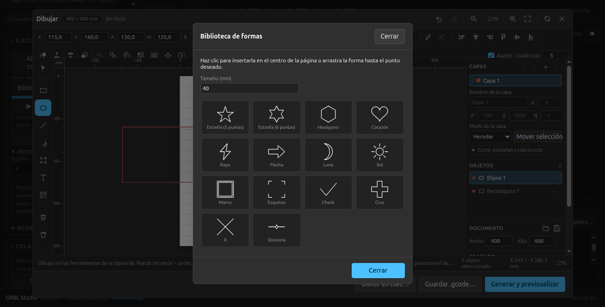

La biblioteca trae formas listas: estrellas (5/6 puntas), hexágono, corazón,
rayo, flecha, luna, sol, marco, esquinas, check, cruz, X y divisoria.

- **Tamaño (mm)** — define el tamaño de la forma.
- **Clic** — inserta en el centro de la página.
- **Arrastre** — inserta en el punto deseado.

💡 Úsela como base para plantillas, marcadores e iconos. Después edite
nodos/booleanas.

---

## 29. Plantilla (molde)

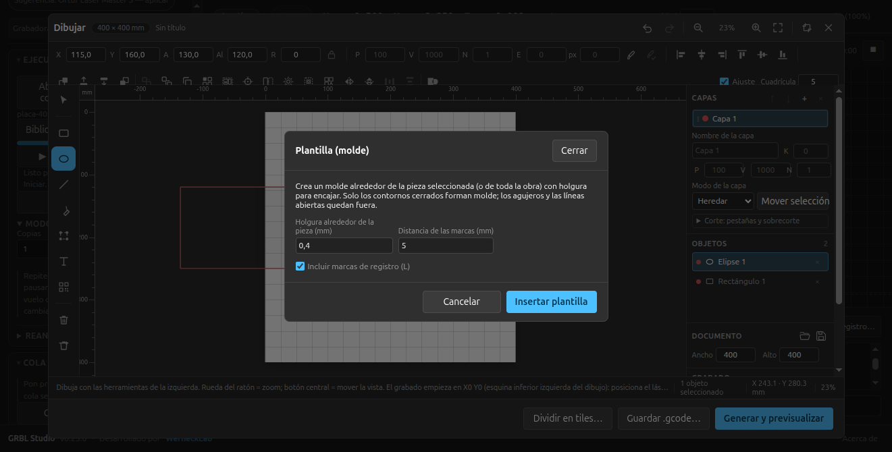

La plantilla crea un **molde** alrededor de la pieza, con holgura y marcas de
registro, para posicionar piezas repetidas.

**Campos:**

- **Holgura alrededor de la pieza (mm)** — espacio entre la pieza y el molde.
- **Distancia de las marcas (mm)** — separación de las marcas de registro.
- **Incluir marcas de registro (L)** — marcas en L para alinear.
- **Insertar plantilla** — añade al dibujo.

**Uso:**

1. Dibuje/importe la pieza.
2. Genere la plantilla con holgura suficiente para encajar la pieza.
3. Corte la plantilla en MDF/chapa.
4. Coloque la pieza en el molde y grabe cada unidad.

💡 La plantilla es la forma más fiable de repetir piezas sin reposicionar el
origen en cada una.

---

## 30. Generadores paramétricos

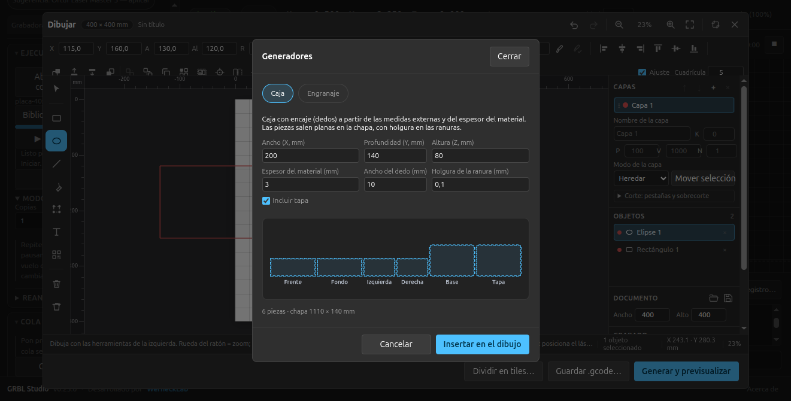

El generador crea formas paramétricas:

### 30.1 Caja con encaje (dedos)

- **Ancho (X)**, **Profundidad (Y)**, **Altura (Z)**.
- **Espesor del material**.
- **Ancho del dedo** y **Holgura de la ranura**.
- **Incluir tapa**.
- Vista previa con las 6 piezas y el tamaño de la chapa.

### 30.2 Engranaje

- Parámetros de módulo/dientes/espesor (según la interfaz).
- Vista previa e inserción en el dibujo.

**Uso:** ajuste las medidas, compruebe la vista previa y haga clic en
**Insertar en el dibujo**. Después defina las capas (grabado/corte) y genere.

⚠️ Compruebe el **espesor real** del material con un calibre. La holgura de la
ranura debe compensar el kerf de su láser.

---

## 31. Grabar por los dos lados

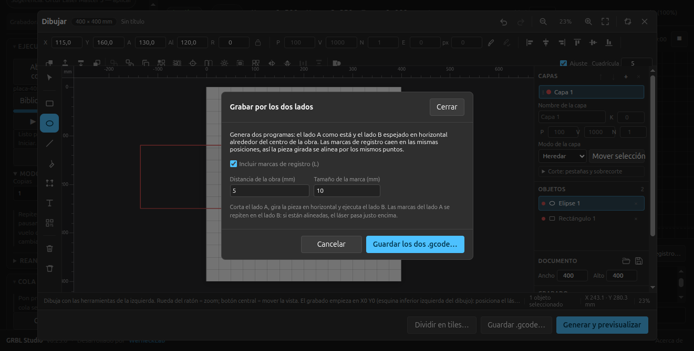

El asistente genera **dos G-code**: lado A y lado B **espejado**, con el mismo
origen y marcas de registro para alinear.

**Campos:**

- **Incluir marcas de registro (L)**.
- **Distancia de la obra (mm)** — separación de las marcas.
- **Tamaño de la marca (mm)**.
- **Guardar los dos .gcode…** — guarda los dos archivos.

**Flujo:**

1. Dibuje la obra.
2. Genere los dos lados con marcas.
3. Grabe el lado A.
4. Gire la pieza usando las marcas para alinear.
5. Grabe el lado B (espejado).

⚠️ La alineación depende de las marcas y de la plantilla. Haga una prueba en un
retal antes de girar la pieza final.

---

## 32. Marcas de registro

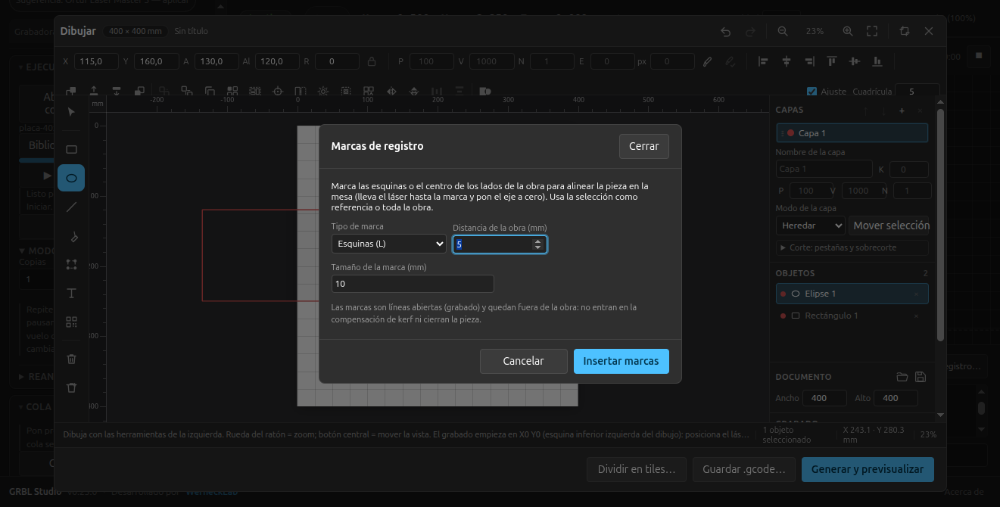

Inserta marcas de alineación alrededor de la obra:

- **Tipo de marca** — **Esquinas (L)** o **Cruces**.
- **Distancia de la obra (mm)**.
- **Tamaño de la marca (mm)**.
- **Insertar marcas**.

**Usos:** alinear el reverso, posicionar en una plantilla, comprobar el origen y
recuperar la posición tras una interrupción.

💡 Use **cruces** para la lectura con cámara/puntero y **esquinas L** para el
encaje físico.

---

## 33. Dividir en tiles

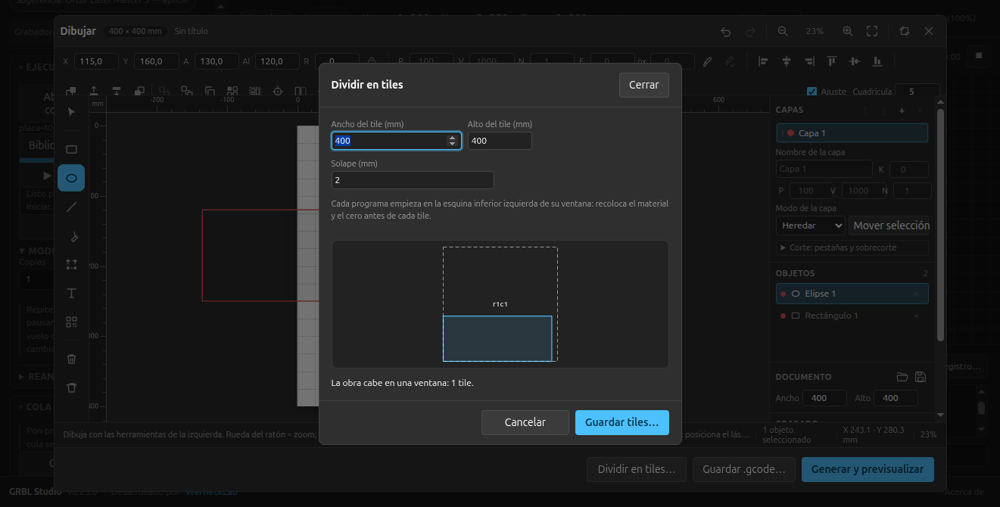

Para obras más grandes que el área de la máquina, la app divide en **tiles** con
solape.

**Campos:**

- **Ancho del tile (mm)** y **Alto del tile (mm)**.
- **Solape (mm)** — evita una unión visible.
- Vista previa con la obra y las ventanas.
- **Guardar tiles…** — genera un archivo por tile.

**Flujo:**

1. Defina el tamaño del tile (un poco menor que el recorrido útil).
2. Use un solape de 2–5 mm.
3. Guarde los tiles.
4. Grabe uno por uno, reposicionando el origen/las marcas.
5. Use las marcas de registro para alinear cada ventana.

⚠️ La unión depende de la precisión del reposicionamiento. Haga una prueba
pequeña antes de la obra grande.

---

## 34. Matriz de copias

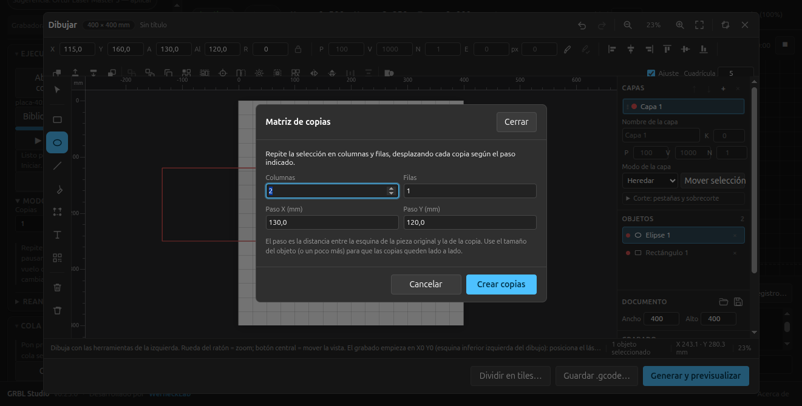

Crea varias copias del objeto seleccionado en una cuadrícula.

**Campos:**

- **Columnas** y **Filas**.
- **Paso X (mm)** y **Paso Y (mm)**.
- **Crear copias** (máx. 1000).

**Uso:** producción en serie en la misma chapa. Combine con el **encaje**
(sección 35) para aprovechar mejor el material.

💡 Deje un espacio entre las piezas para el kerf y para no calentar demasiado el
material.

---

## 35. Encaje en la chapa

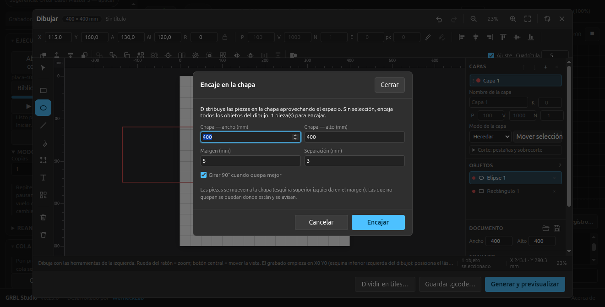

El encaje organiza las piezas en la chapa para aprovechar el material.

**Campos:**

- **Chapa — ancho/alto (mm)**.
- **Margen (mm)** y **Separación (mm)**.
- **Girar 90° cuando quepa mejor**.
- **Encajar** — distribuye las piezas.
- Resultado: piezas encajadas, aprovechamiento (%) y piezas que no cupieron.

**Uso:** seleccione las piezas, defina la chapa y encaje. Compruebe la vista
previa antes de generar.

⚠️ El encaje considera el contorno, no el kerf. Deje una separación suficiente.

---

## 36. Contorno paralelo

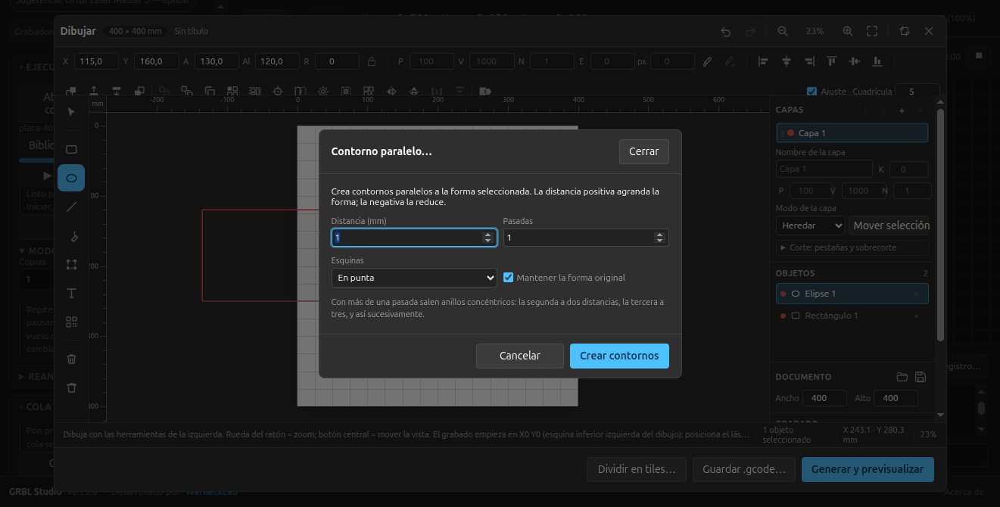

Crea contornos paralelos alrededor de una forma, para corte, refuerzo o kerf.

**Campos:**

- **Distancia (mm)** — positiva hacia fuera, negativa hacia dentro.
- **Pasadas** — contornos concéntricos.
- **Esquinas** — en punta (miter), redondeadas (round) o achaflanadas (bevel).
- **Mantener la forma original**.
- **Crear contornos**.

**Usos:**

- Compensar el **kerf** (ancho del corte) con un offset negativo.
- Crear un borde decorativo.
- Hacer un encaje con holgura.

💡 Para un corte ajustado, mida el kerf (ej.: 0,15 mm) y use un offset de
`-kerf/2` en la capa de corte.

---

## 37. Tamaño de la obra

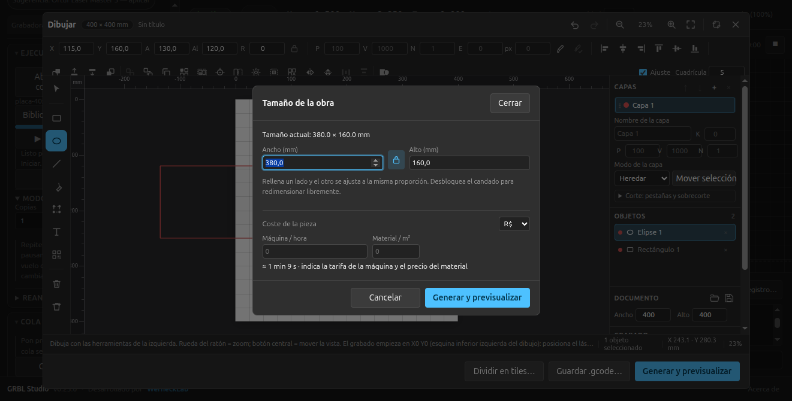

Antes de generar, la app pregunta el tamaño final de la obra:

- **Ancho (mm)** y **Alto (mm)**.
- **Candado** — mantiene la proporción.
- Muestra el **tamaño actual** y el coste/tiempo estimado.
- **Generar** — aplica y abre el posicionamiento.

**Uso:** defina el tamaño real que usted quiere en el material. El editor trabaja
en mm; el tamaño de la obra es la escala final.

💡 Si la obra está en pulgadas, conviértala a mm antes (1 in = 25,4 mm).

---

## 38. QR Code, Data Matrix, PDF417 y Aztec

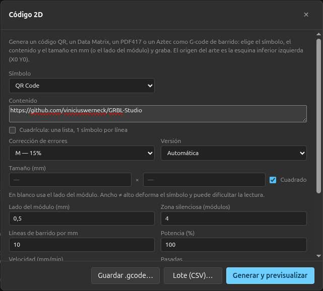

La app genera símbolos 2D como G-code de barrido.

### 38.1 Simbologías

- **QR Code** — corrección de errores L/M/Q/H, versión automática o fija.
- **Data Matrix ECC200** — ECC 0–8.
- **PDF417** — niveles de corrección.
- **Aztec** — niveles de corrección.

### 38.2 Campos

- **Contenido** — texto/URL.
- **Cuadrícula** — una lista, un símbolo por línea (genera una cuadrícula).
- **Corrección de errores** y **Versión**.
- **Tamaño (mm)** — ancho × alto; **Cuadrado** bloquea la proporción.
- **Lado del módulo (mm)** y **Zona silenciosa (módulos)**.
- **Líneas de barrido por mm**.
- **Potencia (%)**, **Velocidad (mm/min)**, **Pasadas**.
- **Modo del láser** (`M4`/`M3`), **Sobrebarrido (mm)**.
- **Polaridad invertida** (quemar el fondo).

### 38.3 Generar

1. Rellene el contenido.
2. Ajuste el tamaño/módulo (un módulo demasiado pequeño = ilegible).
3. **Generar y previsualizar** — la app carga el G-code y abre el
   posicionamiento.
4. Compruebe la lectura con el móvil **antes** de grabar.
5. Grabe o **Guardar .gcode…**.

⚠️ Un módulo pequeño, una potencia alta o un material oscuro pueden destruir el
contraste. Pruebe y valide la lectura.

💡 Para datos variables, use el **Lote** (sección 22) con la hoja.

---

## 39. Código de barras 1D

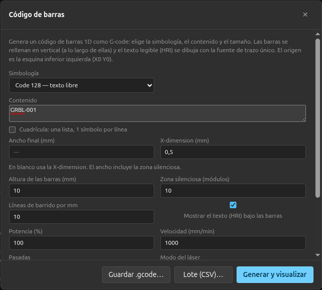

Simbologías admitidas: **Code 128/GS1-128, EAN-13, EAN-8, UPC-A, Code 39,
ITF-14, Codabar y Code 93**.

**Campos:**

- **Simbología** y **Contenido**.
- **Cuadrícula** — lista, un código por línea.
- **Ancho final (mm)** o **X-dimension (mm)**.
- **Altura de las barras (mm)**, **Zona silenciosa (módulos)**.
- **Líneas de barrido por mm**, **Mostrar el texto (HRI)**.
- **Potencia**, **Velocidad**, **Pasadas**, **Modo**, **Overscan**.
- **Polaridad invertida**.

**Generar:** rellene, ajuste la X-dimension (mínimo legible),
**Generar y visualizar**, valide con un lector y grabe.

⚠️ EAN/UPC tienen reglas de dígito verificador y tamaño. Use el contenido
correcto; la app valida y muestra un error si el código no es válido.

💡 Para etiquetas en serie, use el **Lote** con `{1}`/`{nombre}`.

---

## 40. Apariencia e idioma

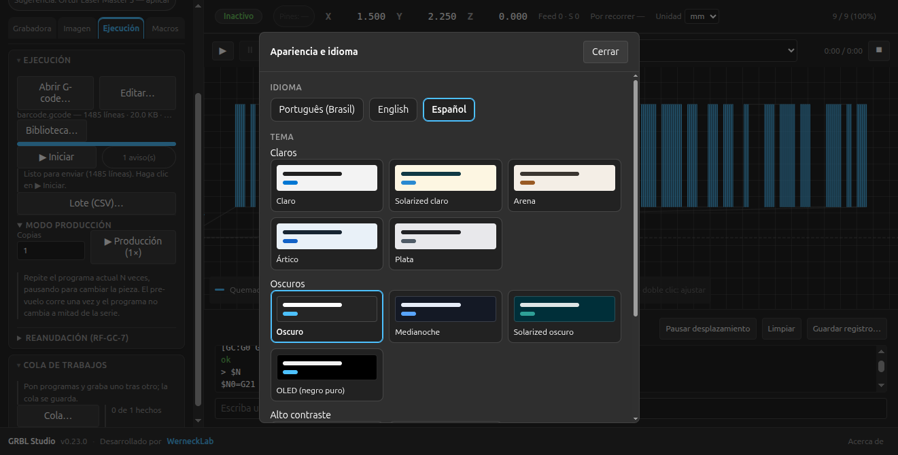

Abra en **Ver → Apariencia e idioma…**.

- **Idioma** — Português (Brasil), English, Español. El cambio es inmediato.
- **Tema** — 5 claros, 4 oscuros y 2 de alto contraste:
  - Claros: Claro, Solarized claro, Arena, Ártico, Plata.
  - Oscuros: Oscuro, Medianoche, Solarized oscuro, OLED (negro puro).
  - Alto contraste: Negro, Blanco.
- **Carpeta de archivos** — carpeta predeterminada de los diálogos de
  abrir/guardar.

💡 En ambientes con mucha luz, use un tema claro; en ambientes oscuros, OLED
ahorra batería y reduce el cansancio.

---

## 41. Acerca de

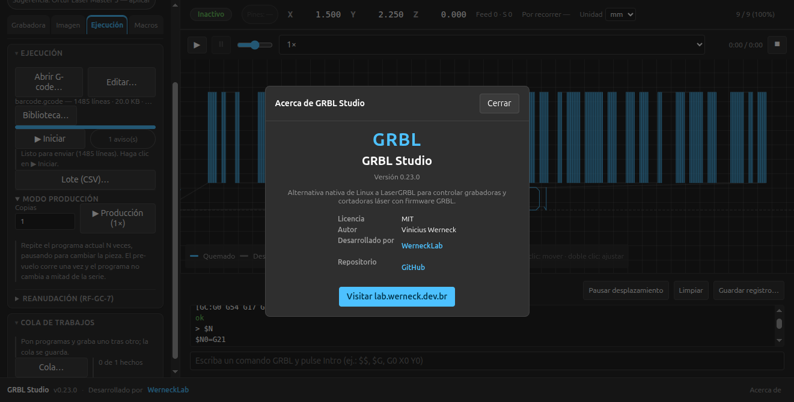

Muestra la versión, la licencia (MIT), el autor (Vinicius Werneck), el
desarrollador (WerneckLab), el repositorio en GitHub y el sitio. Use
**Visitar lab.werneck.dev.br** para conocer las novedades.

---

# Parte IV — Referencia

## 42. Comandos en tiempo real

Comandos de **byte único** — no llevan `\n`. Use los botones de la app; la
consola no es el lugar para escribirlos con Intro.

| Comando | Byte | Función |
| :--- | :--- | :--- |
| Status | `?` | Informe de estado/posición. |
| Feed Hold | `!` | Pausa el movimiento. |
| Cycle Start | `~` | Reanuda. |
| Soft Reset | `0x18` (Ctrl-X) | Aborta y reinicia. |
| Jog Cancel | `0x85` | Cancela el jog. |
| Feed 100% | `0x90` | Reinicio del feed. |
| Feed +10% / −10% | `0x91` / `0x92` | Override grueso. |
| Feed +1% / −1% | `0x93` / `0x94` | Override fino. |
| Rapid 100/50/25% | `0x95` / `0x96` / `0x97` | Desplazamiento rápido. |
| Spindle 100% | `0x99` | Reinicio de la potencia. |
| Spindle +10% / −10% | `0x9A` / `0x9B` | Potencia. |
| Spindle +1% / −1% | `0x9C` / `0x9D` | Potencia fina. |

## 43. Alarmas del GRBL

| Alarma | Significado | Acción recomendada |
| :--- | :--- | :--- |
| **1** | Hard limit activado | **Unlock ($X)** → jog lejos → **Home ($H)**. |
| **2** | Soft limit excedido | Compruebe la vista previa/el recorrido; ajuste el origen o reduzca la obra. |
| **3** | Reset durante la ejecución | Ruido EMI/cable/fuente; use cable blindado/ferrita, desactive la suspensión. |
| **4** | Fallo de sonda: estado inicial inesperado | Compruebe la sonda/el cableado; `$X` para desbloquear. |
| **5** | Fallo de sonda: no tocó la pieza dentro del recorrido | Compruebe el contacto/el recorrido programado; `$X`. |
| **6** | Homing: reset durante el ciclo | Repita `$H`; evite reiniciar en medio del homing. |
| **7** | Homing: puerta de seguridad abierta | Cierre la puerta/tapa y repita `$H`. |
| **8** | Homing: el fin de carrera no se liberó al retroceder | Aumente `$27` (pull-off) y revise el cableado. |
| **9** | Homing: fin de carrera no encontrado | Revise el interruptor/el cableado, `$24`/`$25` y la distancia de búsqueda. |

## 44. Solución de problemas

### 44.1 Conexión

| Síntoma | Solución |
| :--- | :--- |
| Lista de puertos vacía | Permiso `dialout`/udev; cable; actualizar puertos. |
| «Permission denied» | `sudo usermod -aG dialout "$USER"` + cerrar sesión. |
| Consola muda | Baud incorrecto (115200 → 9600 → 250000). |
| Se cae a mitad del job | Cable corto/ferrita/USB 2.0; evite hubs sin alimentación. |

### 44.2 Job

| Síntoma | Solución |
| :--- | :--- |
| Se detiene en una línea aleatoria | Búfer/ruido; use la app (ventana por bytes), un cable bueno. |
| `error:20` | Comando G-code no admitido/no válido — compruebe la línea en el editor. |
| `error:22` | Feed no definido — añada `F` al primer `G1`. |
| `ALARM:3` | EMI/fuente; cable blindado, ferrita, toma de tierra. |
| Job fuera del área | El pre-vuelo lo bloquea; ajuste el origen/el recorrido. |
| Quemó el material | Reduzca la potencia/aumente el feed; prueba de material. |

### 44.3 Imagen/dibujo

| Síntoma | Solución |
| :--- | :--- |
| Imagen invertida | Use **Invertir blanco y negro** o espeje en el editor. |
| Demasiado tiempo en las zonas claras | Use **Umbral B/N**/**Vectorizar (contorno/recorte)**; reduzca el área blanca. |
| Texto espejado | Use **Espejar H/V** solo en el objeto deseado; para que el texto sea legible, evite espejar. |
| El contorno no cierra | Revise los nodos/las booleanas; use **Validar**. |

### 44.4 Símbolos

| Síntoma | Solución |
| :--- | :--- |
| QR ilegible | Aumente el módulo, reduzca la potencia, mejore el contraste. |
| Código de barras no válido | Compruebe el dígito verificador/el formato; use el contenido correcto. |
| Símbolo cortado | Aumente la zona silenciosa/el tamaño; compruebe la vista previa. |

## 45. Atajos de teclado

**Globales (verificados):**

| Acción | Atajo |
| :--- | :--- |
| Parada de emergencia | `Ctrl+X` (siempre) |
| Detener el job (sin diálogo) | `Esc` |
| Cerrar diálogo | `Esc` |
| Jog X/Y | Flechas |
| Jog Z | `PageUp` / `PageDown` |
| Homing | `Home` (si `$22=1`) |

**Editor de dibujo:**

| Acción | Atajo |
| :--- | :--- |
| Seleccionar / Rectángulo / Elipse / Línea / Pluma / Nodos / Texto / Símbolo | `V` / `R` / `E` / `L` / `P` / `N` / `T` / `Q` |
| Deshacer / Rehacer | `Ctrl+Z` / `Ctrl+Y` |
| Agrupar | `Ctrl+G` |
| Ajustar a la página | `F` |
| Zoom 100% | `0` |
| Zoom + / − | `+` / `-` |
| Ajuste (snap) | `J` |
| Mover la selección (flechas) | Flechas (con paso) |
| Eliminar | `Delete` |

> Los atajos de menú (como `Ctrl+O`) dependen del entorno/escritorio. Use el menú
> nativo como ruta garantizada.

## 46. Archivos y carpetas

```text
~/.config/grbl-studio/        # userData de Electron (nombre según el paquete)
├── prefs.json                # preferencias, macros, presets y perfiles $$
├── queue.json                # cola de trabajos
├── joblib/
│   ├── index.json            # metadatos + miniaturas de los últimos 50 jobs
│   └── <id>.gz               # G-code comprimido de cada job
└── logs/
    └── session-<fecha>.log   # registro de la sesión (consola/eventos)
```

**Copia de seguridad:** copie la carpeta entera. Para restaurar, cierre la app y
sustitúyala.

**Registros:** menú **Ayuda → Abrir carpeta de registros** (o
**Guardar registro…** en la consola).

## 47. Lista de comprobación antes de grabar

- [ ] Gafas de protección y extintor a mano.
- [ ] Material permitido (sin PVC/PC/ABS) y bien sujeto.
- [ ] Foco y altura del láser comprobados.
- [ ] Perfil de máquina correcto (recorrido/límites).
- [ ] Origen definido en la esquina/el centro deseado.
- [ ] Contorno dibujado (láser tenue) dentro de la pieza.
- [ ] La vista previa coincide con la obra.
- [ ] Pre-vuelo sin bloqueos.
- [ ] Potencia/velocidad/pasadas probadas en el material.
- [ ] Extracción encendida.
- [ ] Usted se quedará cerca hasta el final.

## 48. Glosario

| Término | Significado |
| :--- | :--- |
| **GRBL** | Firmware de código abierto para controladoras CNC/láser. |
| **G-code** | Lenguaje de comandos de movimiento. |
| **WPos** | Posición de trabajo (tras offsets/origen). |
| **MPos** | Posición de la máquina (coordenadas absolutas). |
| **DRO** | Visualizador digital de posición (X/Y/Z). |
| **DTG** | Distancia que falta hasta el final del segmento. |
| **Feed** | Avance (mm/min). |
| **S** | Potencia del láser (0–S-max). |
| **M3/M4** | Modo láser constante/dinámico. |
| **Override** | Ajuste en tiempo real de feed/potencia/rápido. |
| **Homing** | Rutina de referencia en los fines de carrera (`$H`). |
| **Soft/hard limits** | Límites por software/fines de carrera físicos. |
| **Kerf** | Ancho del corte (material removido). |
| **Offset** | Contorno paralelo; también desplazamiento de origen. |
| **Tabs** | Pestañas que sujetan la pieza en el corte. |
| **Lead-in/out** | Entrada/salida del corte. |
| **Dosis (J/mm)** | Energía por milímetro; compara recetas. |
| **HRI** | Texto legible bajo el código de barras. |
| **Zona silenciosa** | Margen blanco alrededor del símbolo. |
| **X-dimension** | Ancho del módulo del código de barras. |

## 49. Enlaces y licencia

- **Repositorio:** https://github.com/viniciuswerneck/GRBL-Studio
- **Releases:** https://github.com/viniciuswerneck/GRBL-Studio/releases
- **Sitio del autor:** https://lab.werneck.dev.br
- **GRBL Wiki:** https://github.com/gnea/grbl/wiki
- **LaserGRBL (referencia):** https://lasergrbl.com/usage/
- **Licencia:** MIT — software libre, sin garantía.

> **Aviso final:** el láser es peligroso. GRBL Studio es una herramienta; la
> responsabilidad de la operación segura es de quien opera la máquina. Pruebe,
> supervise y nunca deje el láser solo.
