# Manual do Usuário — GRBL Studio

> **Versão do app:** 0.24.0  
> **Atualizado em:** 26/10/2026  
> **Idioma:** Português (Brasil)  
> **Licença:** MIT

Este é o manual completo do **GRBL Studio**, a alternativa nativa para Linux ao
LaserGRBL. Ele vai do primeiro contato até os recursos avançados de desenho,
símbolos e produção em série.

As imagens foram geradas com o app real conectado a um **emulador GRBL** (via
TCP). Por isso, porta, posição e alguns valores são de exemplo — a sua máquina
mostrará os valores reais.

**Convenções usadas neste manual:**

| Símbolo | Significado |
| :--- | :--- |
| ⚠️ | Atenção: risco de queimadura, incêndio ou dano à máquina. |
| 💡 | Dica prática ou atalho para economizar tempo. |
| ✅ | Checklist/verificação antes de seguir. |
| 🔧 | Recurso avançado; exige um pouco mais de experiência. |
| **Negrito** | Nome de botão, campo ou menu exatamente como aparece na tela. |

---

## Sumário

- [Antes de começar: segurança](#antes-de-começar-segurança)
- [Parte I — Básico](#parte-i--básico)
  - [1. O que é o GRBL Studio](#1-o-que-é-o-grbl-studio)
  - [2. Instalação no Linux](#2-instalação-no-linux)
  - [3. Primeira execução](#3-primeira-execução)
  - [4. A tela principal](#4-a-tela-principal)
  - [5. Conectar a máquina](#5-conectar-a-máquina)
  - [6. Abrir um G-code pronto](#6-abrir-um-g-code-pronto)
  - [7. Importar uma imagem](#7-importar-uma-imagem)
  - [8. Pré-visualizar e posicionar](#8-pré-visualizar-e-posicionar)
  - [9. Gravar e controlar o job](#9-gravar-e-controlar-o-job)
  - [10. Overrides em tempo real](#10-overrides-em-tempo-real)
  - [11. Console, DRO e status](#11-console-dro-e-status)
  - [12. Macros](#12-macros)
- [Parte II — Intermediário](#parte-ii--intermediário)
  - [13. Perfil e configurações da máquina](#13-perfil-e-configurações-da-máquina)
  - [14. Editor de G-code](#14-editor-de-g-code)
  - [15. Pré-voo](#15-pré-voo)
  - [16. Fila de trabalhos](#16-fila-de-trabalhos)
  - [17. Biblioteca de jobs](#17-biblioteca-de-jobs)
  - [18. Presets de material](#18-presets-de-material)
  - [19. Catálogo de materiais](#19-catálogo-de-materiais)
  - [20. Teste de material](#20-teste-de-material)
  - [21. Teste de foco](#21-teste-de-foco)
  - [22. Lote com dados variáveis](#22-lote-com-dados-variáveis)
  - [23. Modo produção](#23-modo-produção)
  - [24. Retomada e recuperação](#24-retomada-e-recuperação)
  - [25. Importar SVG, DXF e PDF](#25-importar-svg-dxf-e-pdf)
- [Parte III — Avançado](#parte-iii--avançado)
  - [26. Editor vetorial (Desenhar)](#26-editor-vetorial-desenhar)
  - [27. Camadas e multi-operação](#27-camadas-e-multi-operação)
  - [28. Biblioteca de símbolos](#28-biblioteca-de-símbolos)
  - [29. Gabarito (molde)](#29-gabarito-molde)
  - [30. Geradores paramétricos](#30-geradores-paramétricos)
  - [31. Gravar dos dois lados](#31-gravar-dos-dois-lados)
  - [32. Marcas de registro](#32-marcas-de-registro)
  - [33. Dividir em tiles](#33-dividir-em-tiles)
  - [34. Matriz de cópias](#34-matriz-de-cópias)
  - [35. Encaixe na chapa](#35-encaixe-na-chapa)
  - [36. Contorno paralelo](#36-contorno-paralelo)
  - [37. Tamanho da arte](#37-tamanho-da-arte)
  - [38. QR Code, Data Matrix, PDF417 e Aztec](#38-qr-code-data-matrix-pdf417-e-aztec)
  - [39. Código de barras 1D](#39-código-de-barras-1d)
  - [40. Aparência e idioma](#40-aparência-e-idioma)
  - [41. Sobre](#41-sobre)
- [Parte IV — Referência](#parte-iv--referência)
  - [42. Comandos de tempo real](#42-comandos-de-tempo-real)
  - [43. Alarmes do GRBL](#43-alarmes-do-grbl)
  - [44. Solução de problemas](#44-solução-de-problemas)
  - [45. Atalhos de teclado](#45-atalhos-de-teclado)
  - [46. Arquivos e pastas](#46-arquivos-e-pastas)
  - [47. Checklist antes de gravar](#47-checklist-antes-de-gravar)
  - [48. Glossário](#48-glossário)
  - [49. Links e licença](#49-links-e-licença)

---

## Antes de começar: segurança

⚠️ **Laser de gravação/corte é radiação perigosa.** Mesmo lasers de 3 W a 10 W
podem causar queimaduras na retina e na pele em frações de segundo. Leia esta
seção antes de ligar a máquina.

**Proteção pessoal e do ambiente:**

- Use **óculos de proteção específicos para o comprimento de onda do seu laser**
  (normalmente 445–450 nm). Óculos de sol comuns **não** protegem.
- Nunca olhe diretamente para o feixe, nem para o reflexo em metais, vidro ou
  superfícies polidas.
- Feche a máquina em uma **caixa/enclosure** com janela filtrante sempre que
  possível. Delimite a área de trabalho e mantenha pessoas e animais afastados.
- Tenha um **extintor de incêndio** (CO₂ ou pó químico) por perto. Lasers são
  uma fonte de ignição real: papel, MDF, acrílico e tecidos queimam.
- **Nunca deixe a máquina gravando sozinha.** Fique por perto, com o botão de
  emergência **da máquina** ao alcance.
- Use **exaustão/ventilação** para fumaça e particulados. MDF, couro e alguns
  plásticos liberam fumaça tóxica.
- Prenda o material e o cabo USB. Vibração pode deslocar a peça ou soltar a
  conexão no meio do job.

**Materiais proibidos (não grave/corte):**

| Material | Por quê |
| :--- | :--- |
| **PVC, vinil, EVA com PVC** | Libera **cloro e ácido clorídrico (HCl)** — corrói a máquina e agride os pulmões. |
| **Policarbonato (PC)** | Derrete, libera fumaça irritante e pode pegar fogo. |
| **ABS** | Libera cianeto de hidrogênio (HCN) e outros gases tóxicos. |
| **Qualquer material com adesivo desconhecido** | Pode liberar gases ou pegar fogo. |

**Antes de cada gravação:**

1. Confira o **foco** e a altura do laser (use o teste de foco, se necessário).
2. Confirme a **origem** e o **contorno** da área no material.
3. Verifique se o **pré-voo** não apontou bloqueios.
4. Deixe o **extintor** e o **botão de emergência da máquina** acessíveis.
5. Faça um teste em **retalho** quando mudar material, potência ou velocidade.

> O software ajuda, mas **não substitui** o bom senso e a supervisão. O preview
> mostra o caminho planejado; ele não detecta material errado, foco ruim ou
> incêndio.

---

# Parte I — Básico

## 1. O que é o GRBL Studio

O **GRBL Studio** é um aplicativo **nativo para Linux** (Electron + TypeScript)
para controlar gravadoras e cortadoras laser com firmware **GRBL 1.1**. Ele é
uma alternativa ao LaserGRBL, com foco em:

- **Comunicação confiável**: janela de envio com contagem de caracteres, sem
  estourar o buffer de 128 bytes do GRBL.
- **Segurança**: pré-voo, parada de emergência, alarmes e limites da máquina.
- **Fluxo completo**: conectar, abrir G-code ou imagem, desenhar, pré-visualizar,
  posicionar, gravar e repetir.
- **Recursos de produção**: fila, biblioteca de jobs, presets de material,
  testes de material/foco, lote com CSV e modo produção.

**Requisitos:**

- Linux (X11 ou Wayland), 64 bits.
- Porta USB serial (CH340/CH341/CP2102, comuns) **ou** WiFi/TCP (ESP8266/ESP32
  com firmware serial-over-TCP).
- Permissão de acesso à porta serial (veja a seção 2.4).
- O app funciona **offline** depois de instalado.

**O que ele não faz:**

- Não substitui o firmware GRBL; ele envia comandos para a controladora.
- Não é um CAD completo. O editor vetorial é focado em arte 2D para laser.
- Não garante que o material ou a potência estejam seguros. Isso é com você.

---

## 2. Instalação no Linux

### 2.1 AppImage (recomendado)

O AppImage não precisa de instalação e roda na maioria das distribuições.

```bash
# 1. Baixe a última release em:
#    https://github.com/viniciuswerneck/GRBL-Studio/releases
# 2. Torne executável
chmod +x GRBL-Studio-*.AppImage
# 3. Execute
./GRBL-Studio-*.AppImage
```

💡 Se o AppImage não abrir em algumas distros, instale `libfuse2` (Ubuntu/Debian:
`sudo apt install libfuse2`).

### 2.2 Pacote `.deb`

Para Ubuntu, Debian, Mint, Pop!\_OS e derivados:

```bash
sudo apt install ./grbl-studio_*_amd64.deb
```

O atalho **GRBL Studio** aparece no menu de aplicativos.

### 2.3 Flatpak

Quando publicado no Flathub:

```bash
flatpak install flathub com.grblstudio.app
flatpak run com.grblstudio.app
```

### 2.4 Permissão da porta serial (obrigatório no Linux)

Sem permissão, a lista de portas fica vazia ou o app mostra “Permission denied”.

**Opção A — grupo `dialout` (Ubuntu/Debian/Mint/Pop!\_OS):**

```bash
sudo usermod -aG dialout "$USER"
# Saia da sessão e entre novamente (ou reinicie) para valer.
```

**Opção B — Fedora/RHEL/CentOS/openSUSE:**

```bash
sudo usermod -aG dialout "$USER"   # ou uucp, conforme a distro
# Logout/login.
```

**Opção C — regra udev persistente (recomendada para uma máquina específica):**

```bash
# Exemplo para adaptadores CH340/CH341 (COMGO, Sculpfun, Ortur, AtomStack):
echo 'SUBSYSTEM=="tty", ATTRS{idVendor}=="1a86", ATTRS{idProduct}=="7523", MODE="0666", GROUP="dialout"' \
  | sudo tee /etc/udev/rules.d/99-grbl-studio.rules
sudo udevadm control --reload-rules
sudo udevadm trigger
# Reconecte o cabo USB.
```

✅ Teste rápido: `ls -l /dev/ttyUSB0` deve mostrar o grupo `dialout` e permissão
de leitura/escrita para o grupo. Se a porta for `/dev/ttyACM0`, ajuste o caminho.

---

## 3. Primeira execução

Ao abrir pela primeira vez, o app mostra uma **splash** curta (versão e crédito
WerneckLab) e depois a janela principal. O **tour de boas-vindas** abre
automaticamente em 5 passos:

1. **Conectar** — escolher porta, baud e perfil.
2. **Perfil da máquina** — 30 perfis ou “Genérica (GRBL)”.
3. **Abrir arquivo/imagem** — G-code, PNG, JPG, SVG, DXF, PDF…
4. **Preview e posicionar** — zoom/pan, contorno fraco, marcar centro.
5. **Gravar** — Play, barra flutuante, overrides em tempo real.

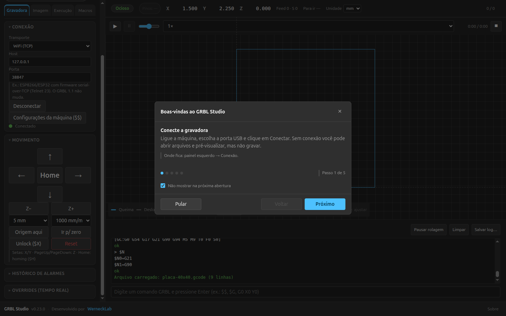

- Marque **Não mostrar na próxima abertura** para dispensar o tour.
- Para rever depois: menu **Ajuda → Tour de boas-vindas**.
- O botão **Assistente** no topo abre o guia rápido (modo Básico). No modo
  Avançado, todos os painéis ficam disponíveis.

**Idioma e tema** são detectados do sistema na primeira execução. Para mudar:
menu **Exibir → Aparência e idioma…**.

💡 O manual usa o **modo Avançado**, que mostra todas as abas e cartões. Se você
preferir o modo guiado, clique em **Assistente** e siga os passos.

---

## 4. A tela principal

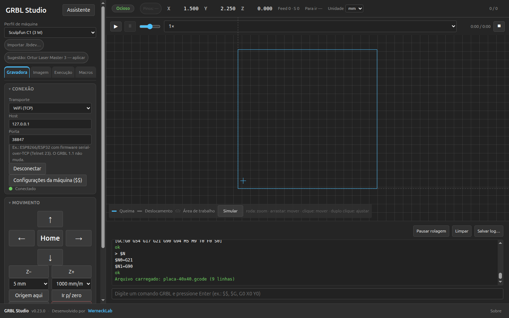

A janela se divide em cinco áreas:

| Área | O que tem |
| :--- | :--- |
| **Barra superior** | Estado da máquina (Ocioso/Executando/Alarme), pinos, DRO X/Y/Z, feed, potência S, “Para ir” (DTG), unidade (mm/in) e progresso. |
| **Barra lateral esquerda** | Perfil de máquina, abas **Gravadora / Imagem / Execução / Macros** e os cartões de conexão, movimento, overrides, etc. |
| **Centro** | Preview 2D do caminho, controles de simulação e barra de status do job. |
| **Rodapé do centro** | Console do GRBL, com campo para digitar comandos e botões de rolagem/limpeza/log. |
| **Rodapé** | Versão, crédito WerneckLab e link **Sobre**. |

### 4.1 Barra superior (status)

- **Badge de estado** — `Ocioso`, `Executando`, `Pausado`, `Alarme`, etc.
- **Pinos** — mostra o estado dos fins de curso/sonda quando o firmware informa.
- **X / Y / Z** — posição de trabalho (WPos) com 0,001 mm.
- **Feed** — avanço real; **S** — potência instantânea do laser.
- **Para ir** — distância restante até o fim do segmento atual (DTG).
- **Unidade** — alterna a exibição entre **mm** e **in** (o G-code não muda).
- **Progresso** — linha atual / total e ETA durante o job.

### 4.2 Preview

O preview desenha o caminho do G-code:

- **Queima** (azul) — movimentos de corte/gravação (`G1`/`G2`/`G3`).
- **Deslocamento** (tracejado) — movimentos rápidos (`G0`).
- **Área de trabalho** — caixa do curso da máquina (`$130`/`$131`).
- **Simular** — playback do job com velocidade ajustável.

**Navegação:**

- **Roda do mouse** — zoom.
- **Arrastar** — mover (no preview, botão esquerdo; no editor, botão do meio ou
  `Espaço` + arrastar).
- **Clique** — escolhe um ponto para mover a cabeça (pede confirmação).
- **Duplo clique** — volta ao enquadramento padrão.
- **F** — ajustar à tela; **0** — 100% (no editor de desenho).

### 4.3 Barra lateral

O topo traz o **Perfil de máquina** (com importação de `.lbdev` do LightBurn e
sugestão de perfil) e o botão **Assistente**. Abaixo ficam as abas:

- **Gravadora** — conexão, movimento (jog), overrides, histórico de alarmes.
- **Imagem** — conversão de imagem em G-code.
- **Execução** — abrir G-code, iniciar, lote, produção, retomada, fila.
- **Macros** — botões de comandos prontos e macros personalizadas.

Cada cartão é um `<details>`: clique no título para abrir/fechar.

### 4.4 Console

O console mostra os comandos enviados (`>`) e as respostas da máquina (`ok`,
`error:`, `ALARM:`, `[MSG:]`). Use o campo inferior para comandos manuais:

```text
$$
$G
$#
G92 X0 Y0
```

> O status (`?`) é consultado automaticamente pelo app; não digite `?` no
> console, porque o campo envia a linha com `Enter` (o `?` de tempo real é byte
> único, sem `\n`).

- **Pausar rolagem** — congela o console para ler uma mensagem.
- **Limpar** — limpa a tela (não apaga o log em disco).
- **Salvar log…** — exporta a sessão para um arquivo.

---

## 5. Conectar a máquina

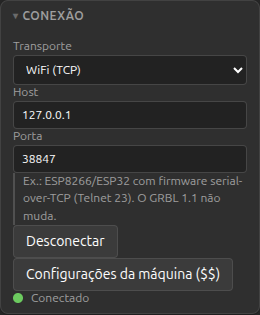

### 5.1 Conexão USB (serial)

1. Conecte o cabo USB e ligue a máquina.
2. Abra a aba **Gravadora**.
3. Em **Conexão → Transporte**, escolha **Serial (USB)**.
4. Selecione a **Porta**:
   - `/dev/ttyUSB0` — adaptadores CH340/CH341/CP2102 (maioria das máquinas).
   - `/dev/ttyACM0` — placas com USB nativo (Arduino, algumas Ortur/xTool).
   - `/dev/ttyS0` — portas seriais reais (raro).
5. **Baud rate**: comece com **115200** (padrão GRBL 1.1). Se não conectar,
   tente **250000**, **57600**, **38400** ou **9600** (opções da lista).
6. Escolha o **Perfil de máquina** (veja 5.3).
7. Clique em **Conectar**.

✅ **Conexão OK** quando:

- O ponto ao lado de **Conexão** fica verde e o texto mostra **Conectado** (o
  badge da máquina mostra **Ocioso**).
- O console mostra o banner do firmware (`Grbl 1.1…`).
- O painel **Máquina** preenche firmware, curso, limites, laser e offsets.
- Não há `error:` no console.

💡 O botão de atualizar portas recarrega a lista sem reiniciar o app. Se a porta
não aparecer, confira o cabo e a permissão `dialout` (seção 2.4).

### 5.2 Conexão WiFi/TCP

Para ESP8266/ESP32 com firmware **serial-over-TCP** (Telnet):

1. Em **Transporte**, escolha **WiFi (TCP)**.
2. Preencha **Host** (ex.: `192.168.4.1`) e **Porta** (padrão `23`; o emulador
   usado nas imagens estava em outra porta).
3. Clique em **Conectar**.

> O GRBL 1.1 em si **não** fala TCP; o adaptador WiFi faz a ponte serial↔TCP.
> A latência e a estabilidade da rede afetam o streaming. Prefira cabo USB para
> jobs longos e críticos.

### 5.3 Perfil de máquina

O perfil é um conjunto de dados da máquina: curso (`$130`/`$131`), velocidade
máxima (`$110`/`$111`), teto de potência (`$30`), modo laser (`$32`), homing,
limites e potência de apontar. Ele é usado pelo pré-voo e pelo preview.

- Escolha o modelo no seletor **Perfil de máquina**.
- **Importar .lbdev…** importa um perfil de dispositivo do LightBurn.
- Se o app reconhecer o firmware, aparece uma **sugestão** (ex.: “Ortur Laser
  Master 3 — aplicar”). Aplique somente se for a sua máquina.
- Sem perfil específico, use **Genérica (GRBL)** e ajuste o `$$` manualmente.

> ⚠️ Perfil errado = limites errados. O pré-voo pode bloquear jobs válidos ou
> deixar passar um job que bate na moldura. Confira o curso real da sua máquina.

### 5.4 Se não conectar

| Sintoma | Causa provável | Solução |
| :--- | :--- | :--- |
| Lista de portas vazia | Sem permissão serial | Grupo `dialout` ou regra udev (seção 2.4). |
| “Access denied” / “Permission denied” | Permissão | `sudo usermod -aG dialout "$USER"` + logout/login. |
| Conecta, console mudo | Baud errado | Tente 115200 → 9600 → 250000. |
| `ALARM:9` ao conectar | Homing não feito | Clique **Home** (`$H`) ou desative `$22` se não houver fins de curso. |
| Firmware não identificado | GRBL antigo/fork | Use “Genérica (GRBL)” e confira `$I` no console. |
| Conexão cai no meio do job | Cabo/hub/ruído | Cabo curto, ferrite, USB 2.0 direto na placa-mãe. |

---

## 6. Abrir um G-code pronto

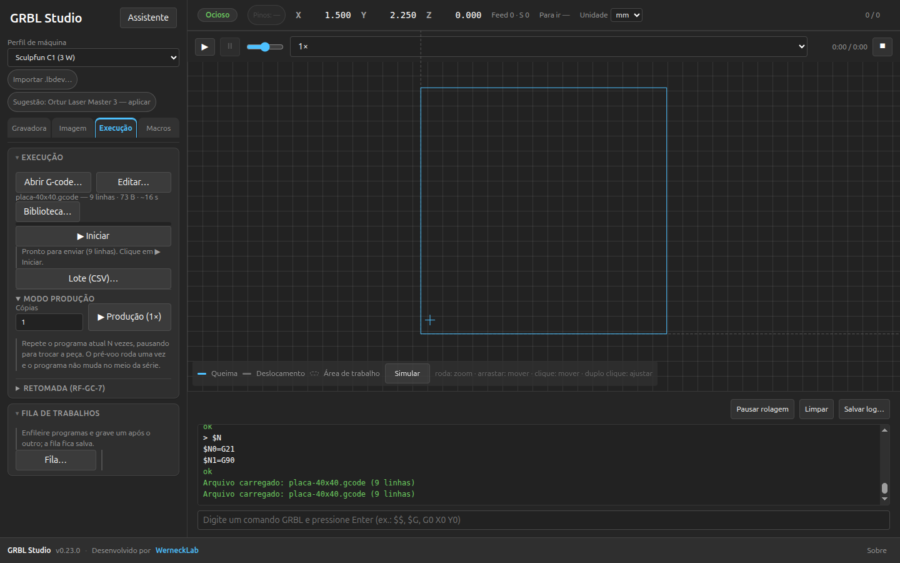

1. Abra a aba **Execução**.
2. Clique em **Abrir G-code…** (ou use **Arquivo → Abrir G-code…** no menu).
3. Selecione o arquivo (`.gcode`, `.nc`, `.tap`, `.txt`).
4. O app mostra **nome, linhas, tamanho e tempo estimado**.
5. O preview desenha o caminho; a barra **Iniciar** fica habilitada.
6. Use **Editar…** para abrir o editor de G-code (seção 14) ou **Biblioteca…**
   para reutilizar jobs anteriores (seção 17).

**O que o app verifica antes de gravar (pré-voo):**

- Linhas perigosas ou malformadas.
- `M3`/`M4` sem `S` (laser sem potência).
- Coordenadas fora do curso da máquina.
- Limites de velocidade.

> ⚠️ O G-code é enviado **exatamente como está**, preservando a precisão do
> arquivo. O app não arredonda valores.

💡 O tempo estimado soma `distância / feed` e considera `G0` a 3000 mm/min. Use
como referência, não como cronômetro.

---

## 7. Importar uma imagem

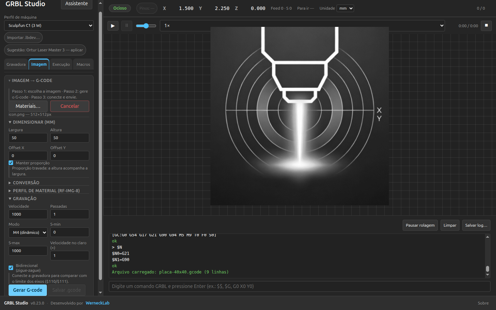

A aba **Imagem** converte PNG/JPG/BMP/GIF/WebP/AVIF em G-code raster ou vetorial.

### 7.1 Passo a passo

1. Abra a aba **Imagem**.
2. Clique em **Escolher imagem…**.
3. Ajuste **Dimensionar (mm)**:
   - **Largura** e **Altura** — tamanho final da arte.
   - **Offset X/Y** — deslocamento em relação à origem.
   - **Manter proporção** — trava a relação largura/altura.
4. Abra **Conversão** e escolha o **Algoritmo**:
   - **Line-to-line** — tons de cinza com PWM/M4; ideal para fotos.
   - **Dithering** (Floyd–Steinberg) — 1 bit; ideal para logos e texto.
   - **Linha única (centerline)** — esqueleto/linha única; ideal para letras e logos grossos.
   - **Vetorizar (contorno / recorte)** — contorno por limiar; ideal para corte/line-art.
5. Ajuste **Brilho**, **Contraste**, **Limiar B&W** e **Inverter preto/branco**
   conforme o material (em material escuro, a inversão ajuda).
6. Em **Perfil de material**, escolha um material e uma ação (gravação/corte).
   O botão **Materiais…** abre o catálogo (seção 19).
7. Em **Gravação**, confira:
   - **Velocidade** (mm/min) e **Passadas**.
   - **Modo** `M3` (potência constante) ou `M4` (dinâmico por velocidade).
   - **S-max** (potência máxima) e **Velocidade no claro (×)**.
   - **Bidirecional** (zigue-zague).
8. Clique em **Gerar G-code**.
9. Confira o preview e clique em **Iniciar** (ou **Salvar .gcode**).

💡 **Dica de ouro:** faça o **teste de material** (seção 20) no seu material
real. Cada lote de MDF/acrílico responde diferente.

⚠️ Imagens com fundo branco geram muitos movimentos no claro. Use o **Limiar
B&W** ou **Vetorizar (contorno / recorte)** para reduzir o tempo e a sujeira.

---

## 8. Pré-visualizar e posicionar

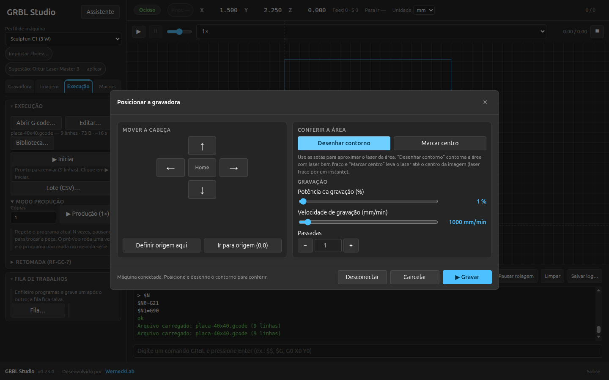

### 8.1 Preview

- **Zoom** com a roda; **arrastar** para mover; **duplo clique** para enquadrar.
- A legenda mostra **Queima**, **Deslocamento**, **Área de trabalho** e
  **Simular**.
- Durante o job, um crosshair acompanha a posição real (WPos).

### 8.2 Posicionar a gravadora

O diálogo **Posicionar a gravadora** abre depois de gerar uma imagem/desenho ou
pelo botão **Posicionar** do assistente. Ele tem duas colunas:

**Mover a cabeça**

- Setas **X−/X+/Y−/Y+** — jog incremental.
- **Home** — homing (`$H`), se a máquina tiver fins de curso.
- **Definir origem aqui** — envia `G92 X0 Y0 Z0` na posição atual.
- **Ir para origem (0,0)** — `G90 G0 X0 Y0`.

**Conferir a área**

- **Desenhar contorno** — percorre o bounding box da arte com laser **bem
  fraco** (potência mínima). ⚠️ O laser **está ligado**; use óculos.
- **Marcar centro** — move a cabeça ao centro geométrico da arte e dá um pulso
  de laser **bem fraco** para marcar o ponto (`M3`/`M5`).
- **Potência da gravação (%)**, **Velocidade (mm/min)** e **Passadas** — ajustam
  o job que será enviado.
- **Gravar** — fecha o diálogo e inicia o job.
- **Cancelar** — fecha o diálogo sem gravar.

⚠️ **Sempre** faça o contorno antes de gravar em material novo. É a forma mais
barata de descobrir que a arte está fora da peça.

💡 Para peças pequenas, defina a origem no canto inferior esquerdo da arte e
posicione o laser nesse canto. O G-code do editor já sai ancorado em `X0 Y0`.

---

## 9. Gravar e controlar o job

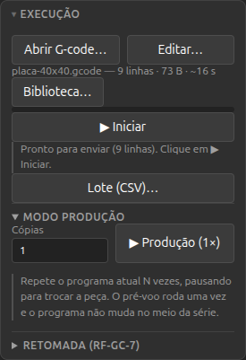

### 9.1 Iniciar

1. Carregue o G-code (aba **Execução**) ou gere a partir de imagem/desenho.
2. Confira o preview e a origem.
3. Clique em **▶ Iniciar**.
4. O **pré-voo** roda automaticamente (seção 15). Se houver bloqueio, ele
   explica o motivo e impede o início.
5. Se passar, o job começa; o badge muda para **Executando**.

### 9.2 Barra flutuante (sempre visível)

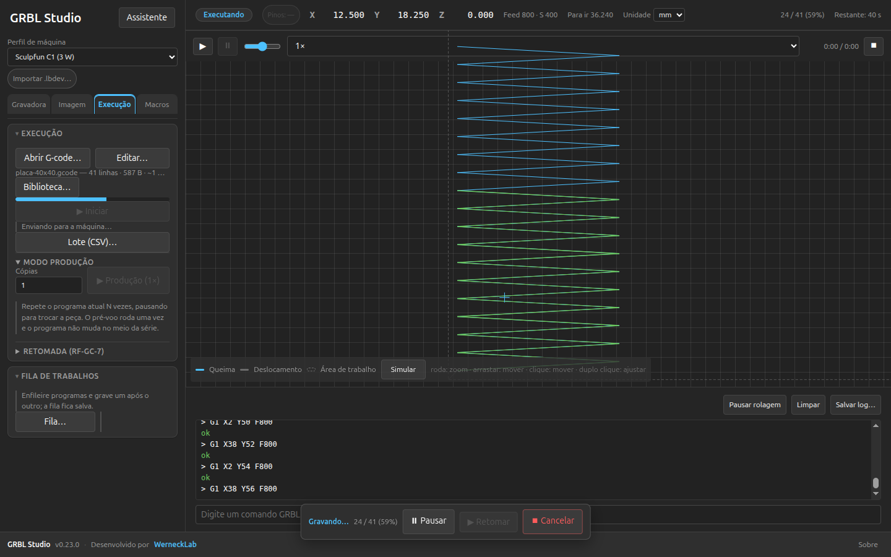

Durante o job, uma barra flutuante fica sobreposta a tudo:

| Botão | Comando | Função |
| :--- | :--- | :--- |
| **⏸ Pausar** | `!` (Feed Hold) | Para o movimento e mantém a posição. |
| **▶ Retomar** | `~` (Cycle Start) | Continua de onde parou. |
| **⏹ Cancelar** | `Ctrl-X` (0x18) | Aborta o job e reseta o GRBL; laser desliga. |

⚠️ **`Ctrl+X` é a parada de emergência garantida**: funciona mesmo com o foco no
console ou em um campo. Não existe um botão separado de “Emergência” — o
**Cancelar** da barra e o atalho `Ctrl+X` fazem o aborto. `Esc` também para o job
quando não há diálogo aberto.

### 9.3 Progresso

- **Linha atual / total** (ex.: `1.247 / 15.832`).
- **ETA** — estimativa de término.
- **DTG** — distância restante no plano.
- **DRO** — posição X/Y/Z em 0,001 mm.
- **Feed / S** — valores reais lidos do status `?`.
- **Overrides ativos** — feed e potência em %.

### 9.4 Ao terminar

- O console mostra **Job concluído** e o badge volta a **Ocioso**.
- O laser desliga (`M5`).
- O job entra na **Biblioteca de jobs** (seção 17).
- A cabeça permanece onde terminou; use **Ir p/ zero** para voltar à origem.
  Na fila, o app retorna ao zero entre os itens.

💡 Se algo der errado, **pare primeiro** e só depois investigue. Não tente
“salvar” o job mexendo no console com o laser ligado.

---

## 10. Overrides em tempo real

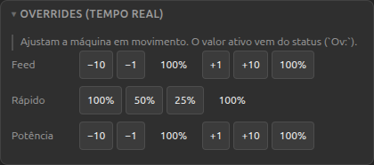

Os overrides ajustam a máquina **em movimento**, sem parar o job. O valor ativo
vem do status (`Ov:`).

| Controle | Efeito | Passo |
| :--- | :--- | :--- |
| **Feed −10 / −1 / +1 / +10** | Avanço | Grosso/fino |
| **Feed 100%** | Volta ao feed programado | Reset |
| **Rápido 100% / 50% / 25%** | Velocidade dos `G0` | 3 níveis |
| **Potência −10 / −1 / +1 / +10** | Potência do laser (spindle) | Grosso/fino |
| **Potência 100%** | Volta à potência programada | Reset |

**Quando usar:**

- Madeira sensível começando a chamuscar → reduza **Feed** em 10–20%.
- Corte não atravessou → reduza **Feed** e/ou aumente **Potência** aos poucos.
- Material fino → reduza **Potência** e mantenha o feed.
- Movimentos rápidos assustadores → **Rápido 50%**.

💡 A **dose** (J/mm) é `W × potência(%) / 100 × 60 / feed`. Se reduzir o feed
pela metade, a dose dobra. Ajuste os dois juntos para manter o resultado.

⚠️ Overrides **não** mudam o G-code no disco. O próximo job volta aos valores
programados.

---

## 11. Console, DRO e status

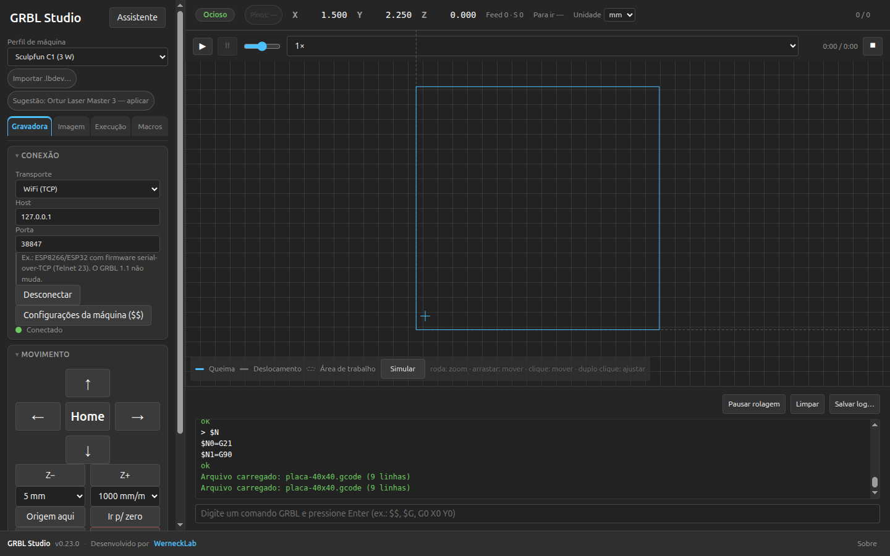

### 11.1 DRO e status

- **X/Y/Z** — posição de trabalho, 0,001 mm, com `tabular-nums` (não “pula”).
- **Feed** e **S** — valores reais do status.
- **Para ir** — distância até o fim do segmento.
- **Unidade** — mm/in; afeta só a exibição.

### 11.2 Movimento manual (jog)

No cartão **Movimento**:

- Setas **X/Y** e **Z−/Z+** — jog.
- **Passo** — 5 mm (ou outro valor no seletor).
- **Feed** — 1000 mm/min (ajuste conforme o material).
- **Home** — `$H`.
- **Origem aqui** — `G92 X0 Y0 Z0`.
- **Ir p/ zero** — `G90 G0 X0 Y0`.
- **Unlock ($X)** — limpa alarme.
- **Reset** — soft reset (0x18).

💡 Com a máquina conectada e sem diálogo aberto, as **setas do teclado** fazem
jog X/Y e **PageUp/PageDown** fazem jog Z. A tecla **Home** dispara o homing (se
`$22=1`).

⚠️ Jog com o laser ligado é perigoso. O app **não** liga o laser no jog, mas
ele pode ter ficado ligado por um comando/macro anterior; confira o badge e o
console e envie `M5` se necessário.

### 11.3 Console

Comandos úteis:

| Comando | O que faz |
| :--- | :--- |
| `$G` | Mostra o estado modal (unidades, distância, plano, feed, S). |
| `$$` | Lista todas as configurações. |
| `$#` | Mostra offsets (G54…G59, G28/G30, G92, TLO, PRB). |
| `$I` | Versão/build/opções do firmware. |
| `$N` | Blocos de inicialização. |
| `$X` | Desbloqueia alarme (use com cuidado). |
| `$H` | Homing. |
| `G92 X0 Y0` | Define a origem de trabalho aqui. |
| `G90 G0 X0 Y0` | Vai para a origem de trabalho. |
| `M5` | Desliga o laser. |

⚠️ Não envie comandos de tempo real (`!`, `~`, `?`) pelo campo de texto com
`Enter`: eles são **byte único** e não levam `\n`. O app consulta o status
automaticamente e os botões enviam os bytes corretos. O console serve para
comandos de linha (`$G`, `$$`, `$#`, `$I`, `G92 …`).

---

## 12. Macros

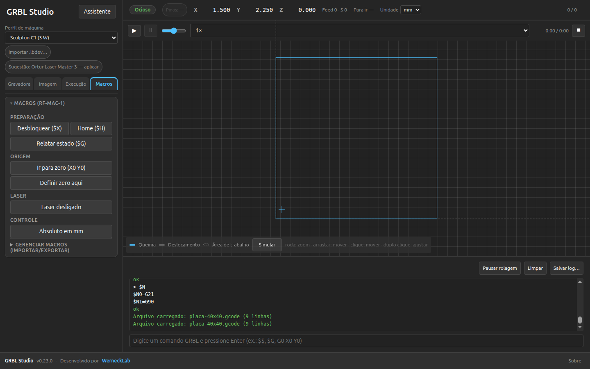

As macros são botões que enviam um ou mais comandos G-code. O app traz um
conjunto seguro por padrão:

| Grupo | Macro | Comando |
| :--- | :--- | :--- |
| Preparação | Desbloquear ($X) | `$X` |
| Preparação | Home ($H) | `$H` |
| Preparação | Relatar estado ($G) | `$G` |
| Origem | Ir para zero (X0 Y0) | `G90 G0 X0 Y0` |
| Origem | Definir zero aqui | `G92 X0 Y0 Z0` |
| Laser | Laser desligado | `M5` |
| Controle | Absoluto em mm | `G21 G90` |

**Usar:** abra a aba **Macros**, clique no botão. Os comandos são enfileirados um
a um, respeitando a janela de envio.

**Gerenciar:** abra **Gerenciar macros (importar/exportar)** para:

- **Adicionar** uma macro (nome, G-code, grupo).
- **Restaurar padrão**.
- **Importar…** / **Exportar…** um arquivo JSON.

💡 Crie macros para tarefas repetitivas: posicionar em um canto, ligar/desligar
ar-assist (se o firmware controlar), ir para um ponto de troca de peça.

⚠️ Macros não passam pelo pré-voo. Evite comandos que movam para fora dos limites
ou liguem o laser sem `S` definido.

---

# Parte II — Intermediário

## 13. Perfil e configurações da máquina

### 13.1 Painel Máquina

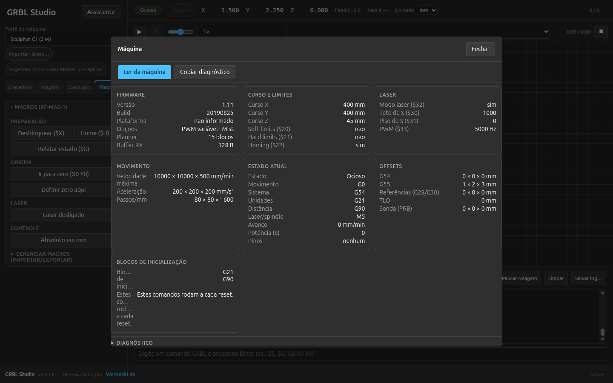

Abra pelo menu **Ferramentas → Máquina e diagnóstico** ou pelo botão **Configurações da
máquina ($$)**. O painel mostra:

- **Firmware** — versão, build, plataforma, opções, planner, buffer RX.
- **Curso e limites** — curso X/Y/Z, soft/hard limits, homing.
- **Laser** — modo (`$32`), teto de S (`$30`), piso (`$31`), PWM (`$33`).
- **Movimento** — velocidade máxima, aceleração, passos/mm.
- **Estado atual** — estado, movimento, sistema, unidades, distância, laser,
  feed, potência, pinos.
- **Offsets** — G54, G55, referências, TLO, sonda.
- **Blocos de inicialização** — comandos que rodam a cada reset.
- **Diagnóstico** — leitura crua/exportável.

**Ler da máquina** atualiza os dados; **Copiar diagnóstico** copia um relatório
para a área de transferência (útil para suporte).

### 13.2 Configurações `$$`

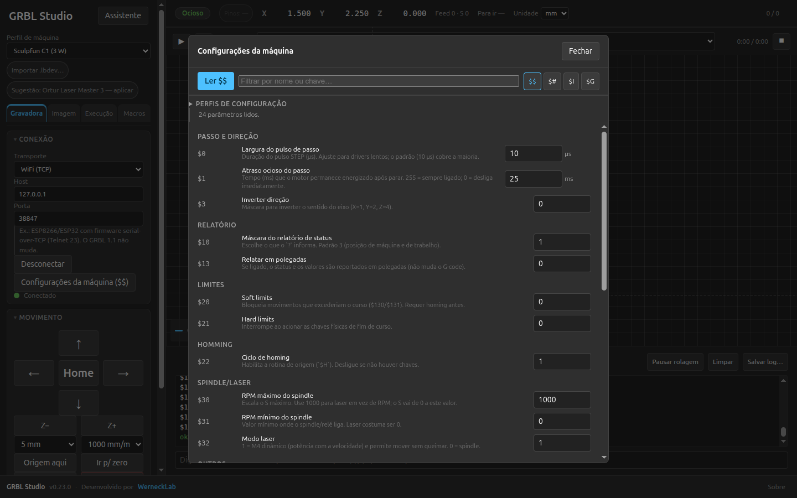

O editor lista os parâmetros com **nome, descrição e unidade**. Você pode:

- **Ler $$** — recarrega da máquina.
- **Filtrar** por nome/chave.
- Alternar entre **$$**, **$#**, **$I** e **$G**.
- Editar um valor e aplicar (o app envia `$n=valor`).
- Salvar/carregar **perfis de configuração** (para voltar a um estado conhecido).

**Parâmetros que você vai encontrar:**

| Chave | Significado | Padrão típico |
| :--- | :--- | :--- |
| `$0` | Largura do pulso de passo (µs) | 10 |
| `$1` | Atraso ocioso do passo (ms) | 25 |
| `$3` | Inversão de direção (máscara) | 0 |
| `$10` | Máscara do relatório de status | 1 |
| `$13` | Relatar em polegadas | 0 |
| `$20` | Soft limits | 0 |
| `$21` | Hard limits | 0 |
| `$22` | Homing | 1 |
| `$30` | RPM/potência máxima (S-max) | 1000 |
| `$31` | RPM/potência mínima | 0 |
| `$32` | Modo laser (1 = M4 dinâmico) | 1 |
| `$100`/`$101`/`$102` | Passos/mm X/Y/Z | 80/80/1600 |
| `$110`/`$111`/`$112` | Velocidade máxima X/Y/Z | 10000/10000/500 |
| `$120`/`$121`/`$122` | Aceleração X/Y/Z | 200/200/200 |
| `$130`/`$131`/`$132` | Curso X/Y/Z (mm) | 400/400/45 |

⚠️ **Não mude `$100`–`$102` sem saber o que está fazendo**: isso altera a escala
de movimento e pode fazer a máquina bater na moldura. Anote os valores originais
antes de qualquer alteração.

💡 Use **perfis de configuração** para guardar o estado “bom” antes de testar.

---

## 14. Editor de G-code

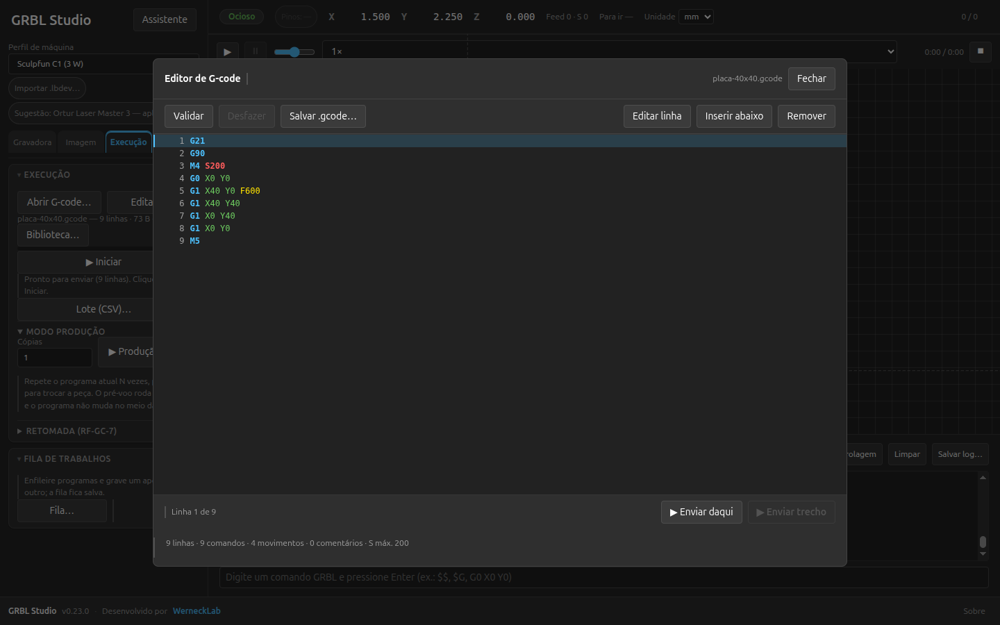

Abra pelo botão **Editar…** na aba Execução ou pelo menu **Arquivo → Editar
G-code…**.

**Recursos:**

- **Validar** — checa linhas perigosas, `M3`/`M4` sem `S`, limites e sintaxe.
- **Desfazer** — desfaz a última edição.
- **Salvar .gcode…** — salva o arquivo editado.
- **Editar linha** — edita a linha selecionada.
- **Inserir abaixo** / **Remover** — manipula linhas.
- **Enviar daqui** — começa o envio a partir da linha atual.
- **Enviar trecho** — envia só o trecho selecionado.
- Rodapé: linhas, comandos, movimentos, comentários e S-máx.

**Quando usar:**

- Corrigir um `F` faltante ou um `S` errado.
- Remover uma linha que o pré-voo bloqueou.
- Testar um trecho específico sem rodar o arquivo inteiro.

⚠️ O editor é para **ajustes pequenos**. Para mudanças grandes, edite no seu CAD
e reimporte. O app preserva a precisão dos valores; não arredonde coordenadas.

---

## 15. Pré-voo

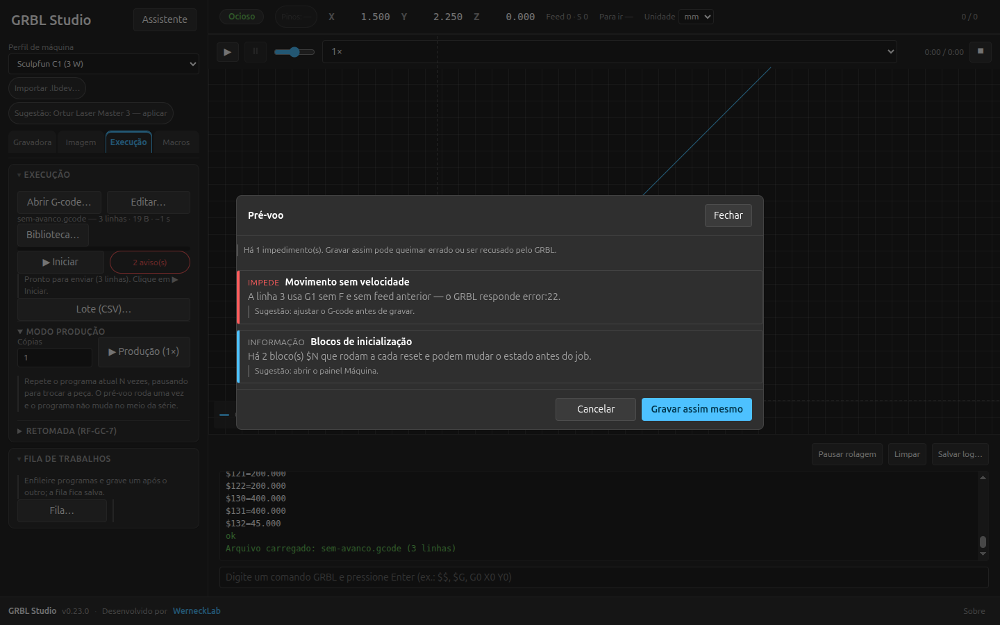

O pré-voo roda automaticamente ao clicar **Iniciar**. Ele classifica os achados:

| Nível | Efeito | Exemplos reais |
| :--- | :--- | :--- |
| **IMPEDE** (block) | Não inicia | `G1` sem `F`; job maior que o curso; laser ligado com `$32=0`; pino de segurança ativo. |
| **AVISO** (warn) | Permite com confirmação | `S` acima de `$30`; `M3`/`M4` sem `S`; soft limits sem homing; `$30` diferente do perfil; `G28`/`G30` sem home. |
| **INFORMAÇÃO** (info) | Só avisa | Blocos de inicialização `$N`; `G20` com relatório em mm; firmware sem `OPT` de buffer. |

**Como agir:**

- Leia o motivo e a sugestão.
- Corrija o G-code (editor) ou os parâmetros.
- Se for apenas um aviso consciente, use **Gravar assim mesmo**.
- Se for bloqueio, **Cancelar** e corrija.

💡 O pré-voo é a sua primeira linha de defesa contra queima de material e erros
`error:22` (feed ausente). Não o ignore.

---

## 16. Fila de trabalhos

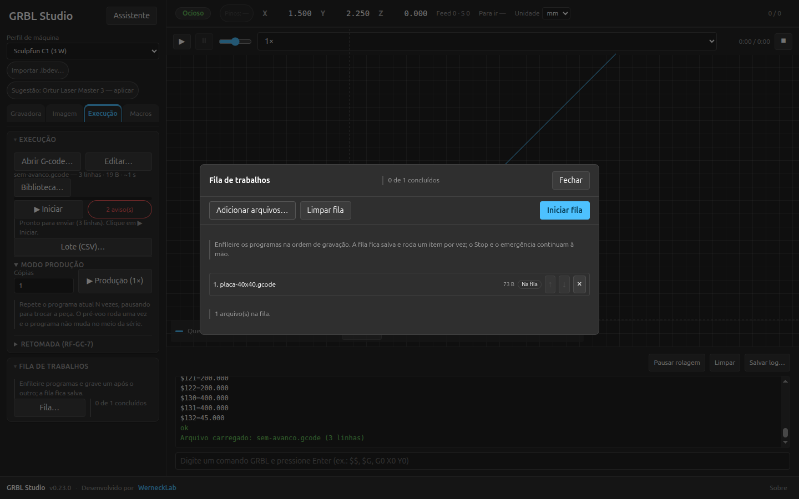

A fila executa vários arquivos em sequência, sem você precisar abrir um por um.

1. Abra **Execução → Fila…** (ou o botão **Fila** no cartão).
2. **Adicionar arquivos…** — escolha um ou mais G-code.
3. **Reordenar** — use as setas **↑/↓** de cada item (ficam desabilitadas durante a
   execução).
4. **Remover** — o “×” do item.
5. **Iniciar fila** — começa pelo primeiro.

**Comportamento:**

- A fila é salva em `queue.json` e sobrevive a reinícios.
- O pré-voo roda no primeiro item.
- Em erro/alarme/“Parar fila”, a agenda pausa e devolve o item atual para a fila.
- **Pausar** e **Cancelar** continuam na barra flutuante.

💡 Use a fila para uma sequência de peças **diferentes**. Para repetir o **mesmo**
programa, use o **Modo produção** (seção 23).

---

## 17. Biblioteca de jobs

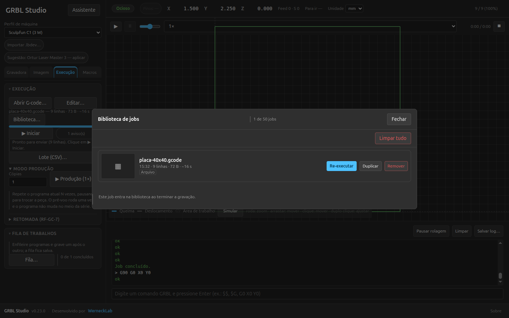

Os últimos **50 programas executados** ficam na biblioteca, com miniatura.

**Abrir:** **Execução → Biblioteca…** ou menu **Arquivo → Biblioteca de jobs…**.

Cada item mostra:

- Nome do arquivo, data/hora, tempo, tamanho e número de linhas.
- Miniatura do caminho.
- Origem: arquivo, imagem, desenho ou biblioteca.

**Ações:**

- **Re-executar** — carrega o G-code salvo e inicia de novo.
- **Duplicar** — carrega uma cópia para editar/ajustar.
- **Remover** — apaga o item.
- **Limpar tudo** — apaga a biblioteca (pede confirmação).

💡 A biblioteca guarda o **G-code executado**, não o arquivo original. Se você
mudou a imagem/desenho depois, o job antigo continua com o G-code da época.

---

## 18. Presets de material

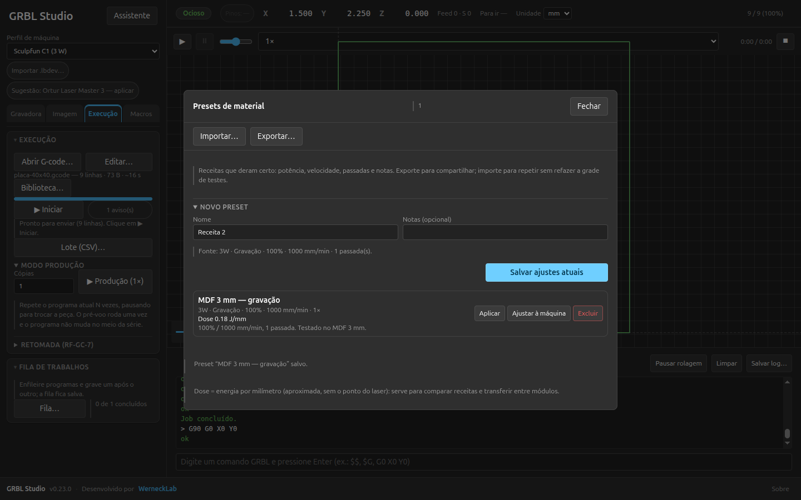

Um preset é uma **receita** que deu certo: potência, velocidade, passadas, modo
e notas. Ele evita refazer testes toda vez.

**Criar:**

1. Ajuste potência/velocidade/passadas no módulo (imagem, desenho, etc.).
2. Abra **Presets** (menu **Ferramentas → Presets de material…** ou **Salvar como preset…**).
3. Dê um **Nome** e **Notas** (opcional).
4. Clique em **Salvar ajustes atuais**.

**Usar:**

- **Aplicar** — leva os valores para o módulo atual.
- **Ajustar à máquina** — converte a receita para o módulo da máquina atual
  (3 W/5 W/10 W…), preservando a **dose** (J/mm).
- **Excluir** — remove o preset.
- **Importar… / Exportar…** — JSON para compartilhar.

**Dose:** `watts × potência(%) / 100 × 60 / velocidade(mm/min)`. Serve para
comparar receitas e transferir entre lasers de potências diferentes. Se o módulo
de destino não alcançar a dose nem a 100%, o app avisa e você deve reduzir a
velocidade.

💡 Presets são por **módulo** e **ação** (gravação/corte). Um preset de “MDF 3 mm
— gravação” não deve ser aplicado em “corte”.

---

## 19. Catálogo de materiais

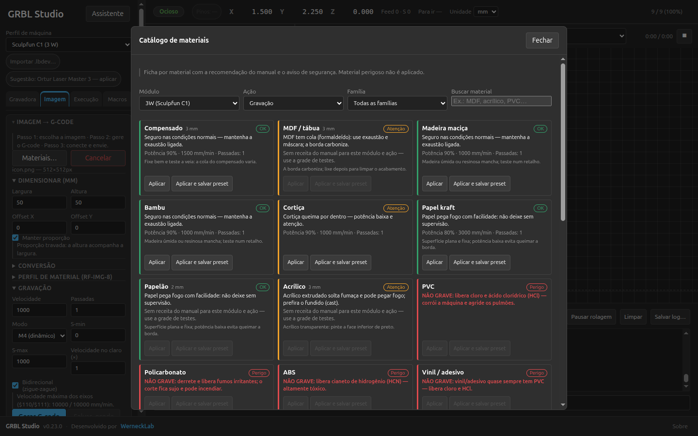

O catálogo traz fichas de material com recomendação de potência/velocidade,
passadas, notas e **aviso de segurança**.

**Filtros:** módulo (3 W/5 W/10 W…), ação (gravação/corte), família (madeira,
plástico, papel, etc.) e busca por nome.

**Cada ficha mostra:**

- **Badge** `OK`, `Atenção` ou `Perigo`.
- Potência (%), velocidade (mm/min), passadas.
- Notas de segurança e acabamento.
- **Aplicar** / **Aplicar e salvar preset**.

**Materiais perigosos** (PVC, policarbonato, ABS, vinil) aparecem em vermelho e
**não são aplicados** — o app bloqueia a receita.

⚠️ As recomendações são um **ponto de partida**. Teste no seu material, com a
sua máquina e o seu módulo. O catálogo não substitui o teste de material.

---

## 20. Teste de material

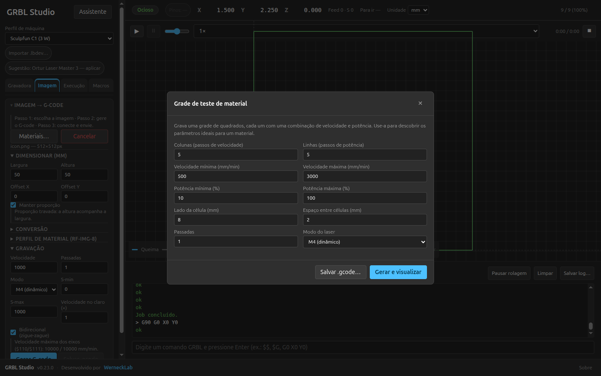

Grava uma grade de quadrados, cada um com uma combinação de **velocidade ×
potência**, para você descobrir os parâmetros ideais.

**Campos:**

- **Colunas (passos de velocidade)** e **Linhas (passos de potência)**.
- **Velocidade mínima/máxima** e **Potência mínima/máxima**.
- **Lado da célula** e **Espaço entre células** (mm).
- **Passadas** e **Modo do laser** (`M3`/`M4`).

**Fluxo:**

1. Preencha os valores (comece com uma faixa ampla).
2. **Gerar e visualizar** — o app cria a grade e abre o posicionamento.
3. Confira o preview e grave em um retalho.
4. Marque qual célula deu o melhor resultado.
5. Salve a receita como **preset** (seção 18).

💡 Faça uma grade por material e por espessura. Anote a data no nome do preset.

---

## 21. Teste de foco

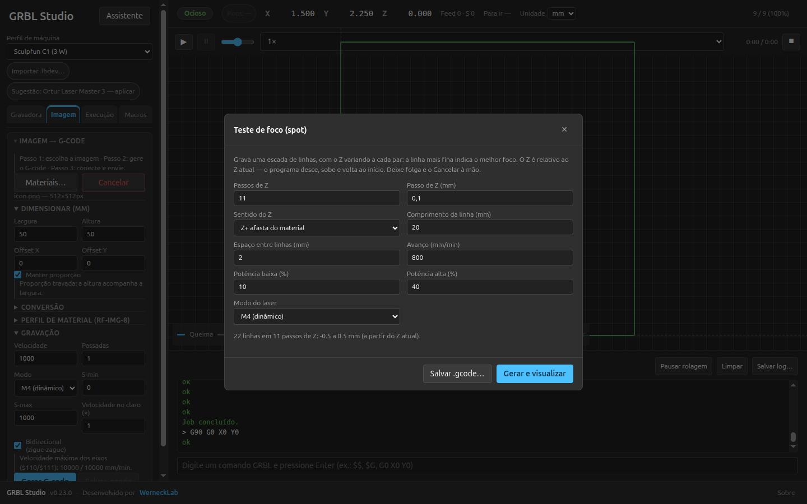

Grava uma escada de linhas com o **Z variando a cada par**. A linha mais fina
indica a melhor altura de foco.

**Campos:**

- **Passos de Z** e **Passo de Z (mm)**.
- **Sentido do Z** (`Z+` afasta ou aproxima, conforme a máquina).
- **Comprimento da linha** e **Espaço entre linhas**.
- **Avanço**, **Potência baixa (%)** e **Potência alta (%)**.
- **Modo do laser**.

**Fluxo:**

1. Posicione o laser sobre um retalho, com folga para descer/subir.
2. Gere e visualize.
3. Grave; a linha mais fina/marcada é o melhor foco.
4. Ajuste o Z e repita se necessário.

⚠️ O programa **desce, sobe e volta** ao Z inicial. Deixe folga e mantenha o
**Cancelar** à mão. Use potências diferentes para comparar marcação e corte.

---

## 22. Lote com dados variáveis

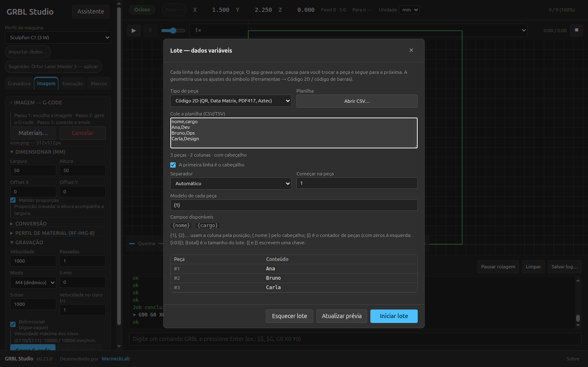

O lote transforma uma planilha em uma **fila de peças**, uma por linha. É ideal
para QR codes/códigos de barras com dados variáveis (nomes, URLs, números de
série).

### 22.1 Preparar a planilha

CSV ou TSV, com ou sem cabeçalho:

```csv
nome,cargo
Ana,Dev
Bruno,Ops
Carla,Design
```

- **Separador**: automático, vírgula, ponto e vírgula, tabulação ou `|`.
- **A primeira linha é o cabeçalho** — marque se for o caso.
- **Começar na peça** — útil para retomar um lote interrompido.

### 22.2 Modelo de cada peça

Use tokens no campo **Modelo de cada peça**:

| Token | Significado |
| :--- | :--- |
| `{1}`, `{2}`… | Coluna pela posição. |
| `{nome}` | Coluna pelo cabeçalho. |
| `{i}` | Contador de peças. |
| `{i:03}` | Contador com zeros à esquerda (`001`, `002`…). |
| `{total}` | Total de peças. |
| `{{` / `}}` | Chave literal. |

Exemplo: `https://exemplo.com/{1}` ou `Peça {i:03} — {nome}`.

### 22.3 Gravar o lote

1. Escolha o **Tipo de peça** (2D ou 1D). A geometria usa os ajustes do símbolo
   (Ferramentas → Código 2D / Código de barras).
2. Cole ou abra a planilha.
3. Confira a **prévia** (peça + conteúdo).
4. Clique em **Iniciar lote**.
5. O app grava uma peça, **pausa para você trocar a peça** e mostra **▶ Próxima
   peça**. Use **Encerrar lote** para parar.

⚠️ O lote **não** move a origem sozinho. Cada peça precisa estar na mesma posição
(use um gabarito, seção 29). Confira a primeira antes de soltar a série.

💡 Para o **mesmo** programa repetido N vezes, use o **Modo produção** (seção 23),
que é mais simples.

---

## 23. Modo produção

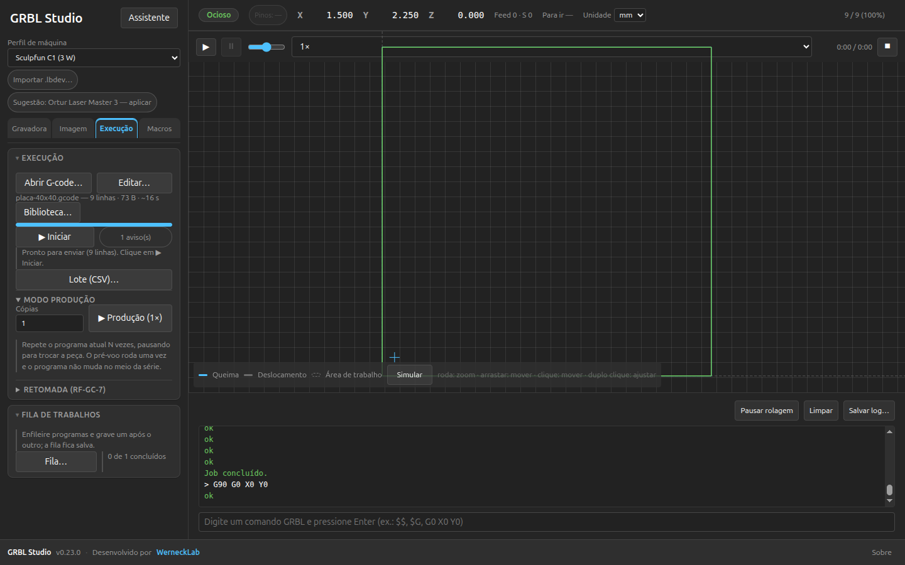

O modo produção repete o **programa atual** N vezes, pausando entre as peças.

1. Carregue o G-code.
2. Em **Modo produção**, defina **Cópias** (1–999).
3. Clique em **▶ Produção**.
4. O pré-voo roda **uma vez**; o programa não muda no meio da série.
5. Ao fim de cada peça, o app pausa para a troca; use **▶ Próxima peça**.
6. **Encerrar** interrompe a série.

**Trava de UI:** durante a produção, trocar o programa é bloqueado para evitar
repetir o arquivo errado.

💡 Use junto com um **gabarito** para colocar cada peça no mesmo lugar. A precisão
da série depende da montagem, não do software.

---

## 24. Retomada e recuperação

Se um job for interrompido (pausa, alarme, queda de conexão), o app pode retomar
do ponto onde parou.

1. Abra **Execução → Retomada (RF-GC-7)**.
2. O app mostra a linha de retomada e o estado.
3. Clique em **Retomar**.
4. Antes de continuar, o app reafirma **plano, unidades, distância, offsets e
   laser** (ex.: `G21 G90`, `G54`, `M4`) para o GRBL não herdar um estado errado.

**Quando retomar:**

- Pausa (`!`) ou queda de conexão sem deslocamento da peça.
- Alarme que não moveu a cabeça.

**Quando NÃO retomar:**

- A peça saiu do lugar, a cabeça bateu ou o material queimou.
- Você não tem certeza da posição. Nesse caso, **recomece** do zero após
  reposicionar.

⚠️ Retomar no meio de um corte pode sobrepor a linha e queimar. Na dúvida,
refaça a peça.

---

## 25. Importar SVG, DXF e PDF

O menu **Arquivo** importa vetores para o editor:

- **Importar SVG…** — caminhos vetoriais.
- **Importar DXF…** — DXF ASCII (LINE, LWPOLYLINE, CIRCLE, ARC, SPLINE, blocos).
- **Importar PDF…** — primeira página, caminhos vetoriais.

O app converte para G-code/contornos no editor, onde você pode escalar, mover,
combinar e definir camadas. PDFs digitalizados (imagem) **não** são vetorizados
por essa importação; use a aba Imagem.

💡 SVG é a melhor opção para arte vetorial: preserve o arquivo original e importe
com escala conhecida.

---

# Parte III — Avançado

## 26. Editor vetorial (Desenhar)

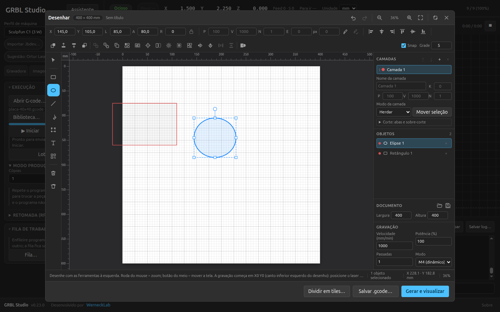

O editor **Desenhar** é uma prancheta em **mm**, com réguas, grade e a área da
máquina. O G-code sai **ancorado na origem (X0 Y0)**, no canto inferior esquerdo.

### 26.1 Barra de ferramentas

| Ferramenta | Atalho | Uso |
| :--- | :--- | :--- |
| Selecionar | `V` | Selecionar, mover, redimensionar. |
| Retângulo | `R` | Arrastar para criar. |
| Elipse | `E` | Arrastar para criar. |
| Linha | `L` | Arrastar. |
| Caneta | `P` | Desenho livre com simplificação. |
| Nós | `N` | Editar nós de um caminho. |
| Texto | `T` | Texto vetorial. |
| Símbolo | `Q` | Biblioteca de símbolos. |

### 26.2 Propriedades

Para o objeto selecionado: **X**, **Y**, **L** (largura), **A** (altura), **R**
(rotação), **P** (potência), **V** (velocidade), **N** (passadas), **E**
(espessura), além de **cadeado** (proporção) e **px** (unidade).

### 26.3 Ações

- **Desfazer/Refazer** (`Ctrl+Z` / `Ctrl+Y`).
- **Zoom** (`+`/`-`, `F` ajustar, `0` 100%).
- **Espelhar H/V**, **distribuir H/V**.
- **Agrupar/desagrupar** (`Ctrl+G`).
- **Alinhar** (esquerda, centro, direita, topo, meio, base).
- **Ordem Z** (trazer para frente/enviar para trás).
- **Booleanas** (menu de interseção): unir, subtrair, intersecção, exclusão.
- **Snap** e **Grade** (mm).

### 26.4 Documento e gravação

- **Documento** — largura/altura da página (mm), importar/exportar.
- **Gravação** — velocidade, potência, passadas e modo (`M4`/`M3`).
- **Salvar .gcode…** — salva o G-code gerado.
- **Gerar e visualizar** — abre **Tamanho da arte** (seção 37), depois o
  posicionamento e o preview.

💡 O editor não é um CAD paramétrico. Para peças de precisão, importe DXF/SVG e
ajuste a escala.

---

## 27. Camadas e multi-operação

Cada **camada** tem potência, velocidade, passadas, modo e **kerf** próprios.
Isso permite **gravar e cortar na mesma execução**.

- **Nova camada** / **Excluir camada**.
- **Nome da camada**, **P/V/N**, **Modo da camada** (herdar ou próprio).
- **Corte: abas e sobre-corte** — abas (tabs) seguram a peça; sobre-corte (lead-in/out)
  melhora a entrada/saída.
- **Mover seleção** — atribui os objetos selecionados à camada.
- **Ordem** — a ordem das camadas define a sequência de gravação.

**Fluxo típico:**

1. Camada 1 — **gravação** (potência baixa, velocidade alta).
2. Camada 2 — **corte** (potência alta, velocidade baixa, passadas).
3. Selecione os objetos e mova para a camada correta.
4. Gere e confira as cores/ordem no preview.

⚠️ A ordem importa: corte antes de gravar pode deslocar a peça. Grave primeiro,
corte por último.

---

## 28. Biblioteca de símbolos

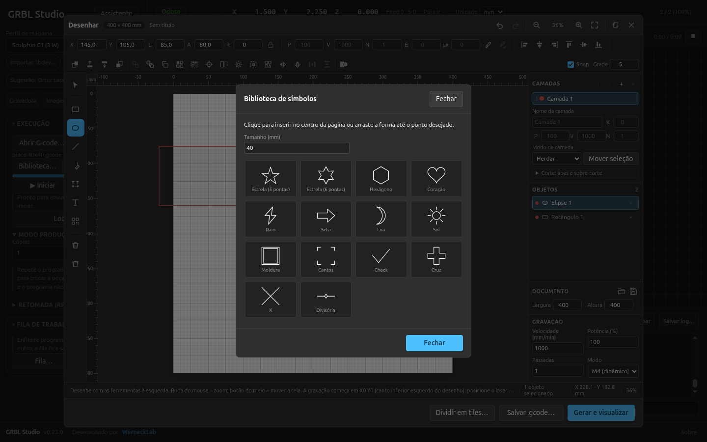

A biblioteca traz formas prontas: estrelas (5/6 pontas), hexágono, coração, raio,
seta, lua, sol, moldura, cantos, check, cruz, X e divisória.

- **Tamanho (mm)** — define o tamanho da forma.
- **Clique** — insere no centro da página.
- **Arraste** — insere no ponto desejado.

💡 Use como base para gabaritos, marcadores e ícones. Depois edite nós/booleanas.

---

## 29. Gabarito (molde)

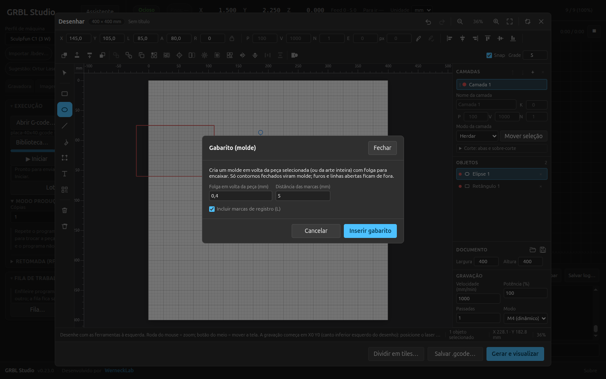

O gabarito cria um **molde** em volta da peça, com folga e marcas de registro,
para posicionar peças repetidas.

**Campos:**

- **Folga em volta da peça (mm)** — espaço entre a peça e o molde.
- **Distância das marcas (mm)** — afastamento das marcas de registro.
- **Incluir marcas de registro (L)** — marcas em L para alinhar.
- **Inserir gabarito** — adiciona ao desenho.

**Uso:**

1. Desenhe/importe a peça.
2. Gere o gabarito com folga suficiente para encaixar a peça.
3. Corte o gabarito em MDF/chapa.
4. Coloque a peça no molde e grave cada unidade.

💡 O gabarito é a forma mais confiável de repetir peças sem reposicionar a origem
a cada uma.

---

## 30. Geradores paramétricos

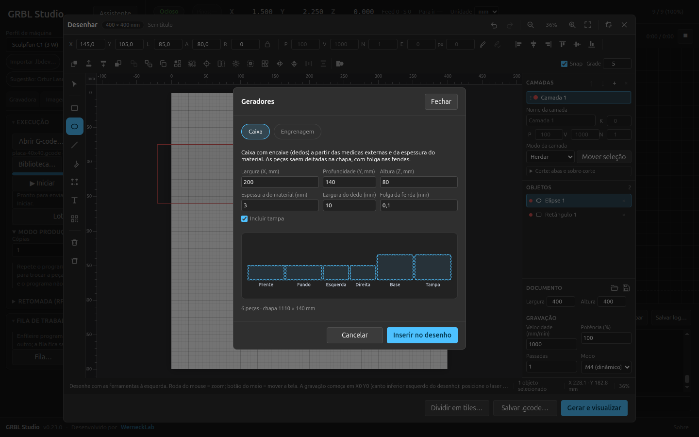

O gerador cria formas paramétricas:

### 30.1 Caixa com encaixe (dedos)

- **Largura (X)**, **Profundidade (Y)**, **Altura (Z)**.
- **Espessura do material**.
- **Largura do dedo** e **Folga da fenda**.
- **Incluir tampa**.
- Prévia com as 6 peças e o tamanho da chapa.

### 30.2 Engrenagem

- Parâmetros de módulo/dentes/espessura (conforme a interface).
- Prévia e inserção no desenho.

**Uso:** ajuste as medidas, confira a prévia e clique em **Inserir no desenho**.
Depois defina camadas (gravação/corte) e gere.

⚠️ Confira a **espessura real** do material com um paquímetro. A folga da fenda
precisa compensar o kerf do seu laser.

---

## 31. Gravar dos dois lados

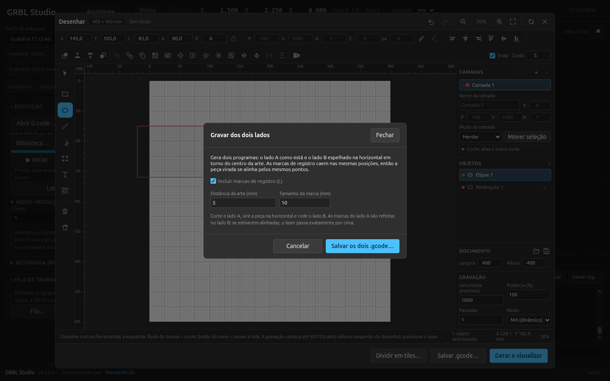

O assistente gera **dois G-code**: lado A e lado B **espelhado**, com a mesma
origem e marcas de registro para alinhar.

**Campos:**

- **Incluir marcas de registro (L)**.
- **Distância da arte (mm)** — afastamento das marcas.
- **Tamanho da marca (mm)**.
- **Salvar os dois .gcode…** — grava os dois arquivos.

**Fluxo:**

1. Desenhe a arte.
2. Gere os dois lados com marcas.
3. Grave o lado A.
4. Vire a peça usando as marcas para alinhar.
5. Grave o lado B (espelhado).

⚠️ O alinhamento depende das marcas e do gabarito. Teste em um retalho antes de
virar a peça final.

---

## 32. Marcas de registro

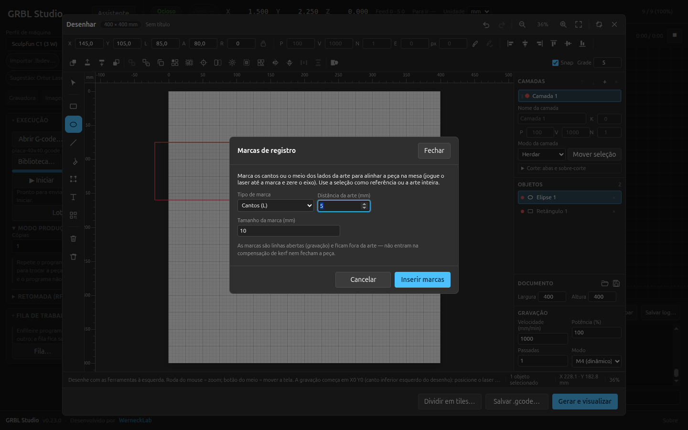

Insere marcas de alinhamento ao redor da arte:

- **Tipo de marca** — **Cantos (L)** ou **Cruzes**.
- **Distância da arte (mm)**.
- **Tamanho da marca (mm)**.
- **Inserir marcas**.

**Usos:** alinhar o verso, posicionar em um gabarito, conferir a origem e
recuperar a posição após uma interrupção.

💡 Use **cruzes** para leitura com câmera/ponteiro e **cantos L** para encaixe
físico.

---

## 33. Dividir em tiles

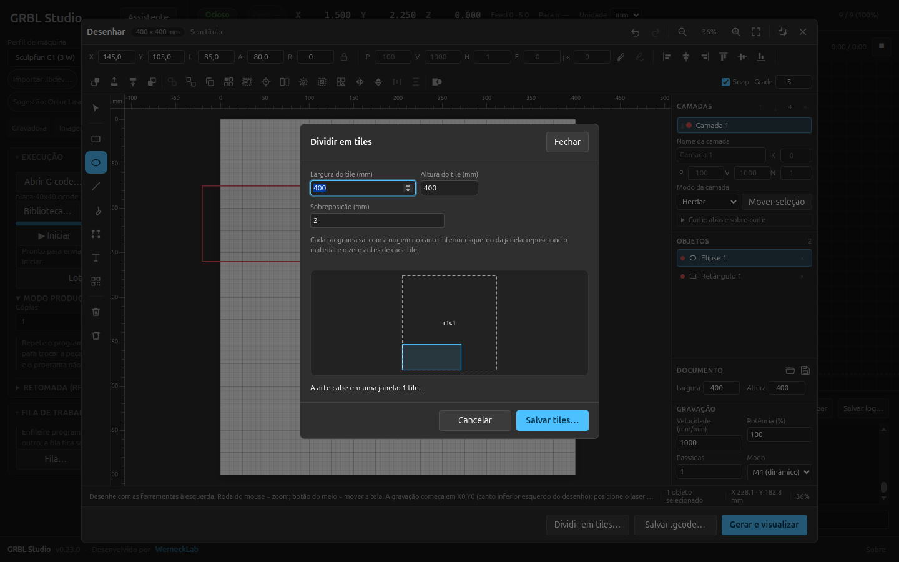

Para arte maior que a área da máquina, o app divide em **tiles** com sobreposição.

**Campos:**

- **Largura do tile (mm)** e **Altura do tile (mm)**.
- **Sobreposição (mm)** — evita emenda visível.
- Prévia com a arte e as janelas.
- **Salvar tiles…** — gera um arquivo por tile.

**Fluxo:**

1. Defina o tamanho do tile (um pouco menor que o curso útil).
2. Use sobreposição de 2–5 mm.
3. Salve os tiles.
4. Grave um por um, reposicionando a origem/marcas.
5. Use as marcas de registro para alinhar cada janela.

⚠️ A emenda depende da precisão do reposicionamento. Faça um teste pequeno antes
da arte grande.

---

## 34. Matriz de cópias

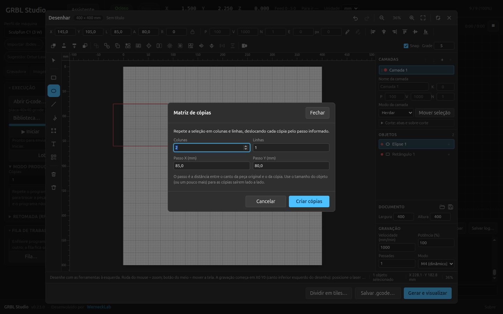

Cria várias cópias do objeto selecionado em uma grade.

**Campos:**

- **Colunas** e **Linhas**.
- **Passo X (mm)** e **Passo Y (mm)**.
- **Criar cópias** (máx. 1000).

**Uso:** produção em série na mesma chapa. Combine com o **encaixe** (seção 35)
para aproveitar melhor o material.

💡 Deixe um espaço entre as peças para o kerf e para não aquecer demais o material.

---

## 35. Encaixe na chapa

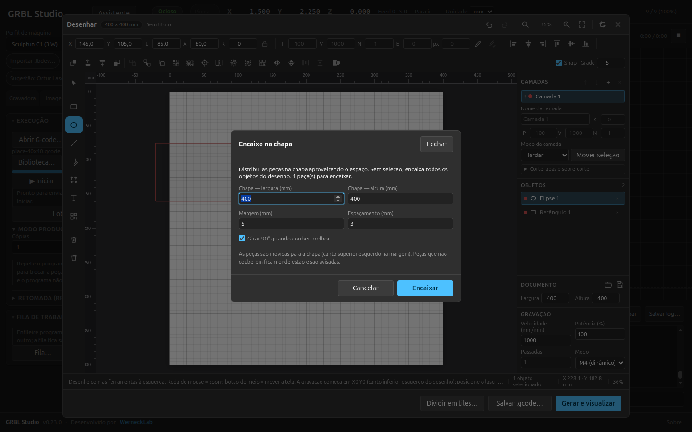

O encaixe organiza as peças na chapa para aproveitar o material.

**Campos:**

- **Chapa — largura/altura (mm)**.
- **Margem (mm)** e **Espaçamento (mm)**.
- **Girar 90° quando couber melhor**.
- **Encaixar** — distribui as peças.
- Resultado: peças encaixadas, aproveitamento (%) e peças que não couberam.

**Uso:** selecione as peças, defina a chapa e encaixe. Confira o preview antes de
gerar.

⚠️ O encaixe considera o contorno, não o kerf. Deixe espaçamento suficiente.

---

## 36. Contorno paralelo

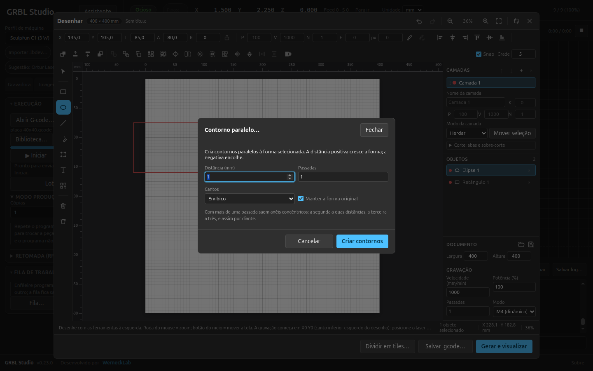

Cria contornos paralelos ao redor de uma forma, para corte, reforço ou kerf.

**Campos:**

- **Distância (mm)** — positiva para fora, negativa para dentro.
- **Passadas** — contornos concêntricos.
- **Cantos** — em bico (miter), arredondados (round) ou chanfrados (bevel).
- **Manter a forma original**.
- **Criar contornos**.

**Usos:**

- Compensar o **kerf** (largura do corte) com um offset negativo.
- Criar uma borda decorativa.
- Fazer um encaixe com folga.

💡 Para corte justo, meça o kerf (ex.: 0,15 mm) e use offset de `-kerf/2` na
camada de corte.

---

## 37. Tamanho da arte

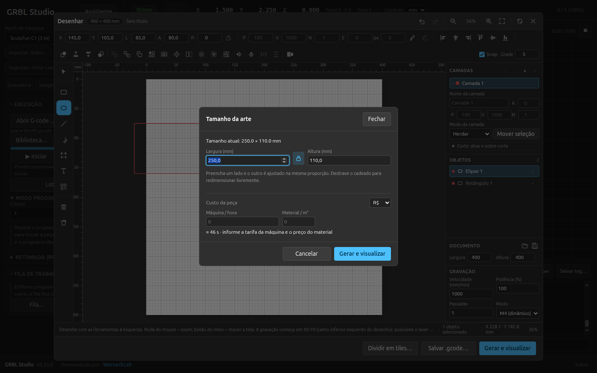

Antes de gerar, o app pergunta o tamanho final da arte:

- **Largura (mm)** e **Altura (mm)**.
- **Cadeado** — mantém a proporção.
- Mostra o **tamanho atual** e o custo/tempo estimado.
- **Gerar** — aplica e abre o posicionamento.

**Uso:** defina o tamanho real que você quer no material. O editor trabalha em
mm; o tamanho da arte é a escala final.

💡 Se a arte estiver em polegadas, converta para mm antes (1 in = 25,4 mm).

---

## 38. QR Code, Data Matrix, PDF417 e Aztec

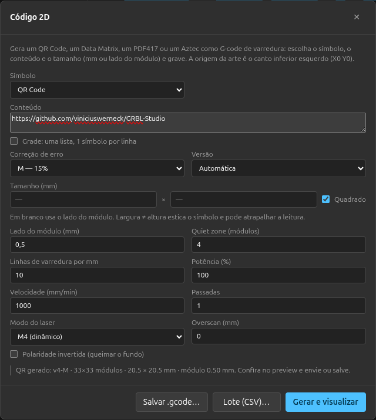

O app gera símbolos 2D como G-code de varredura.

### 38.1 Simbologias

- **QR Code** — correção de erro L/M/Q/H, versão automática ou fixa.
- **Data Matrix ECC200** — ECC 0–8.
- **PDF417** — níveis de correção.
- **Aztec** — níveis de correção.

### 38.2 Campos

- **Conteúdo** — texto/URL.
- **Grade** — uma lista, um símbolo por linha (gera uma grade).
- **Correção de erro** e **Versão**.
- **Tamanho (mm)** — largura × altura; **Quadrado** trava a proporção.
- **Lado do módulo (mm)** e **Quiet zone (módulos)**.
- **Linhas de varredura por mm**.
- **Potência (%)**, **Velocidade (mm/min)**, **Passadas**.
- **Modo do laser** (`M4`/`M3`), **Overscan (mm)**.
- **Polaridade invertida** (queimar o fundo).

### 38.3 Gerar

1. Preencha o conteúdo.
2. Ajuste o tamanho/módulo (módulo muito pequeno = ilegível).
3. **Gerar e visualizar** — o app carrega o G-code e abre o posicionamento.
4. Confira a leitura com o celular **antes** de gravar.
5. Grave ou **Salvar .gcode…**.

⚠️ Módulo pequeno, potência alta ou material escuro podem destruir o contraste.
Teste e valide a leitura.

💡 Para dados variáveis, use o **Lote** (seção 22) com a planilha.

---

## 39. Código de barras 1D

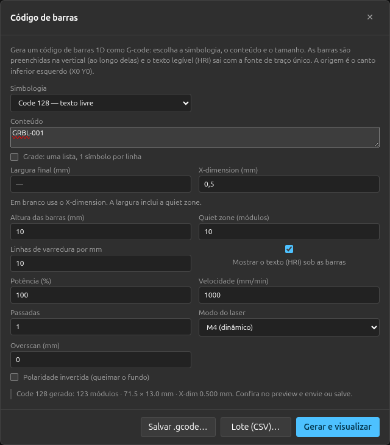

Simbologias suportadas: **Code 128/GS1-128, EAN-13, EAN-8, UPC-A, Code 39,
ITF-14, Codabar e Code 93**.

**Campos:**

- **Simbologia** e **Conteúdo**.
- **Grade** — lista, um código por linha.
- **Largura final (mm)** ou **X-dimension (mm)**.
- **Altura das barras (mm)**, **Quiet zone (módulos)**.
- **Linhas de varredura por mm**, **Mostrar o texto (HRI)**.
- **Potência**, **Velocidade**, **Passadas**, **Modo**, **Overscan**.
- **Polaridade invertida**.

**Gerar:** preencha, ajuste o X-dimension (mínimo legível), **Gerar e
visualizar**, valide com um leitor e grave.

⚠️ EAN/UPC têm regras de dígito verificador e tamanho. Use o conteúdo correto;
o app valida e mostra erro se o código for inválido.

💡 Para etiquetas em série, use o **Lote** com `{1}`/`{nome}`.

---

## 40. Aparência e idioma

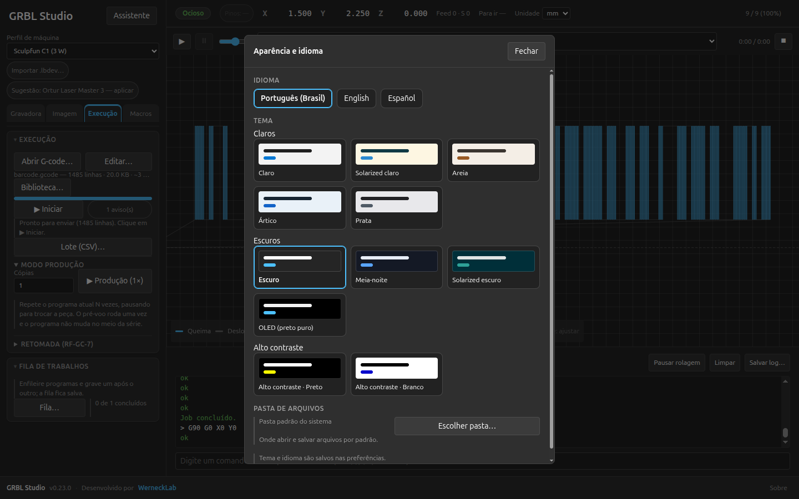

Abra em **Exibir → Aparência e idioma…**.

- **Idioma** — Português (Brasil), English, Español. A mudança é imediata.
- **Tema** — 5 claros, 4 escuros e 2 de alto contraste:
  - Claros: Claro, Solarized claro, Areia, Ártico, Prata.
  - Escuros: Escuro, Meia-noite, Solarized escuro, OLED (preto puro).
  - Alto contraste: Preto, Branco.
- **Pasta de arquivos** — pasta padrão dos diálogos de abrir/salvar.

💡 Em ambientes com muita luz, use um tema claro; em ambientes escuros, OLED
economiza bateria e reduz o cansaço.

---

## 41. Sobre

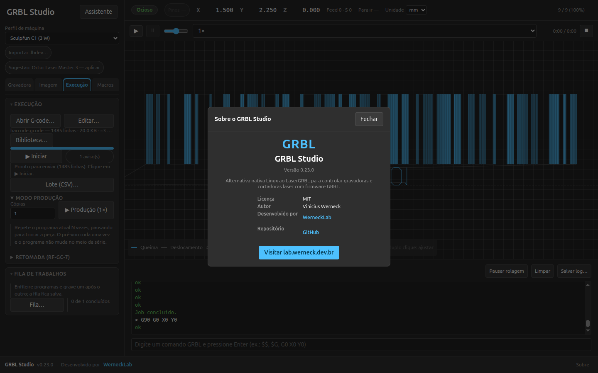

Mostra versão, licença (MIT), autor (Vinicius Werneck), desenvolvedor
(WerneckLab), repositório no GitHub e o site. Use **Visitar lab.werneck.dev.br**
para novidades.

---

# Parte IV — Referência

## 42. Comandos de tempo real

Comandos de **byte único** — não levam `\n`. Use os botões do app; o console
não é o lugar para digitá-los com Enter.

| Comando | Byte | Função |
| :--- | :--- | :--- |
| Status | `?` | Relatório de estado/posição. |
| Feed Hold | `!` | Pausa o movimento. |
| Cycle Start | `~` | Retoma. |
| Soft Reset | `0x18` (Ctrl-X) | Aborta e reseta. |
| Jog Cancel | `0x85` | Cancela o jog. |
| Feed 100% | `0x90` | Reset do feed. |
| Feed +10% / −10% | `0x91` / `0x92` | Override grosso. |
| Feed +1% / −1% | `0x93` / `0x94` | Override fino. |
| Rapid 100/50/25% | `0x95` / `0x96` / `0x97` | Deslocamento rápido. |
| Spindle 100% | `0x99` | Reset da potência. |
| Spindle +10% / −10% | `0x9A` / `0x9B` | Potência. |
| Spindle +1% / −1% | `0x9C` / `0x9D` | Potência fina. |

## 43. Alarmes do GRBL

| Alarme | Significado | Ação recomendada |
| :--- | :--- | :--- |
| **1** | Hard limit acionado | **Unlock ($X)** → jog para longe → **Home ($H)**. |
| **2** | Soft limit excedido | Confira o preview/curso; ajuste a origem ou reduza a arte. |
| **3** | Reset durante execução | Ruído EMI/cabo/fonte; use cabo blindado/ferrite, desative suspensão. |
| **4** | Falha de sonda: estado inicial inesperado | Confira a sonda/fiação; `$X` para destravar. |
| **5** | Falha de sonda: não tocou a peça no curso | Confira o contato/curso programado; `$X`. |
| **6** | Homing: reset durante o ciclo | Refaça `$H`; evite reset no meio do homing. |
| **7** | Homing: porta de segurança aberta | Feche a porta/tampa e refaça `$H`. |
| **8** | Homing: fim de curso não liberou ao recuar | Aumente `$27` (pull-off) e verifique a fiação. |
| **9** | Homing: fim de curso não encontrado | Verifique switch/fiação, `$24`/`$25` e a distância de busca. |

## 44. Solução de problemas

### 44.1 Conexão

| Sintoma | Solução |
| :--- | :--- |
| Porta vazia | Permissão `dialout`/udev; cabo; atualizar portas. |
| “Permission denied” | `sudo usermod -aG dialout "$USER"` + logout. |
| Console mudo | Baud errado (115200 → 9600 → 250000). |
| Cai no meio do job | Cabo curto/ferrite/USB 2.0; evite hub sem fonte. |

### 44.2 Job

| Sintoma | Solução |
| :--- | :--- |
| Para em linha aleatória | Buffer/ruído; use o app (janela por bytes), cabo bom. |
| `error:20` | Comando G-code não suportado/inválido — confira a linha no editor. |
| `error:22` | Feed não definido — adicione `F` ao primeiro `G1`. |
| `ALARM:3` | EMI/fonte; cabo blindado, ferrite, aterramento. |
| Job fora da área | Pré-voo bloqueia; ajuste origem/curso. |
| Queimou o material | Reduza potência/aumente feed; teste de material. |

### 44.3 Imagem/desenho

| Sintoma | Solução |
| :--- | :--- |
| Imagem invertida | Use **Inverter preto/branco** ou espelhe no editor. |
| Muito tempo no claro | Use **Limiar B&W**/**Vetorizar (contorno / recorte)**; reduza a área branca. |
| Texto espelhado | Use **Espelhar H/V** só no objeto desejado; para texto legível, evite espelhar. |
| Contorno não fecha | Verifique nós/booleanas; use **Validar**. |

### 44.4 Símbolos

| Sintoma | Solução |
| :--- | :--- |
| QR ilegível | Aumente o módulo, reduza potência, melhore o contraste. |
| Código de barras inválido | Confira dígito verificador/formato; use o conteúdo correto. |
| Símbolo cortado | Aumente a quiet zone/tamanho; confira o preview. |

## 45. Atalhos de teclado

**Globais (verificados):**

| Ação | Atalho |
| :--- | :--- |
| Parada de emergência | `Ctrl+X` (sempre) |
| Parar job (sem diálogo) | `Esc` |
| Fechar diálogo | `Esc` |
| Jog X/Y | Setas |
| Jog Z | `PageUp` / `PageDown` |
| Homing | `Home` (se `$22=1`) |

**Editor de desenho:**

| Ação | Atalho |
| :--- | :--- |
| Selecionar / Retângulo / Elipse / Linha / Caneta / Nós / Texto / Símbolo | `V` / `R` / `E` / `L` / `P` / `N` / `T` / `Q` |
| Desfazer / Refazer | `Ctrl+Z` / `Ctrl+Y` |
| Agrupar | `Ctrl+G` |
| Ajustar à página | `F` |
| Zoom 100% | `0` |
| Zoom + / − | `+` / `-` |
| Snap (encaixe) | `J` |
| Mover seleção (setas) | Setas (com passo) |
| Apagar | `Delete` |

> Atalhos de menu (como `Ctrl+O`) dependem do ambiente/desktop. Use o menu
> nativo como caminho garantido.

## 46. Arquivos e pastas

```text
~/.config/grbl-studio/        # userData do Electron (nome conforme o pacote)
├── prefs.json                # preferências, macros, presets e perfis $$
├── queue.json                # fila de trabalhos
├── joblib/
│   ├── index.json            # metadados + miniaturas dos últimos 50 jobs
│   └── <id>.gz               # G-code compactado de cada job
└── logs/
    └── session-<data>.log    # log da sessão (console/eventos)
```

**Backup:** copie a pasta inteira. Para restaurar, feche o app e substitua.

**Logs:** menu **Ajuda → Abrir pasta de logs** (ou **Salvar log…** no console).

## 47. Checklist antes de gravar

- [ ] Óculos de proteção e extintor por perto.
- [ ] Material permitido (sem PVC/PC/ABS) e bem preso.
- [ ] Foco e altura do laser conferidos.
- [ ] Perfil de máquina correto (curso/limites).
- [ ] Origem definida no canto/centro desejado.
- [ ] Contorno desenhado (laser fraco) dentro da peça.
- [ ] Preview confere com a arte.
- [ ] Pré-voo sem bloqueios.
- [ ] Potência/velocidade/passadas testadas no material.
- [ ] Exaustão ligada.
- [ ] Você vai ficar por perto até o fim.

## 48. Glossário

| Termo | Significado |
| :--- | :--- |
| **GRBL** | Firmware open-source para controladoras CNC/laser. |
| **G-code** | Linguagem de comandos de movimento. |
| **WPos** | Posição de trabalho (após offsets/origem). |
| **MPos** | Posição da máquina (coordenadas absolutas). |
| **DRO** | Display digital de posição (X/Y/Z). |
| **DTG** | Distância para ir até o fim do segmento. |
| **Feed** | Avanço (mm/min). |
| **S** | Potência do laser (0–S-max). |
| **M3/M4** | Modo laser constante/dinâmico. |
| **Override** | Ajuste em tempo real de feed/potência/rápido. |
| **Homing** | Rotina de referência nos fins de curso (`$H`). |
| **Soft/hard limits** | Limites por software/fins de curso físicos. |
| **Kerf** | Largura do corte (material removido). |
| **Offset** | Contorno paralelo; também deslocamento de origem. |
| **Tabs** | Abas que seguram a peça no corte. |
| **Lead-in/out** | Entrada/saída do corte. |
| **Dose (J/mm)** | Energia por milímetro; compara receitas. |
| **HRI** | Texto legível sob o código de barras. |
| **Quiet zone** | Margem branca ao redor do símbolo. |
| **X-dimension** | Largura do módulo do código de barras. |

## 49. Links e licença

- **Repositório:** https://github.com/viniciuswerneck/GRBL-Studio
- **Releases:** https://github.com/viniciuswerneck/GRBL-Studio/releases
- **Site do autor:** https://lab.werneck.dev.br
- **GRBL Wiki:** https://github.com/gnea/grbl/wiki
- **LaserGRBL (referência):** https://lasergrbl.com/usage/
- **Licença:** MIT — software livre, sem garantia.

> **Aviso final:** laser é perigoso. O GRBL Studio é uma ferramenta; a
> responsabilidade pela operação segura é de quem opera a máquina. Teste,
> supervise e nunca deixe o laser sozinho.
